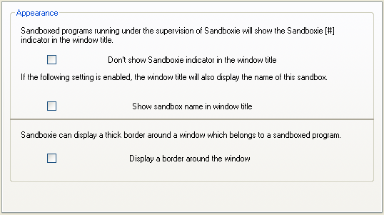

# Appearance Settings

Sandboxie Control > Sandbox Settings > Appearance:

通常、Sandboxie はサンドボックス化されたプログラムに関連するウィンドウのタイトル バーに Sandboxie マーク [#] を挿入します。

* 最初のチェックボックスを使用して、この既定の動作を上書きし、Sandboxie マークが表示されないようにすることができます。

* 2 番目のチェックボックスを使用して、この既定の動作を拡張し、[#] マークの間にサンドボックスの名前も挿入することができます。これは、同じプログラムを複数のサンドボックスで頻繁に使用する場合に便利です。

注: 両方のチェックボックスを同時に有効にすることはできません。

Sandboxie は、ウィンドウがサンドボックス化されたプログラムに属している場合、アクティブな (フォアグラウンドの) ウィンドウの周囲に色付きの境界線を描画することもできます。3 番目のチェックボックスを使用してこの動作を有効にし、このサンドボックス内のプログラムの境界線の色を選択します。

関連する [Sandboxie Ini](SandboxieIni.md) 設定: [BoxNameTitle](BoxNameTitle.md)、[BorderColor](BorderColor.md)。
