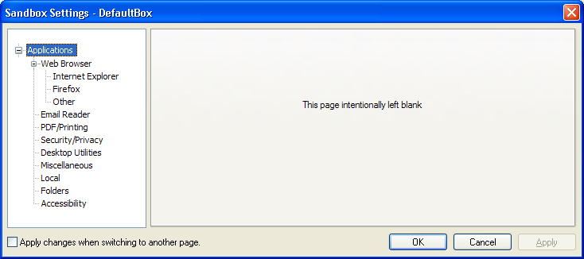
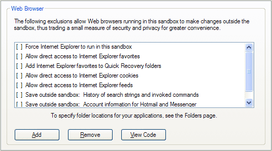
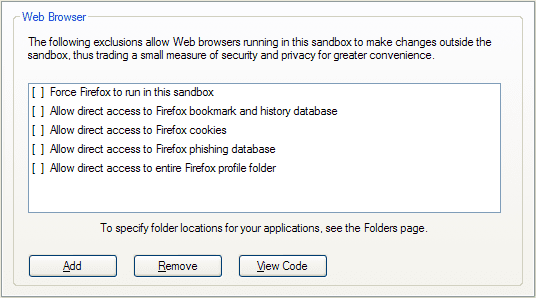
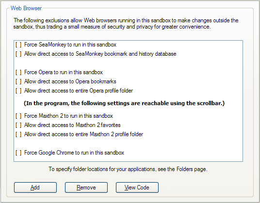
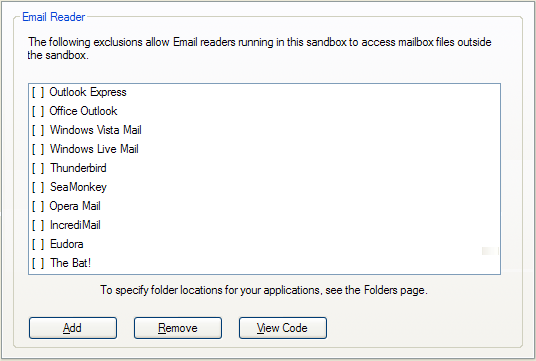
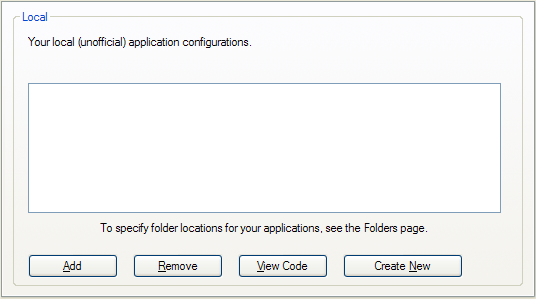
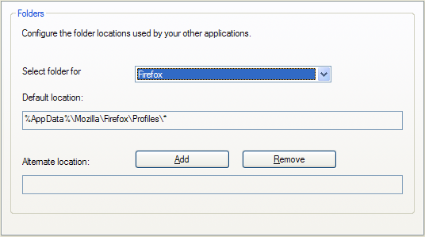
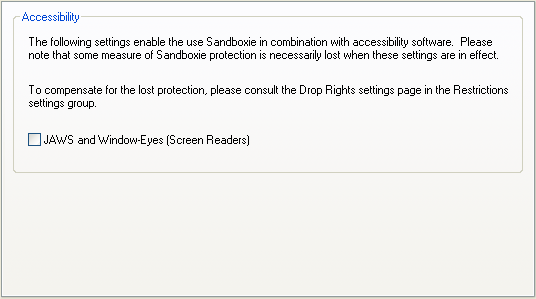

# Applications Settings

### アプリケーション設定グループ

[Sandboxie Control](SandboxieControl.md) > [Sandbox Settings](SandboxSettings.md) > Applications。

この設定ページ グループは、他のアプリケーション、特にさまざまな有名な Web ブラウザーや電子メール プログラムで使用するための Sandboxie のクイック構成を提供します。また、Sandboxie で特別な構成が必要であることが知られている一部のサードパーティ製アプリケーションも対象です。

* * *

### Web ブラウザー {#web-browser}

[Sandboxie Control](SandboxieControl.md) > [Sandbox Settings](SandboxSettings.md) > Applications > Web Browser

この設定サブグループは、さらに 3 つのサブグループに分かれています:

#### Internet Explorer

参照: [Internet Explorer Tips](InternetExplorerTips.md)

#### Firefox

参照: [Firefox Tips](FirefoxTips.md)

#### その他のブラウザー

この設定ページは、次のブラウザーのクイック構成を提供します: Internet Explorer、Mozilla Firefox と SeaMonkey、Opera Web ブラウザー、Maxthon 2、および Google Chrome。

目的の構成を選択 (強調表示) し、_Add_ ボタンをクリックしてこのサンドボックスに対して有効にします。Web ブラウザーが使用するデータ (プロファイル) フォルダーに既定以外の場所を使用している場合は、必ず [Applications > Folders](ApplicationsSettings.md#folders) 設定ページにアクセスして代替の場所を指定してください。

Internet Explorer 設定ページの 2 つの特別な設定:

*   サンドボックス外に保存: 検索文字列と呼び出されたコマンドの履歴。 
詳細については、[Sandboxie Ini](SandboxieIni.md) 設定 [OpenProtectedStorage](OpenProtectedStorage.md) を参照してください。

*   ~~サンドボックス外に保存: Hotmail と Messenger のアカウント情報。~~ (Sandboxie v0.8.0 / 5.50.0 以降では利用できなくなりました)。 
詳細については、[Sandboxie Ini](SandboxieIni.md) 設定 [OpenCredentials](OpenCredentials.md) を参照してください。
*   詳細と推奨事項については、[Save Outside Sandbox in Internet Explorer Tips](InternetExplorerTips.md#save-outside-sandbox) も参照してください。

* * *

#### メール リーダー {#email-reader}

[Sandboxie Control](SandboxieControl.md) > [Sandbox Settings](SandboxSettings.md) > Applications > Email Reader

この設定ページは、次の電子メール プログラムのクイック構成を提供します:

*   Outlook Express
*   Office Outlook
*   Windows Vista Mail
*   Windows Live Mail
*   Mozilla Thunderbird
*   Mozilla SeaMonkey
*   Opera Mail
*   IncrediMail
*   Eudora
*   The Bat!

目的の構成を選択 (強調表示) し、_Add_ ボタンをクリックしてこのサンドボックスに対して有効にします。

次の場合は、Sandboxie にメールボックス データ ファイルが存在する場所を伝える必要があることもあります:

*   メールボックスが既定以外または非標準の場所にある場合。
*   Eudora または The-Bat! 電子メール ソフトウェアを使用している場合。

これを行うには、[Sandbox Settings > Applications > Folders](ApplicationsSettings.md#folders) を開き、ドロップダウン リストから電子メール ソフトウェアを選択し、関連付けるフォルダー場所を選択します。

電子メールの構成を完了したら、Sandboxie の下で実行している場合でも、サンドボックスを削除したときに新しい電子メールが失われないことを確認するために、テストすることをお勧めします。これを行うには、[Test Email Configuration](TestEmailConfiguration.md) に記載されている手順に従ってください。

電子メール プログラムが Sandboxie に認識されていない場合は、[Sandbox Settings > Resource Access > File Access > Direct Access](ResourceAccessSettings.md#file-access-direct-access) を使用して、メールボックス データ ファイルを含むフォルダーへの直接アクセスを明示的に追加できます。

メッセージ [SBIE2212](SBIE2212.md)、[Email Protection](EmailProtection.md)、および [FAQ Email](FAQEmail.md) も参照してください。

* * *

### その他 {#miscellaneous}

次の設定ページは、主題別に分類されたサードパーティ製ソフトウェアの構成を有効にするために使用されます。PDF および印刷ソフトウェア、パスワードおよびセキュリティ ソフトウェア、デスクトップ ユーティリティ、その他の各種プログラムおよび設定のための設定ページがあります。

目的の構成を選択 (強調表示) し、_Open Web Site_ ボタンをクリックして、Sandboxie が認識する特定のプログラムのベンダー Web サイトにアクセスします。

目的の構成を選択 (強調表示) し、_Add_ ボタンをクリックしてこのサンドボックスに対して有効にします。場合によっては、サードパーティ製ソフトウェアが使用するデータ ファイルの場所も指定します。代替の場所を指定するには、[Applications > Folders](ApplicationsSettings.md#folders) 設定ページを使用します。

* * *

#### ローカル {#local}

[Sandboxie Control](SandboxieControl.md) > [Sandbox Settings](SandboxSettings.md) > Applications > Local

この設定ページを使用して、特定のサンドボックスに対して簡単に有効化または無効化できるアプリケーション構成パッケージとして、独自のカスタム設定を入力します。

Sandboxie インストール フォルダー内の標準の _Templates.ini_ ファイルには、テンプレートを設計するための例が含まれています。独自のテンプレートは [Sandboxie Ini](SandboxieIni.md) に配置し、通常は `[Template_Local_*]` セクションを使用します。それらがどのように選択および適用されるかについては、[Template Architecture](TemplateArchitecture.md) を参照してください。

* * *

#### フォルダー {#folders}

[Sandboxie Control](SandboxieControl.md) > [Sandbox Settings](SandboxSettings.md) > Applications > Folders

この設定ページを使用して、サンドボックスで有効化した (またはサンドボックスに追加する) アプリケーションが使用するデータ ファイルの代替 (非既定) フォルダー場所を指定します。

まず目的のアプリケーションを選択 (強調表示) し、_Add_ ボタンをクリックして代替の場所を指定します。

* * *

#### アクセシビリティ設定

[Sandboxie Control](SandboxieControl.md) > [Sandbox Settings](SandboxSettings.md) > Applications > Accessibility

この設定ページは、次のスクリーン リーダー プログラムのクイック構成を提供します:

*   JAWS
*   NVDA
*   Windows-Eyes
*   System Access

Windows のアクセシビリティ サポートにより、あらゆるプログラムが表示しているコンテンツに関するヒントと情報を提供できます。スクリーン リーダー ソフトウェアは通常、これらのヒントを使用して画面のコンテンツに関するより詳細な情報を提供します。

通常、Sandboxie の分離により、スクリーン リーダーはサンドボックス化されたプログラムが提供するアクセシビリティ ヒントにアクセスできません。

この設定を有効にすると、スクリーン リーダー プログラムとサンドボックス化されたプログラム間の双方向通信を許可するために、Sandboxie の保護が弱まります。

失われた保護を補うために、[Sandbox Settings > Restrictions > Drop Rights](RestrictionsSettings.md#drop-rights) を有効にすることをお勧めします。
