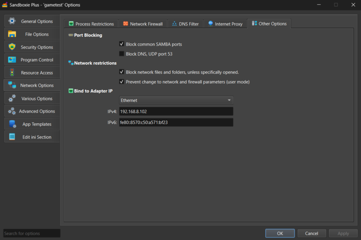

# Bind Adapter

*BindAdapter* と *BindAdapterIP* は、サンドボックス化されたプロセスでサポートされているソケット操作が使用するローカル ネットワーク インターフェイスを選択します。バインドは SbieDll で Winsock 操作を傍受することによって実装されています。ファイアウォールや普遍的なネットワーク強制境界ではありません。

一致するプロセスについて、Sandboxie はサポートされている IPv4 および IPv6 ソケット パスを、指定されたアダプターに関連付けられたアドレス、または構成されたローカル IP アドレスにバインドできます。標準的な傍受パスには、接続、データグラムの送受信、および関連する Winsock 拡張パスが含まれますが、それらのパスをバイパスするソフトウェアはこの機能のスコープ外です。

## バインド方法の選択

DHCP や VPN の場合のように、アドレスが変わる可能性がある場合は *BindAdapter* を使用します。Sandboxie は構成された値を Windows アダプターの **FriendlyName** と大文字小文字を区別せずに照合し、そのアダプターに現在割り当てられている使用可能なアドレスに従います。

特定のローカル アドレスを選択する必要がある場合は [*BindAdapterIP*](BindAdapterIP.md) を使用します。アドレスはアクティブなホスト インターフェイスに割り当てられたままでなければなりません。ホスト構成が変更されても、Sandboxie はルールを別のアドレスに移行しません。

両方の設定が同じプロセスに適用可能な場合、構成の優先順位は *BindAdapter* にあります。*BindAdapterIP* は、アダプター ベースのバインドが適用可能な構成メカニズムでない場合に使用されます。使用できない名前付きアダプターのフォールバックではありません。

## BindAdapter 構文

```ini
BindAdapter=[process,]adapter_name
```

`process` を省略すると、サンドボックス内のすべてのプロセスにルールが適用されます。プログラム固有のルールには実行可能ファイル名を指定します。スペースを含むアダプターのフレンドリ名はそのまま記述できます。

例:

```ini
BindAdapter=Ethernet
BindAdapter=browser.exe,My VPN
```

最初のルールは、より具体的な適用可能ルールを持たないすべてのプロセスに適用されます。2 番目は `browser.exe` に適用され、`My VPN` という名前のアダプターを選択します。

ルールは、継承されたテンプレート設定を含む、サンドボックスの有効な構成から読み取られます。現在の Sandboxie Plus インターフェイスはボックス全体のルールを管理します。実行可能ファイル固有のルールには手動での [Sandboxie Ini](SandboxieIni.md) 構成が必要です。

## アダプターの選択とアドレス ファミリ

名前付きアダプターが存在し、動作している必要があります。Sandboxie はそこから最大 1 つの使用可能な IPv4 アドレスと 1 つの使用可能な IPv6 アドレスを使用します。アダプター選択中、`169.254.0.0/16` の IPv4 リンクローカル アドレスおよび `fe80::/10` の IPv6 リンクローカル アドレスを除外します。

したがって、アダプターは次を提供することがあります:

- IPv4 のみ。
- IPv6 のみ。
- 両方のアドレス ファミリ。

使用可能なファミリがソケット操作と一致する必要があります。*StrictBindIP* は、未構成または現在使用できないファミリが要求されたバインドなしで続行できるかどうかを制御します。

Sandboxie は選択された名前付きアダプターの状態とアドレスを定期的に更新します。これにより、プロセスの初期化時に存在しなかったアダプターが後で現れた場合に検出でき、DHCP の更新や VPN の再接続などのアドレス変更を追跡できます。アダプターが使用できない場合、localhost をフォールバックとして使用しません。

## StrictBindIP

*StrictBindIP* は Sandboxie Plus 1.16.7 で追加され、既定で有効です。*BindAdapter* または *BindAdapterIP* がバインド サブシステムを初期化した場合にのみ関係します。

```ini
StrictBindIP=[process,]y|n
```

例:

```ini
StrictBindIP=y
StrictBindIP=browser.exe,n
```

既定値 `y` では、サポートされている傍受された Winsock 操作は、選択されたバインドが使用できない場合、または操作がバインドが構成されていないアドレス ファミリを使用する場合に通常失敗します。よく見られるエラーは `WSAEADDRNOTAVAIL` ですが、アプリケーションはすべてのソケット パスに対して 1 つのエラー値に依存すべきではありません。

`StrictBindIP=n` では、構成されたアドレスを使用できない通常の傍受パスはバインドされずに続行でき、Windows が別のローカル アドレスとルートを選択できるようになります。これにより別のインターフェイスを通じてトラフィックが送信されることがあるため、互換性フォールバックはその動作が許容できる場合にのみ有効にすべきです。

`connect`、`WSAConnect`、`ConnectEx`、`sendto`、`WSASendTo`、`recvfrom`、および `WSARecvFrom` などの接続およびデータグラム パスは、バインド コードによって処理される操作に含まれます。`bind` およびその他のソケット パスへのアプリケーションによる明示的な呼び出しは、すべて同じように処理されるわけではありません。*StrictBindIP* は、絶対的なネットワーク ポリシーとしてではなく、ユーザー モード傍受レイヤー内の互換性動作として扱ってください。

Sandboxie Plus は現在、専用の *StrictBindIP* チェックボックスを提供していません。既定以外の値が必要な場合は `Sandboxie.ini` で構成してください。

## セキュリティとプライバシーの制限事項

アダプター バインドは、サポートされている傍受された Winsock 操作が使用するローカル ソース アドレスを制御します。次は行いません:

- Windows Filtering Platform (WFP) ルールを作成する。
- すべての可能なネットワーキング メカニズムをブロックする。
- カーネル モード ネットワーキングを含む、傍受された Winsock パスをバイパスするコードを対象とする。
- トラフィックが別のインターフェイスを決して使用できないことを保証する。

インターフェイスの制限がセキュリティ上重要である場合は、バインドを独立して強制されるネットワーク ポリシーと組み合わせてください。Sandboxie の別個のフィルタリング サポートについては [Windows Filtering Platform](../PlusContent/WFPSupport.md) を参照してください。

## SOCKS プロキシとの相互作用

通常のプロキシ パスでは、ソース アドレスまたはアダプターのバインドは、Sandboxie が SOCKS プロキシ接続を行う前に評価されます。したがって、使用できない厳格なバインドはプロキシ エンドポイントへの接続を妨げることがあります。

実験的な `UseProxyThreads` 互換モードは、別個のリレー ワーカーから外部プロキシ接続を作成するため、通常のパスと同じソース アドレス バインドの保証を提供するものとして扱うべきではありません。プロキシ機能のスコープと制限事項については [Proxy Support](../PlusContent/ProxySupport.md) を参照してください。

## 構成変更の適用

*BindAdapter* および *BindAdapterIP* ルールは、サンドボックス化されたプロセスが Winsock を初期化するときに初期化されます。これらのルールを変更した後は、影響を受けるサンドボックス化されたプロセスを再起動してください。

既に選択された *BindAdapter* の物理状態と現在のアドレスは、プロセスの実行中に更新されます。対照的に、*BindAdapterIP* は、構成されたリテラル アドレスが動作中のインターフェイスに割り当てられたままであるかどうかを再検証しますが、別のアドレスを使用するようにルールを書き換えません。*StrictBindIP* は傍受された操作中に照会されるため、保存された変更は、バインド サブシステムが既に初期化されているプロセスの以降の操作に影響を与えることがあります。ネットワーク構成を変更した後に影響を受けるプロセスを再起動することが依然として確実な方法です。SandMan または Sandboxie サービスの再起動は通常必要ありません。

## Sandboxie Plus インターフェイス

Sandboxie Plus で次を開きます:

**Sandbox Options** > **Network Options** > **Other Options**

グループには **Bind to Adapter IP** というラベルが付いており、次を含みます:

- アダプターのドロップダウン リスト。
- **IPv4:** フィールド。
- **IPv6:** フィールド。

アダプターを選択すると *BindAdapter* が構成されます。**None (Don't bind to adapter)** を選択すると、*BindAdapterIP* 用のリテラル アドレスを入力できます。したがって、単一の UI グループが 2 つの異なる構成キーを表します。



SandMan はこの現在の構成インターフェイスを提供します。ランタイムは Sandboxie Plus と Classic で共有されるため、Classic は機能が利用可能な場合に互換性のある手動構成の設定を使用できますが、同等の最新のインターフェイスは提供しません。*StrictBindIP* は、専用の SandMan または Classic のチェックボックスではなく INI 設定です。

## バージョン履歴

- Sandboxie Plus 1.15.10 / Classic 5.70.10 が、実行可能ファイル修飾構成を含む *BindAdapterIP* を導入しました。
- Sandboxie Plus 1.15.12 / Classic 5.70.12 が、名前付きアダプターを選択するための *BindAdapter* を導入しました。
- 1.16.x シリーズは、アダプターおよび VPN の切断処理の修正を追加しました。
- Sandboxie Plus 1.16.7 / Classic 5.71.7 が *StrictBindIP* を追加しました。

## 関連設定

- [Bind Adapter IP](BindAdapterIP.md) — リテラル ローカル アドレスへのバインドの詳細
- [Proxy Support](../PlusContent/ProxySupport.md) — SOCKS5 プロキシの動作とバインドの相互作用
- [Windows Filtering Platform](../PlusContent/WFPSupport.md) — 別個のネットワーク レイヤー強制
- [Network DNS Filter](NetworkDnsFilter.md) — サンドボックス化されたプログラムからの DNS 要求をフィルター処理します
