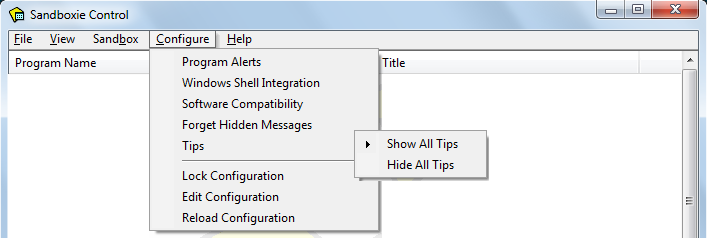
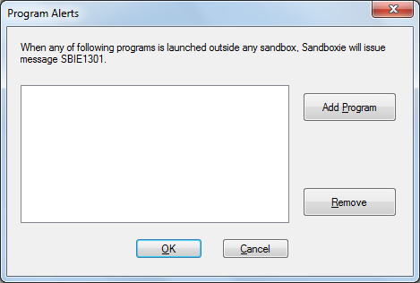
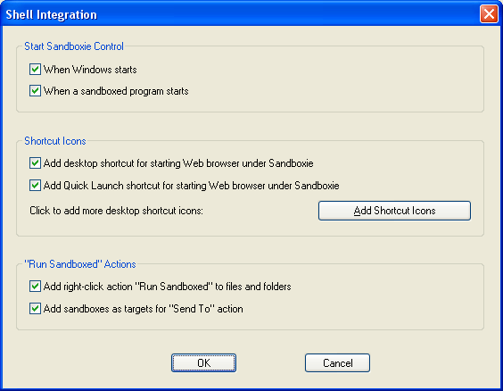
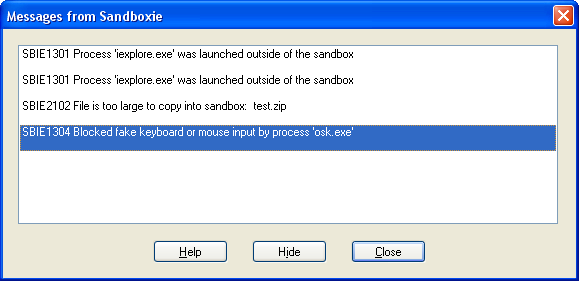
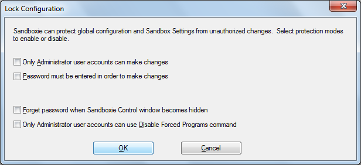

# 構成 メニュー

[Sandboxie Control](SandboxieControl.md) > 構成 メニュー

* * *

### プログラム アラート

_Program Alerts_（プログラム アラート）コマンドは、特定のプログラムがサンドボックス外で起動するたびにメッセージ [SBIE1301](SBIE1301.md) を発行するよう Sandboxie を構成できる次のウィンドウを開きます。

*   _Add Program_（プログラムの追加）ボタンを使用して、Program Groups ウィンドウを開き、追加するプログラムを選択します。

*   たとえば、Internet Explorer の場合は _iexplore.exe_、Firefox の場合は _firefox.exe_ です。
*   または、Internet Explorer は通常 _C:\Program Files\Internet Explorer_ フォルダーにあります。
*   Mozilla Firefox は通常 _C:\Program Files\Mozilla Firefox_ フォルダーにあります。

目的のプログラムがすでにサンドボックス内で実行されている場合は、[プログラム設定](ProgramSettings.md#page-1)を使用して、そのプログラムに対してメッセージ [SBIE1301](SBIE1301.md) を発行するように指定することもできます。

関連する [Sandboxie Ini](SandboxieIni.md) 設定: [AlertProcess](AlertProcess.md)。

* * *

### Windows シェル統合

_Windows Shell Integration_（Windows シェル統合）コマンドは、[Sandboxie Control](SandboxieControl.md) が Windows デスクトップにどのように統合され、関連付けられるかを制御するウィンドウを開きます。また、プログラムをサンドボックス内で実行するためのデスクトップ ショートカット アイコンを作成するためにも使用できます。既定では、ウィンドウ内のすべての設定が有効になっています。

*   上部のフレームは、[Sandboxie Control](SandboxieControl.md) をいつ起動するかを示します。

*   _When Windows starts_（Windows の起動時）は、[Sandboxie Control](SandboxieControl.md) をスタートアップ シーケンスに統合します。

*   _When a sandboxed program starts_（サンドボックス化されたプログラムの起動時）は、サンドボックス化されたプログラムの起動時に [Sandboxie Control](SandboxieControl.md) を（まだ実行されていない場合）起動します。これは、[Run Sandboxed](SandboxMenu.md#sandbox-menu) コマンドを使用する場合や、_Add Shortcut Icons_（後述）を使用して作成したショートカットなど、Sandboxie を通じて明示的に起動されるプログラムに適用されます。また、[強制プログラム](ProgramStartSettings.md#forced-programs)や[強制フォルダー](ProgramStartSettings.md#forced-folders)にも適用されます。

*   中央のフレームはショートカット アイコンを扱います。

*   _Add desktop shortcut for starting Web browser under Sandboxie_（Sandboxie で Web ブラウザーを起動するためのデスクトップ ショートカットを追加）は、デスクトップに _Sandboxed Web Browser_ ショートカット アイコンを作成（チェック時）または削除（チェック解除時）します。

*   _Add Quick Launch shortcut for starting Web browser under Sandboxie_（Sandboxie で Web ブラウザーを起動するためのクイック起動ショートカットを追加）は、クイック起動バーに _Sandboxed Web Browser_ ショートカット アイコンを作成（チェック時）または削除（チェック解除時）します。クイック起動バーは通常、Windows のスタート メニュー ボタンに隣接しています。

*   _Add Shortcut Icons_（ショートカット アイコンの追加）は、Sandboxie の監視下で特定のプログラムを実行するためのショートカット アイコンをデスクトップに作成します。プログラムは Sandboxie スタート メニューから選択します。サンドボックスにプログラムがインストールされている場合、Sandboxie スタート メニューにはインストール中に作成されたショートカットが含まれ、それらを使用してデスクトップ ショートカットを作成できることに注意してください。_Add Shortcut Icons_ を使用して作成したデスクトップ ショートカットを削除するには、デスクトップから単に削除します。

*   下部のフレームは「右クリック」シェル統合を制御します。

*   _Add right-click action "Run Sandboxed" to files and folders_（ファイルとフォルダーに右クリック アクション "Run Sandboxed" を追加）は、デスクトップや Windows エクスプローラーでファイルまたはフォルダーを右クリックしたときに表示される _Run Sandboxed_ オプションを有効化（チェック時）または削除（チェック解除時）します。

*   _Add sandboxes as targets for "Send To" action_（"送る" アクションのターゲットとしてサンドボックスを追加）は、デスクトップや Windows エクスプローラーでファイルまたはフォルダーを右クリックしたときに表示される _Send To_（送る）アクションのオプションとして、利用可能なサンドボックスを有効化（チェック時）または削除（チェック解除時）します。この設定が有効な場合、[Sandboxie Control](SandboxieControl.md) はサンドボックスが[作成](SandboxMenu.md#create-new-sandbox)または削除されるたびに _Send To_ ターゲットのリストを自動的に更新します。

* * *

### ソフトウェア互換性

_Software Compatibility_（ソフトウェア互換性）コマンドは、利用可能な互換性テンプレートのリストを含むウィンドウを開きます。

* * *

### 非表示メッセージを忘れる

[Sandboxie Control](SandboxieControl.md) が 1 つ以上の [SBIE メッセージ](SBIEMessages.md)を表示するたびに、そのメッセージの今後の表示を非表示にするオプションがあります。これは、メッセージを強調表示して _Hide_（非表示）コマンドをクリックすることで行います。

メッセージはメッセージ コードだけでフィルター処理されることに注意してください。たとえば、上の図は情報詳細 _osk.exe_ を含むメッセージ [SBIE1304](SBIE1304.md) を示しています。このメッセージを非表示にすると、情報詳細に関係なく、メッセージ SBIE1304 の今後のすべてのインスタンスが非表示になります。

_Forget Hidden Messages_（非表示メッセージを忘れる）コマンドは、メッセージのフィルター処理を停止し、発生するすべての SBIExxxx メッセージの表示を再開するよう Sandboxie に指示します。

* * *

### ヒント

[Sandboxie Control](SandboxieControl.md) が警告または通知のメッセージ ボックスを表示するとき、通常は _In the future, don't show this message._（今後、このメッセージを表示しない）というラベルのチェックボックスが含まれています。チェックボックスをオンにすると、その特定のメッセージは今後表示されません。

_Show All Tips_（すべてのヒントを表示）コマンドは、そのようなチェックボックスの使用を無視し、すべての警告と通知の表示を再開するよう Sandboxie に指示します。

_Hide All Tips_（すべてのヒントを非表示）コマンドは、すべてのチェックボックスがチェックされていると見なし、警告や通知を表示しないよう Sandboxie に指示します。

* * *

### 構成のロック

[構成の保護](ConfigurationProtection.md)を参照してください。

* * *

### 構成の編集

[Sandboxie Ini](SandboxieIni.md) 構成ファイルを編集するために、システムのテキスト エディター（通常は _Windows メモ帳_）を開きます。エディターを閉じると、_Reload Configuration_（構成の再読み込み）コマンドが自動的に呼び出されます。

注: Sandboxie.ini の手動編集はお勧めしません。Sandboxie の構成を変更するには、[サンドボックス設定](SandboxSettings.md)や [Sandboxie Control](SandboxieControl.md) のその他の構成ウィンドウを使用することをお勧めします。

注: [Sandboxie Ini](SandboxieIni.md) 構成ファイルは通常 _Windows_ フォルダーにあり、非特権ユーザー アカウントでは変更できません。ユーザー アカウント制御 (UAC) を有効にした Windows を使用している場合、Sandboxie.ini を変更する前に管理者アカウントに昇格する必要がある場合があります。

* * *

### 構成の再読み込み

[Sandboxie Ini](SandboxieIni.md) 構成ファイルから構成を再読み込みするよう Sandboxie に強制します。

* * *

[Sandboxie Control](SandboxieControl.md#menus)、[ヘルプ トピック](HelpTopics.md)に進みます。
