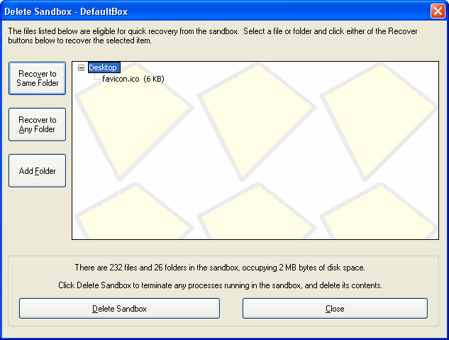

# Delete Sandbox

[Sandboxie Control](SandboxieControl.md) > [Sandbox Menu](SandboxMenu.md) > Delete Contents

[Sandboxie Control](SandboxieControl.md) > [Tray Icon Menu](TrayIconMenu.md) > Delete Contents

_Delete Sandbox_ ウィンドウは、サンドボックスが削除されようとしているときに表示されます。ウィンドウは 2 つの領域に分かれています:

*   上部 (ウィンドウの約 3/4) には [Quick Recovery](QuickRecovery.md) の表示とコントロールが表示され、_Quick Recovery_ ウィンドウと同じように動作します。詳細については [Quick Recovery](QuickRecovery.md) を参照してください。

*   下部にはサンドボックスのサイズ (ファイル、フォルダー、およびディスク領域のバイト数) がカウントされ、サンドボックスの削除処理を開始する _Delete Sandbox_ ボタンが含まれています。

このウィンドウは、[Sandbox Menu > Sandbox > Delete Contents](SandboxMenu.md#sandbox-menu) コマンド ([Tray Icon Menu](TrayIconMenu.md) の対応するコマンド) が呼び出されたときに表示されます。

このウィンドウは、サンドボックスが自動削除用に構成されており ([Sandbox Settings > Delete > Invocation](DeleteSettings.md#invocation) を参照)、[Quick Recovery](QuickRecovery.md) の対象となるファイルがある場合にも表示されます。対象となるファイルがない場合、サンドボックスは _Delete Sandbox_ ウィンドウを表示せずにサイレントに削除されることに注意してください。

_Delete Sandbox_ コマンドは、サンドボックスで実行中のすべてのプログラムを終了し、削除処理を開始することに注意してください。空のサンドボックスは、_Delete Sandbox_ ボタンをクリックするとすぐにプログラムを実行できるようになります。古いサンドボックスで削除処理が進行している間、Sandboxie のトレイ アイコンは赤い X アイコンに変わり、サンドボックスの削除が進行中であることを示します。正しく動作している場合、赤い X アイコンが数秒以上表示され続けることはありません。

* * *

[Quick Recovery](QuickRecovery.md)、[Sandboxie Control](SandboxieControl.md)、[Help Topics](HelpTopics.md) に移動します。
