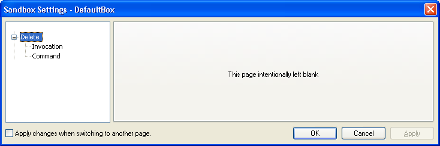
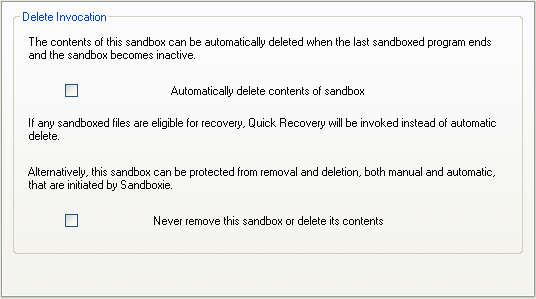
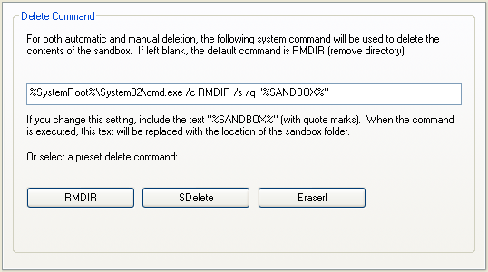

# Delete Settings

このページでは Sandboxie Control / Classic について説明します。その歴史的な **Delete Sandbox** という表現は、主に保存された内容の削除を指し、サンドボックス定義の削除ではありません。現在の SandMan のクリーンアップと削除の動作については、[Sandbox Deletion and Removal Lifecycle](SandboxRemoval.md) を参照してください。

## "Delete" Settings Group

[Sandboxie Control](SandboxieControl.md) > [Sandbox Settings](SandboxSettings.md) > Delete:

ここでは、Sandboxie Control がサンドボックスの保存された内容をいつ、どのように削除するかを構成します。

## Invocation

[Sandboxie Control](SandboxieControl.md) > [Sandbox Settings](SandboxSettings.md) > Delete > Invocation:

この Classic 設定ページを使用して、サンドボックスの内容をいつ削除するかを指定します:

* 明示的な要求によってのみ削除: 両方のチェックボックスをオフのままにします
* 定期的かつ自動的に削除: 最初のチェックボックスをオンにします
* 削除しない: 2 番目のチェックボックスをオンにします

両方のチェックボックスをオフにできますが、オンにできるチェックボックスは常に 1 つだけであることに注意してください。

2 番目のチェックボックスがオンになっている限り、明示的に要求した場合でも、通常の Classic の内容削除操作は保護されます。これは他のプログラムがサンドボックスのストレージを変更することに対する保護ではありません。SandMan には内容と定義の別個の保護設定があります。[Never Delete](NeverDelete.md) を参照してください。

関連する [Sandboxie Ini](SandboxieIni.md) 設定: [AutoDelete](AutoDelete.md)、[NeverDelete](NeverDelete.md)、[DeleteCommand](DeleteCommand.md)。

## Command

[Sandboxie Control](SandboxieControl.md) > [Sandbox Settings](SandboxSettings.md) > Delete > Command:

Sandboxie Control / Classic では、この設定ページを使用して、サンドボックスの内容を削除するシステム コマンドを指定します。既定では、これは単純な RMDIR (ディレクトリの削除) コマンドです。プライバシー問題を気にする人は、[Secure Delete Sandbox](SecureDeleteSandbox.md) でより詳細に説明されているように、代わりに安全な削除を使用することを選択できます。SandMan の現在のクリーンアップ エンジンはこの従来の `DeleteCommand` を使用しません。その別個の [`OnBoxDelete`](SandManTriggers.md#onboxdelete) トリガーは、削除を実行するのではなく、クリーンアップ前に実行されます。

ボタンを使用してプリセット コマンドを選択できます。RMDIR ボタンは上記の単純な RMDIR を選択します。

SDelete ボタンは、[SDelete by SysInternals/Microsoft](https://docs.microsoft.com/en-us/sysinternals/downloads/sdelete) を使用してサンドボックスの内容を削除します。コマンドへのパスを調整する必要があることに注意してください。

Eraserl ボタンは、[Eraser by Heidi Computers](https://eraser.heidi.ie/) を使用してサンドボックスの内容を削除します。
