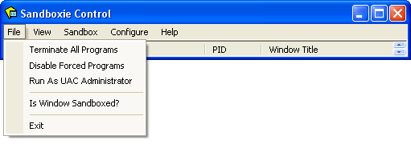
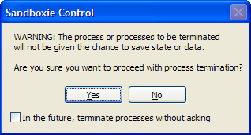
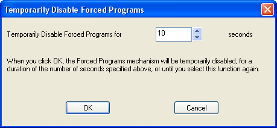
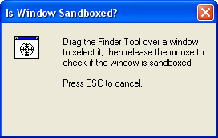

# ファイル メニュー

[Sandboxie Control](SandboxieControl.md) > ファイル メニュー

* * *

### すべてのプログラムを終了

[Sandboxie Control](SandboxieControl.md) > [ファイル メニュー](FileMenu.md) > すべてのプログラムを終了

_Terminate All Programs_（すべてのプログラムを終了）コマンドは、すべてのサンドボックスで実行されているすべてのプログラムを即座に停止します。このコマンドに関連付けられたウィンドウはありません。ただし、終了されようとしているプログラムによって処理されているデータが失われる可能性について警告が表示される場合があります。

この警告は、たとえば保存されない開いているドキュメントを指します。この警告は、下部のチェックボックス _In the future, terminate processes without asking._（今後、確認せずにプロセスを終了する）を選択することで無効にできます。

関連項目: [トレイ アイコン メニュー](TrayIconMenu.md)の[すべてのプログラムを終了](TrayIconMenu.md#terminate-all-programs)。

* * *

### 強制プログラムを無効化

[Sandboxie Control](SandboxieControl.md) > [ファイル メニュー](FileMenu.md) > 強制プログラムを無効化

_Disable Forced Programs_（強制プログラムを無効化）トグル コマンドは、強制サンドボックス化を一時的に無効化または再有効化します。通常、[強制プログラム](ProgramStartSettings.md#forced-programs)（または[強制フォルダー](ProgramStartSettings.md#forced-folders)内のプログラム）は、Sandboxie の監視下で自動的に起動します。Disable Forced Programs コマンドが呼び出されると、強制サンドボックス化は一時的に中断されます。

既定では、強制サンドボックス化は 10 秒間中断されます。秒数は、このコマンドを選択したときに表示される次のダイアログ ボックスで変更できます。

[トレイ アイコン メニュー](TrayIconMenu.md)の関連コマンドでは、このダイアログ ボックスは表示されず、最後に指定された期間、または既定の 10 秒が使用されることに注意してください。

Disable Forced Programs モードが有効な期間中:

*   システム トレイ領域の Sandboxie アイコンに小さな赤い X が含まれます。
*   [ファイル メニュー](FileMenu.md)と[トレイ アイコン メニュー](TrayIconMenu.md)の「Disable Forced Programs」コマンドの横にチェックマークが表示されます。
*   強制プログラムが起動されると、メッセージ [SBIE1301](SBIE1301.md) が発行されます。
*   このコマンドを再度選択するとモードが解除され、アイコンが元の外観に戻り、強制サンドボックス化の通常の動作が再開されます。

関連項目: [トレイ アイコン メニュー](TrayIconMenu.md)の[強制プログラムを無効化](TrayIconMenu.md#disable-forced-programs)。

* * *

### UAC 管理者として実行

[Sandboxie Control](SandboxieControl.md) > [ファイル メニュー](FileMenu.md) > UAC 管理者として実行

_Run As UAC Administrator_（UAC 管理者として実行）トグル コマンドは、プログラムを起動する前に管理者特権への昇格を要求するよう Sandboxie に指示します。このコマンドは、Windows でユーザー アカウント制御 (UAC) が有効であり、ユーザー アカウントがまだ昇格されていない場合にのみ使用できます。このコマンドがメニューで使用できる場合、通常はプログラムをサンドボックスにインストールする前に有効にする必要があり、インストールが完了したら無効にすることをお勧めします。

このコマンドに関連付けられたウィンドウはありません。ただし、_Run As UAC Administrator_ が有効な間は、[ファイル メニュー](FileMenu.md)と[トレイ アイコン メニュー](TrayIconMenu.md)のコマンドの横にチェックマークが表示されます。

関連項目: [トレイ アイコン メニュー](TrayIconMenu.md)の [UAC 管理者として実行](TrayIconMenu.md#run-as-uac-administrator)。

* * *

### ウィンドウはサンドボックス化されていますか?

[Sandboxie Control](SandboxieControl.md) > [ファイル メニュー](FileMenu.md) > ウィンドウはサンドボックス化されていますか?

_Is Window Sandboxed?_（ウィンドウはサンドボックス化されていますか?）コマンドは、画面に表示されているウィンドウを選択するために使用され、そのウィンドウがサンドボックス化されたプログラムによって所有されている場合、コマンドはプログラムの名前とそれが実行されているサンドボックスを表示します。

このコマンドを使用するには、_Finder Tool_、つまりウィンドウ内のターゲットのアイコン上でマウスの左ボタンを押し続けます。マウスの左ボタンを離さずにターゲットを目的のウィンドウの上にドラッグし、ターゲットが目的のウィンドウの境界内に入ったらマウスの左ボタンを離します。

ウィンドウがサンドボックス化されたプログラムによって所有されている場合、Sandboxie はプログラム名とサンドボックス名を表示し、ビューを[プログラム ビュー](ProgramsView.md)に切り替えて、そのプログラムを強調表示します。

一部のプログラムはカスタマイズされたグラフィックを使用してウィンドウを表示するため、Sandboxie がタイトル バーに [#] インジケーターを表示できません。このような場合は、_Is Window Sandboxed?_ コマンドを使用して、ウィンドウとその関連プログラムがサンドボックス内で実行されていることを確認できます。

* * *

### 終了

[Sandboxie Control](SandboxieControl.md) > [ファイル メニュー](FileMenu.md) > 終了

_Exit_（終了）コマンドは [Sandboxie Control](SandboxieControl.md) を終了します。ウィンドウを閉じるだけ（または[トレイ アイコン メニュー](TrayIconMenu.md)から _Hide Window_ コマンドを選択するだけ）では Sandboxie Control は終了**しない**ことに注意してください。

フロントエンド アプリケーションである Sandboxie Control が非アクティブであっても、Sandboxie は引き続きアクティブであり、プログラムを正しく監視します。ただし、以下の機能は Sandboxie Control によって提供されるため、フロントエンド プログラムが実行されていないときは使用できません。

*   サンドボックスの自動削除
*   クイック復元と即時復元
*   強制プログラム無効化モード（[Sandboxie Start](StartCommandLine.md) プログラムから開始した場合）

Sandboxie Control をシステム トレイ領域に表示したくない場合は、Sandboxie Control を終了するのではなく、Windows タスク バーで常にアイコンを非表示にするように構成することを検討してください。

* * *

[Sandboxie Control](SandboxieControl.md#menus)、[トレイ アイコン メニュー](TrayIconMenu.md)、[ヘルプ トピック](HelpTopics.md)に進みます。
