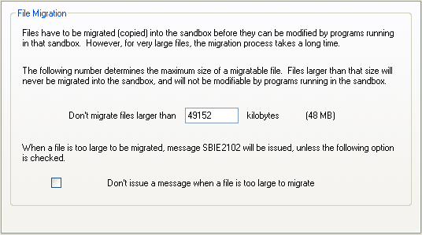

# File Migration Settings

## Sandboxie Plus

SandMan > Sandbox Options > General Options > File Migration

Sandboxie は通常、サンドボックス化されたプログラムが最初にコピーせずにホスト ファイルを読み取れるようにします。プログラムが既存のファイルを変更する必要がある操作を要求すると、Sandboxie はファイルをサンドボックスに移行し、その変更をそのサンドボックス コピーに適用します。ホスト ファイルは変更されません。

SandMan では、File Migration ページが通常のサイズ決定と、それを上書きできるパス ルールを制御します。

## Sandboxie Control Classic

[Sandboxie Control](SandboxieControl.md) > [Sandbox Settings](SandboxSettings.md) > File Migration:

Sandboxie Control Classic は引き続きサポートされています。その File Migration ページは、[CopyLimitKb](CopyLimitKb.md) や [CopyLimitSilent](CopyLimitSilent.md) などの既存の移行サイズ制御を処理します。以下で説明する新しい移行ルール アクションは現在の SandMan インターフェイスを記述するものであり、Sandboxie Control Classic における同等の制御を意味するものではありません。

## 移行ルール

ルール リストは 4 つのアクションをサポートしています:

- **Always copy** ([CopyAlways](CopyAlways.md)) は、通常のサイズしきい値を適用せずに、一致するホスト ファイルをその内容とともに移行します。
- **Don't copy** ([DontCopy](DontCopy.md)) は内容の移行を防ぎます。初期移行中、オープンは書き込みおよび削除アクセスなしで再試行されるか、[CopyBlockDenyWrite](CopyBlockDenyWrite.md) が有効な場合は拒否されます。
- **Copy empty** ([CopyEmpty](CopyEmpty.md)) は、ホストの内容を移行する代わりに、長さゼロのサンドボックス コピーを作成します。
- **Copy newer** ([CopyNewer](CopyNewer.md)) は、一致するホスト ファイルの最終書き込み時刻がより新しい場合に、既存のサンドボックス コピーを更新します。

最初の 3 つのアクションは、既存の通常のホスト ファイルが最初にどのように移行されるかを選択します。それらのパターンが重複する場合、_DontCopy_ が _CopyAlways_ より優先され、_CopyAlways_ が _CopyEmpty_ より優先されます。_CopyNewer_ は既に存在するサンドボックス コピーの別個のチェックです。それが更新を開始する場合、その移行の試行は同じエバリュエーターを使用するため、該当する移行ルール、サイズ制限、プロンプト動作、および関連する通知が関与できます。他のルール自体は更新をトリガーしません。

ルールは繰り返すことができ、プログラムに限定できます。構文、パターンの動作、およびオープン モードの制限については、専用の設定ページを参照してください。

## 通常のサイズ決定

明示的な移行ルールが一致せず、ホストの内容を移行する必要がある場合、Sandboxie はホスト ファイルのサイズを [CopyLimitKb](CopyLimitKb.md) と比較します。構成されたしきい値より厳密に小さいファイルが完全な内容の移行に選択されます。制限を `-1` に設定するとサイズ制限が無効になります。しきい値に達するかそれを超えるファイルについては、SandMan は [PromptForFileMigration](PromptForFileMigration.md) に従ってユーザーにプロンプトを表示できます。承認はコピー試行を選択するものであり、コピーの成功を保証するものではありません。移行が承認されない場合、[CopyBlockDenyWrite](CopyBlockDenyWrite.md) は、初期の移行依存のオープンをアクセス拒否で失敗させるか、書き込みおよび削除権限なしでホスト アクセスを再試行させます。その再試行も失敗する可能性があります。

有効な _CopyLimitKb_ 値が構成されていない場合、ランタイム コンシューマーは `-1` にフォールバックします。SandMan の 80 MiB 表示フォールバックと Classic の 48 MiB UI/アクセサー フォールバックは異なります。それらの構成動作については [CopyLimitKb](CopyLimitKb.md) を参照してください。

[CopyLimitSilent](CopyLimitSilent.md) は、サイズ決定が移行を妨げ、使用可能なプロンプト応答が返されないときにメッセージ [SBIE2102](SBIE2102.md) を制御します。決定自体を変更するものではありません。明示的な否定的なプロンプト応答は、このパスを通じて SBIE2102 を発行しません。[NotifyNoCopy](NotifyNoCopy.md) は、明示的な _CopyEmpty_ または _DontCopy_ モードが選択されたとき (_CopyNewer_ の更新中を含む) に、メッセージ SBIE2113、SBIE2114、および SBIE2115 を別個に制御します。

## 変更の適用

サイズ制限、サイレント フラグ、書き込み拒否の選択、通知フラグ、および移行ルール リストはプロセスごとに初期化されます。変更後は、影響を受ける新しいサンドボックス化されたプロセスを開始してください。_PromptForFileMigration_ は異なります。構成が再読み込みされた後、既に実行中のプロセスでの後の該当する決定が、その変更された値を観察できます。
