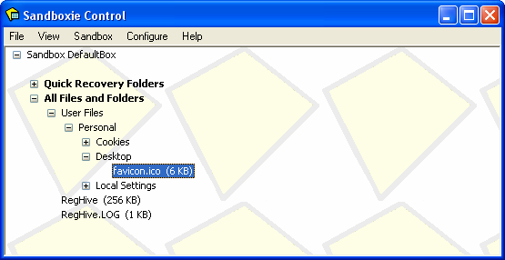

# Files And Folders View

[Sandboxie Control](SandboxieControl.md) > [View Menu](ViewMenu.md) > [Files and Folders](ViewMenu.md#files-and-folders)

_Files and Folders View_ は [Sandboxie Control](SandboxieControl.md) の副次的な表示モードです。各サンドボックス内のファイルとフォルダーを、フォルダーのツリーに編成し、サンドボックス名ごとにグループ化して表示します。

各サンドボックス内には、2 つのトップレベル フォルダーがあります:

*   _Quick Recover Folders_ は、[クイック復元](QuickRecovery.md)用に構成されたフォルダー、およびこれらのフォルダーに含まれるフォルダーまたはファイルを表示します。

*   _All Files and Folders_ は、サンドボックスの完全な内容 ([Sandbox Hierarchy](SandboxHierarchy.md#files) で説明) をわかりやすい方法で含みます。このフォルダー自体は 2 つのフォルダーに編成されています:
    *   _Drives_ は、システム内のドライブ用に作成されたサンドボックス化された内容を表示します。
    *   _User Files_ は、ユーザー プロファイル フォルダーのサンドボックス化された内容を表示します。ユーザー プロファイル フォルダーには、_My Documents_、_Desktop_、_Favorites_ などのフォルダーが含まれます。
    *   _All Files and Folders_ フォルダーは通常、Windows レジストリのサンドボックス化されたコピーを表す _RegHive_ ファイルも含みます。

各サンドボックス行の先頭にある小さな _+_ または _-_ アイコンを使用して、サンドボックス内のファイルとフォルダーの表示を展開または折りたたみます。

**コンテキスト メニュー**

_Files and Folders View_ は、サンドボックスおよびプログラム用のコンテキスト メニューを提供します。ある行の項目 (サンドボックス、ファイル、またはフォルダー) のコンテキスト メニューを表示するには、次のいずれかを行います:

*   行の任意の場所でマウスの右ボタンをクリックします。

*   マウスまたはキーボードを使用して行を選択 (強調表示) し、Shift+F10 を押します。

*   マウスまたはキーボードを使用して行を選択 (強調表示) し、[View Menu -> Context Menu](ViewMenu.md#context-menu) コマンドを使用します。

サンドボックス行の場合、表示されるコンテキスト メニューは [Sandbox Menu -> Sandbox Sub-Menu](SandboxMenu.md#sandbox-sub-menu) と同じです。完全な説明についてはそちらを参照してください。

ファイルまたはフォルダーの場合、コンテキスト メニューは次のコマンドを提供します:

*   _Run Sandboxed_ コマンドは、Sandboxie の監督下でファイルまたはフォルダーを開きます:
    *   実行可能なプログラム ファイルは直接呼び出されます。
    *   ドキュメント ファイルは、そのドキュメントの種類に関連付けられたプログラムのサンドボックス化されたインスタンスで開かれます。
    *   フォルダーは、Windows エクスプローラーのサンドボックス化されたインスタンスで開かれます。

*   _Recover to Same Folder_ および _Recover to Any Folder_ コマンドは、ファイルまたはフォルダーをサンドボックスの外に移動します。完全な説明については [Quick Recovery](QuickRecovery.md) を参照してください。

*   _Add Folder to Quick Recovery_ コマンドは、トップレベルの _All Files and Folders_ フォルダーより下のフォルダーで使用可能であり、そのフォルダーを[クイック復元](QuickRecovery.md)フォルダーのリストに追加します。

*   _Remove Folder from Quick Recovery_ コマンドは、トップレベルの _Quick Recovery Folders_ フォルダーより下のフォルダーで使用可能であり、そのフォルダーを[クイック復元](QuickRecovery.md)フォルダーのリストから削除します。

* * *

[Sandboxie Control](SandboxieControl.md)、[Programs View](ProgramsView.md)、[Help Topics](HelpTopics.md) に移動します。
