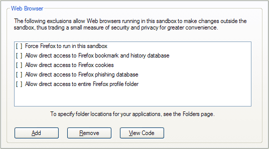
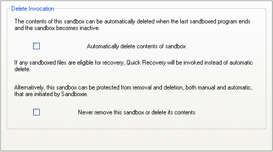
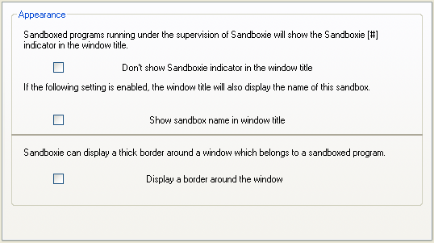

# Firefox Tips

## Firefox 固有のヒント

[Sandboxie Control](SandboxieControl.md) > [Sandbox Settings](SandboxSettings.md) > [Applications > Web Browser > Firefox](ApplicationsSettings.md#firefox)

* * *

**常にサンドボックス内で実行**

*   設定: Force Firefox to run in this sandbox

この設定は、Sandboxie の機能またはコマンドを通じて直接起動されなかった場合でも、Firefox のインスタンスが起動するたびに自動的に監督するよう Sandboxie に指示します。

* * *

**Firefox とそのアドオンの更新**

既定の構成では、Firefox またはそのアドオンへの更新はサンドボックス内でのみ行われます。サンドボックスが削除されると、そのような更新はすべて同様に削除されます。この問題を回避するには、更新が利用可能であると認識したときに Firefox をサンドボックスの外で実行する必要があります。Firefox の必要な再起動を含め、通常の Firefox に更新を完了させます。最後に、Firefox を終了し、Sandboxie で再起動します。

Firefox が常に Sandboxie で実行するように強制されている場合 (上記で説明)、[Disable Forced Programs](FileMenu.md#disable-forced-programs) コマンドを使用して、数分間強制サンドボックス化を無効にします。次に、前の段落の手順に従います。最後に、再び _Disable Forced Programs_ コマンドを使用して強制サンドボックス化を再開します。

* * *

**ブックマーク、履歴、およびお気に入り**

*   設定: Allow direct access to Firefox bookmarks and history database

この設定により、Sandboxie で実行されている Firefox はブックマークをサンドボックスの外に保存できるため、サンドボックスが削除された後でも保持されます。このオプションが設定されていない場合、ブックマークはサンドボックス内にのみ保存され、サンドボックスが削除されると削除されます。

Firefox 3 以降、同じファイル (_places.sqlite_ と呼ばれる) がブックマークと訪問したサイトの履歴の両方を保存することに注意してください。したがって、この設定により Firefox は訪問履歴もサンドボックスの外に保存します。

~~これに対する 1 つのアプローチは、[PlainOldFavorites](https://www.iosart.com/firefox/plainoldfavorites) アドオンをインストールすることです。これにより Firefox は Mozilla スタイルのブックマークに加えて Internet Explorer スタイルのお気に入りを作成および管理できます。次に、[Internet Explorer Tips](InternetExplorerTips.md#favorites) のお気に入りに関する議論を参照してください。~~

**結論:**

~~*   追加のアドオンを気にしない場合は、PlainOldFavorites をインストールして Internet Explorer スタイルのお気に入りで Firefox を強化し、[Internet Explorer Tips](InternetExplorerTips.md) のお気に入りの処理に関する推奨事項を読んでください。~~
*   Firefox のブックマークに満足している場合は、この設定を選択します。

* * *

**Cookie**

*   設定: Allow direct access to Firefox cookies

この設定により、Sandboxie で実行されている Firefox は Cookie をサンドボックスの外 (_cookies.sqlite_ と呼ばれるファイル) に保存できるため、サンドボックスが削除された後でも保持されます。このオプションが設定されていない場合、Cookie はサンドボックス内にのみ保存され、サンドボックスが削除されると削除されます。

この設定の代替アプローチは、通常の Firefox でお気に入りのサイトに一度アクセスし、これらのサイトが Cookie であなたを記憶するようにすることです。次に、Sandboxie 下の Firefox に切り替えると、新しい Cookie はサンドボックスを削除するまでサンドボックスに保持されます。

**結論:**

*   Cookie を定期的に削除し、Sandboxie を定期的に使用し始める予定がある場合は、この設定を選択しないままにしておくことができ、Cookie を定期的に削除し続ける必要がありません。
*   サンドボックス化された Firefox で訪問する Web サイトがあなたを記憶する必要がある場合は、この設定を選択します。

* * *

**フィッシング データベース**

*   設定: Allow direct access to Firefox phishing database

この設定により、Sandboxie で実行されている Firefox はフィッシング Web サイトのデータベース (_urlclassifier*.sqlite_ と呼ばれるファイル) を更新および維持できます。このオプションが設定されていない場合、サンドボックスが削除されるたびに、Firefox はフィッシング データベース (非常に大きなファイルである可能性があります) をサンドボックスにコピーし、データベースへの更新をダウンロードするために時間を費やす必要があるかもしれません。この設定は既定で有効です。

**結論:** 設定を選択したままにしてください。

* * *

**プロファイル全体へのアクセス**

*   設定: Allow direct access to entire Firefox profile folder

この設定により、Sandboxie で実行されている Firefox は Firefox プロファイル全体内の任意のデータ ファイルにアクセスできます。この設定には上記の他の Firefox データ ファイルが含まれ、先に説明した他のすべての「直接アクセス」設定を上書きします。

**結論:** この設定を選択しないでください。

* * *

## 一般的なヒント

**サンドボックスの自動削除**

[Sandboxie Control](SandboxieControl.md) > [Sandbox Settings](SandboxSettings.md) > [Delete](DeleteSettings.md) > [Invocation](DeleteSettings.md#invocation)

*   設定: Automatically delete contents of sandbox

この設定は、サンドボックス内のすべてのプログラムが実行を停止するたびにサンドボックスを削除するよう Sandboxie に指示します。

* * *

**Sandboxie で実行されているプログラムのウィンドウを強調表示**

[Sandboxie Control](SandboxieControl.md) > [Sandbox Settings](SandboxSettings.md) > [Appearance Settings](AppearanceSettings.md)

*   設定: Display a border around the window

この設定は、このサンドボックスで実行されているプログラムに属するウィンドウの周囲に色付きの枠を描画するよう Sandboxie に指示します。既定の色は黄色ですが、サンドボックスごとに異なる色を選択できます。

あるいは、Sandboxie の監督下で実行されているプログラムとそうでないプログラムの区別を曖昧にしたい場合は、「Don't show Sandboxie indicator in the window title」設定を選択します。
