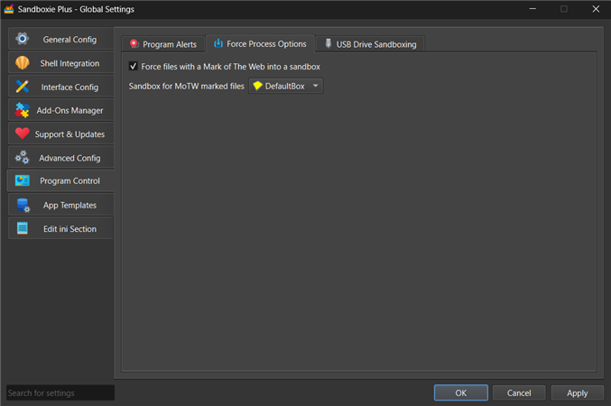

# Force Mark of The Web

_ForceMarkOfTheWeb_ は、新しく開始されるプロセスをサンドボックスに強制するかどうかを決定するときに Mark-of-the-Web ストリームの存在を使用するグローバルな [Sandboxie Ini](SandboxieIni.md) 設定です。既定では無効です。これはプロセス開始ルールであり、アプリケーションが開くすべてのマーク付きファイルを継続的に分離するものではありません。

## 構成

```ini
[GlobalSettings]
ForceMarkOfTheWeb=y
MarkOfTheWebBox=Web_Box
```

`ForceMarkOfTheWeb=y` はチェックを有効にします。`MarkOfTheWebBox` は宛先サンドボックスを指定します。存在しないか空の場合、ドライバーのランタイム フォールバックは `DefaultBox` です。このメカニズムでは両方の設定が個々のサンドボックス セクションではなくグローバル構成から読み取られます。

## Sandboxie がチェックするもの

対象となるプロセス開始中、Sandboxie は実行可能ファイルのパスをチェックします。新しいプロセスのコマンド ラインから識別できる場合はドキュメント引数もチェックできます。ドキュメント チェックは、評価されるプロセスが Sandboxie 自身の `Start.exe` または SandMan である場合にスキップされます。Sandboxie はすべてのコマンド ライン引数をスキャンするわけではなく、Mark of the Web について作業ディレクトリをチェックしません。

各候補パスについて、ドライバーは `:Zone.Identifier` を追加し、その代替データ ストリームを開こうとします。オープンの成功が一致としてカウントされます。ドライバーはストリームを読み取ったり、その `ZoneId`、発信元、URL、参照元、内容、または評判をチェックしたりしません。ストリームを開けない場合、その候補は一致しません。

## プロセス開始の動作とルールの順序

Sandboxie は、以前のプロセス開始チェックでサンドボックスが選択されておらず、アラート ルールが評価を停止していない場合にのみ、このルールを評価します。それらの以前のチェックには、既存のサンドボックス パス、[Force Box Docs](ForceBoxDocs.md)、[Force Folder](ForceFolder.md)、および [Force Process](ForceProcess.md) または強制子ルールが含まれます。ホスト インジェクションはその後で考慮されます。Mark-of-the-Web ルールは、サンドボックス化された親から既に継承されたサンドボックスを上書きしません。

既に実行中のホスト アプリケーションで **File > Open** を通じてマーク付きドキュメントを開いても、それ自体ではこのプロセス開始チェックは実行されず、そのアプリケーションがサンドボックスに移動されることもありません。

## 宛先サンドボックス

構成された名前は、大文字と小文字を区別せずに有効なサンドボックス名と照合されます。適格性は、サンドボックスが現在のユーザーとセッションに対して有効であることに依存します。[Disable Force Rules](DisableForceRules.md) が有効なサンドボックスは適格なリストから除外され、このルールの宛先として選択できません。

候補が一致しても、そのリストから宛先を選択できない場合 (たとえば、サンドボックスが存在しないか無効であるため)、Sandboxie はこのパスがサンドボックス化されずに続行することを許可するのではなく、新しいプロセスを終了対象としてマークします。特定のアプリケーション エラーやメッセージはこの設定によって修正されません。

## SandMan インターフェイス

Sandboxie Plus で **Global Settings > Program Control > Force Process Options** を開きます。コントロールは **Force files with a Mark of The Web into a sandbox** および **Sandbox for MoTW marked files** とラベル付けされています。

`MarkOfTheWebBox` 値が保存されていない場合、SandMan は最初にセレクターで `Web_Box` という名前のサンドボックスを探します。見つからない場合、セレクターは最初に利用可能なサンドボックスを使用します。この UI 初期化は、設定が存在しない場合のドライバーの `DefaultBox` ランタイム フォールバックとは別個です。



## 制限

このルールは、後のファイル読み取りまたはオープンを監視したり、既に実行中のホスト アプリケーションをサンドボックスに移動したり、Mark of the Web を作成または保持したり、アーカイブの内容を検査したりしません。ファイルの評判を検証せず、SmartScreen やアンチウイルス スキャンの代わりにはなりません。その結果は、プロセス開始チェック時に該当する `Zone.Identifier` ストリームが開けるかどうかに依存します。

## バージョン履歴

`ForceMarkOfTheWeb` と `MarkOfTheWebBox` は Sandboxie Plus 1.16.0 / Classic 5.71.0 で導入されました。後の 1.16.1 / 5.71.1 の更新では **Run Un-Sandboxed** との相互作用が修正されました。

## 関連ページ

- [Mark Of The Web Box](MarkOfTheWebBox.md)
- [Force Process](ForceProcess.md)
- [Force Folder](ForceFolder.md)
- [Force Box Docs](ForceBoxDocs.md)
- [Disable Force Rules](DisableForceRules.md)
