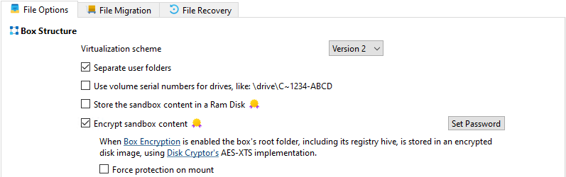
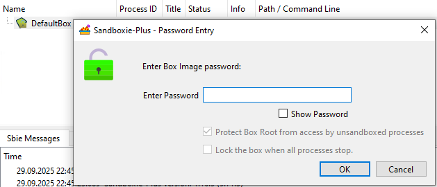

# Force Protection On Mount

_ForceProtectionOnMount_ は [Sandboxie Ini](SandboxieIni.md) の SandMan が使用するボックスごとの設定で、Sandboxie Plus 1.13.4 / Classic 5.68.4 で導入されました。[ファイル ベースのサンドボックス イメージ](UseFileImage.md) に対してマウント ルート保護を要求するよう SandMan のイメージ マウント ダイアログ/ワークフローを制約します。

これは、すべてのマウント呼び出し元に対して適用されるサービス全体のルールではありません。

## 使用法

```ini
[DefaultBox]

ForceProtectionOnMount=y
```

SandMan はボックスの直接の値を読み取り、フォールバックは `n` です。テンプレートまたは GlobalSettings の値がこのワークフローを制御すると想定しないでください。

## 使用する場合

マウント ダイアログでチェックを外せないようにしつつ、SandMan にマウント ルート保護を要求させたい場合にこの設定を使用します。マウント中の保護はイメージ暗号化とは別個であり、絶対的なホスト アクセス保証ではありません。

## 動作と UI

**Sandbox Options > General Options > File Options** で **Force protection on mount** を有効にします。チェックボックスは、イメージ バッキング オプションが有効で選択されている場合に利用可能であり、通常の RAM ディスクの選択肢には表示されません。



結果として得られる SandMan のマウント ダイアログでは、この設定は **Protect Box Root from access by unsandboxed processes** をチェックして無効にします。マウント要求は保護を要求するためにサービスとドライバーに到達します。



> [!WARNING]
> 保護を要求しても、登録が成功したことにはなりません。ルート保護の登録が失敗してもマウントは成功することがあり、通常のマウント クエリは保護がアクティブであることを確定しません。

マウント アクセスの境界については [Encrypted Sandboxes](../PlusContent/BoxEncryption.md) を、セッション リーダーの例外については [Protect Admin Only](ProtectAdminOnly.md) を参照してください。

## 自動アンマウントの制限

すべての SandMan マウントに対して自動アンマウントを強制するためにこの設定に依存しないでください。現在の呼び出し元の初期化は、ダイアログの強制状態が適用された後に自動ロック状態を上書きすることがあります。

SandMan の起動時マウント パスは自動アンマウントを有効にして提供します。通常の手動マウント パスは無効にして提供するため、上記のように **Lock the box when all processes stop.** が無効でチェックされていない状態のままになることがあります。これは現在の実装上の不一致であり、自動アンマウントが強制されることを保証するものではありません。

自動アンマウント自体は、レジストリ/ルートの正常な解放とデバイスのクリーンアップに依存します。そのライフサイクルについては [Use File Image](UseFileImage.md#automatic-mounting-and-locking) を参照してください。

## その他の呼び出し元とアンマウント

`Start.exe /mount` は `ForceProtectionOnMount` を使用しません。`/mount_protected` はルート保護を明示的に要求します。[Start Command Line](StartCommandLine.md#mount-box-images) を参照してください。

この設定はプロセスの終了やアンマウントの成功を制御しません。SandMan の手動アンマウント操作と基盤となるサービスのアンマウント操作には別個の動作があり、[Use File Image](UseFileImage.md#unmounting-box-image) で説明されています。

## 関連ページ

- [Use File Image](UseFileImage.md)
- [Encrypted Sandboxes](../PlusContent/BoxEncryption.md)
- [Protect Admin Only](ProtectAdminOnly.md)
- [Start Command Line](StartCommandLine.md#mount-box-images)
