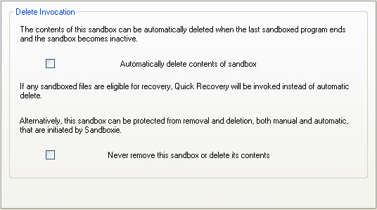
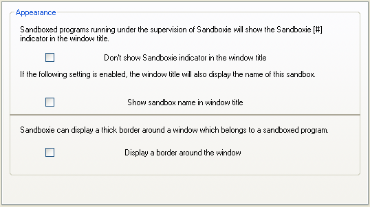

# General Tips

**Automatic Delete Sandbox**

[Sandboxie Control](SandboxieControl.md) > [Sandbox Settings](SandboxSettings.md) > [Delete](DeleteSettings.md) > [Invocation](DeleteSettings.md#invocation)

*   設定: Automatically delete contents of sandbox

この設定は、サンドボックス内のすべてのプログラムが実行を停止するたびにサンドボックスを削除するよう Sandboxie に指示します。

* * *

**Highlight Windows of Programs Running Under Sandboxie**

[Sandboxie Control](SandboxieControl.md) > [Sandbox Settings](SandboxSettings.md) > [Appearance Settings](AppearanceSettings.md)

*   設定: Display a border around the window

この設定は、このサンドボックスで実行されているプログラムに属するウィンドウの周りに色付きの境界線を描画するよう Sandboxie に指示します。既定の色は黄色ですが、サンドボックスごとに異なる色を選択できます。

あるいは、Sandboxie の監督下で実行されているプログラムとそうでないプログラムの区別を曖昧にしたい場合は、"Don't show Sandboxie indicator in the window title." 設定を選択します。
