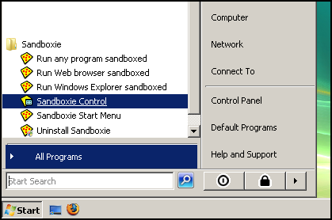
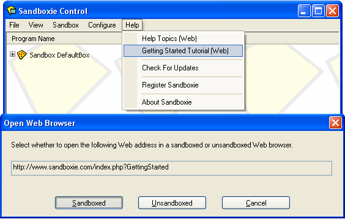

# はじめに

### 第 1 部: 概要

Sandboxie は、サンドボックスと呼ばれる分離された抽象領域でアプリケーションを実行します。Sandboxie の監視下では、アプリケーションは通常どおりフルスピードで動作しますが、コンピューターに永続的な変更を加えることはできません。変更はサンドボックス内でのみ行われます。

この「はじめに」チュートリアルでは、次のことを説明します。

  * Sandboxie を使用してアプリケーションを実行する方法
  * 変更がどのようにサンドボックス内に閉じ込められるか
  * 重要なファイルやドキュメントをサンドボックスから復元する方法
  * サンドボックスを削除する方法

または、いくつかの最後のポイントを説明する[はじめに 第 6 部](GettingStartedPartSix.md)まで読み飛ばすこともできます。

Sandboxie に関するチュートリアルへのリンクをさらに掲載した[外部チュートリアル](ExternalTutorials.md)ページも参照してください。英語以外の言語のものや、テキストではなく動画形式のものもあります。

* * *

### Sandboxie Control のインターフェース

Sandboxie Classic は、[Sandboxie Control](SandboxieControl.md) プログラムを通じて操作します。このプログラムは、タスクバーのシステム通知（「トレイ」）領域に黄色い Sandboxie アイコンを追加します。

[Sandboxie Control](SandboxieControl.md) がまだ起動していない場合は、Windows のスタート メニューの Sandboxie プログラム グループから見つけて起動できます。

起動しているときは、Sandboxie のトレイ アイコンをダブルクリックすることで、[Sandboxie Control](SandboxieControl.md) のメイン ウィンドウを非表示にしたり表示したりできます。または、アイコンを右クリックして最初のコマンドを選択します。これは _Hide Window_（ウィンドウを隠す）と _Show Window_（ウィンドウを表示）を切り替えます。

このチュートリアルでは、[Sandboxie Control](SandboxieControl.md) のメイン ウィンドウが表示されていることを確認してください。

* * *

このチュートリアルは、サンドボックス化された Web ブラウザーで表示することをお勧めします。そのためには、[Sandboxie Control](SandboxieControl.md) の[ヘルプ メニュー](HelpMenu.md)にある _Getting Started Tutorial (Web)_ コマンドを使用し、ブラウザーを**サンドボックス内で**実行するよう [Sandboxie Control](SandboxieControl.md) に指示します。

チュートリアルは[はじめに 第 2 部](GettingStartedPartTwo.md)に続きます。
