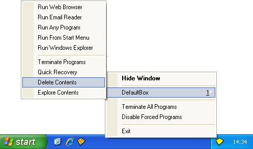
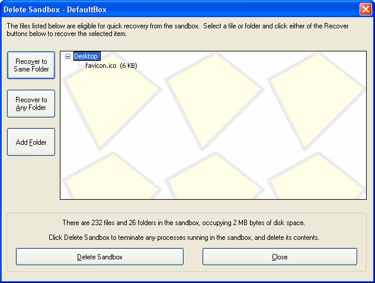
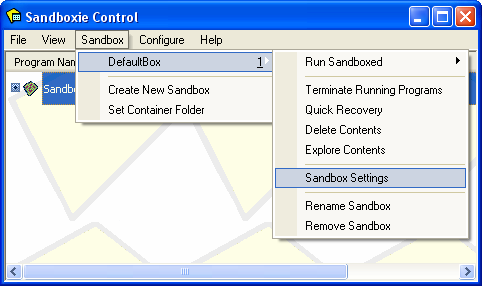
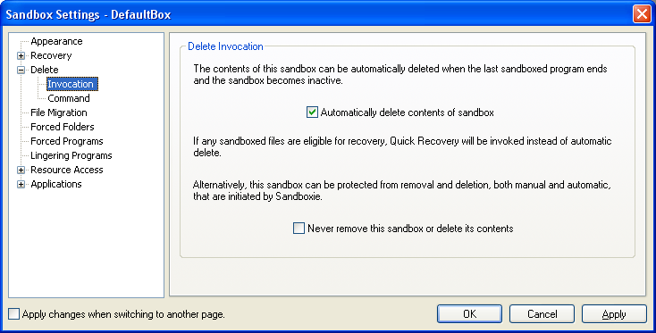

# はじめに 第 5 部

### 第 5 部: サンドボックスの削除

Sandboxie の下でアプリケーションを使用し終え、ダウンロードしたファイル、ドキュメント、その他の必要な作業項目を復元したら、サンドボックスの内容を削除することをお勧めします。[トレイ アイコン メニュー](TrayIconMenu.md)の **Delete Contents**（内容を削除）コマンドをクリックします。

**Delete Contents** コマンドは、Sandboxie Control のメイン ウィンドウにある[サンドボックス メニュー](SandboxMenu.md)から呼び出すこともできます。

* * *

[サンドボックスの削除](DeleteSandbox.md)ウィンドウが表示され、サンドボックスにまだ残っているファイルを復元する最後の機会が与えられます。

上の図のウィンドウの上半分は、前の部分でクイック復元コマンドとして紹介したものです。下半分には、サンドボックスの内容の累積サイズが表示されます。

最後に、必要なものがすべて復元されたことを確認したら、_Delete Sandbox_（サンドボックスを削除）をクリックしてサンドボックスを削除します。

サンドボックスのサイズに関係なく、削除プロセスは常に数秒しかかからないことに注意してください。これは正常で想定内と考えるべきです。この間、Sandboxie のトレイ アイコンは赤い X アイコンに変わり、サンドボックスの削除が進行中であることを示します。

* * *

既定の構成では、サンドボックスは自動的に削除されないため、サンドボックスの内容を削除したいときはいつでも **Delete Contents** コマンドを手動で呼び出す必要があります。

この動作は設定を変更することで変えられます。[Sandboxie Control](SandboxieControl.md) のメイン ウィンドウで、[サンドボックス メニュー](SandboxMenu.md)を使用して[サンドボックス設定](SandboxSettings.md)ウィンドウを開きます。

[サンドボックス設定](SandboxSettings.md)ウィンドウが表示されます。_Delete_ をクリックして削除設定グループを展開し、_Invocation_ をクリックして[削除 > 起動](DeleteSettings.md#invocation)設定ページを表示します。

設定ページの説明に従って Sandboxie が Delete Sandbox コマンドを自動的に呼び出すようにするには、_Automatically delete contents of sandbox_（サンドボックスの内容を自動的に削除する）のチェックボックスにチェックを入れます。

* * *

チュートリアルは[はじめに 第 6 部](GettingStartedPartSix.md)で終わります。
