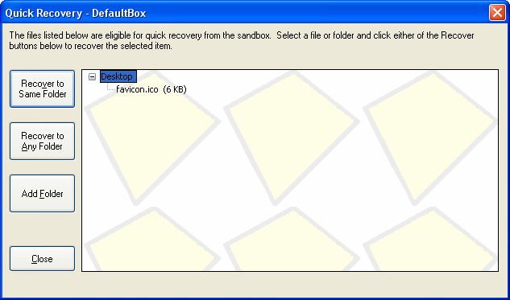
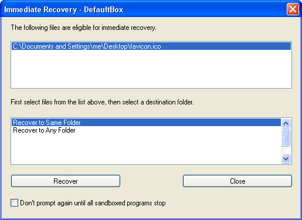

# はじめに 第 4 部

### 第 4 部: クイック復元

先ほどファイル _favicon.ico_ をデスクトップ フォルダーに保存したとき、Sandboxie がそのファイルに対して[即時復元](ImmediateRecovery.md)を提案したことに気づいたかもしれません。しかし、_test1.txt_ を C ドライブのルート フォルダーに保存したときには、そのような提案はありませんでした。

これは、デスクトップ フォルダーが（既定で）_復元可能_なフォルダーの場所として構成されており、通常はそこからファイルを復元したいと考えるためです。C ドライブのルート フォルダーは復元可能な場所とは見なされません。

[クイック復元](QuickRecovery.md)コマンドは、復元可能なフォルダーをスキャンし、復元可能なすべてのファイルの概要を表示します。

**クイック復元**コマンドは、次の場所から呼び出すことができます。

*   Sandboxie Control のメイン ウィンドウにある[サンドボックス メニュー](SandboxMenu.md)。

*   画面の隅にある[トレイ アイコン メニュー](TrayIconMenu.md)を右クリック。

* * *

上の図では、_favicon.ico_ が唯一の復元可能なファイルとして表示されています。これは、復元可能な場所（この場合はデスクトップ フォルダー）に保存された唯一のファイルだったためです。

既定で復元可能なフォルダーとして設定されているその他のフォルダーの場所には、_Documents_ フォルダーや Windows の _Favorites_ フォルダーがあります。該当する場合、_Downloads_ フォルダーも復元可能なフォルダーと見なされます。これらのフォルダーには復元対象となるファイルが含まれていないため、上の図にはまったく表示されていません。

_Add Folder_（フォルダーの追加）ボタンを使用して、クイック復元にフォルダーを追加できます。

*   [Sandboxie Control](SandboxieControl.md) を[ファイルとフォルダー ビュー](FilesAndFoldersView.md)に切り替えて、サンドボックス内のどこにあるファイルでも表示および復元できます。

* * *

ファイル（またはフォルダー）を復元するとき、サンドボックス外の対応する場所に復元することを選択できます。たとえば、サンドボックス化されたデスクトップ フォルダーから実際のデスクトップに復元できます。_Recover to Same Folder_（同じフォルダーに復元）コマンド（上の図ではボタンとして表示されています）がこれを行います。

または、_Recover to Any Folder_（任意のフォルダーに復元）コマンドを使用して、サンドボックス化されたファイルをコンピューター システム内の任意のフォルダーの場所に移動できます。

* * *

### 即時復元

このガイドの前の部分で簡単に触れた[即時復元](ImmediateRecovery.md)機能は、[クイック復元](QuickRecovery.md)の拡張です。即時復元は同じ復元可能なフォルダーのセットをスキャンし続け、ファイルが作成された直後に復元できるようにします。

クイック復元と同様に、_Recover to Same Folder_（同じフォルダーに復元）または _Recover to Any Folder_（任意のフォルダーに復元）を選択できます。

* * *

まとめ:

*   ファイルが[クイック復元](QuickRecovery.md)や[即時復元](ImmediateRecovery.md)によって検出されるには、復元可能なフォルダーに作成される必要があります。

*   復元可能なフォルダーのセットをカスタマイズできます。

*   [ファイルとフォルダー ビュー](FilesAndFoldersView.md)を使用して、復元可能なフォルダーにないファイルを復元できます。

* * *

チュートリアルは[はじめに 第 5 部](GettingStartedPartFive.md)に続きます。
