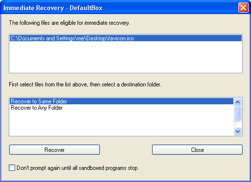
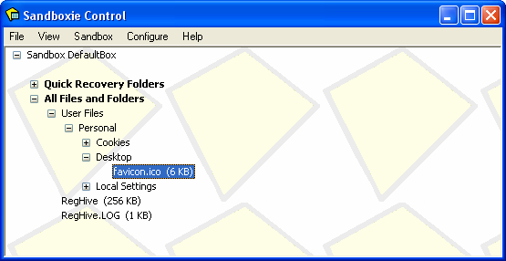
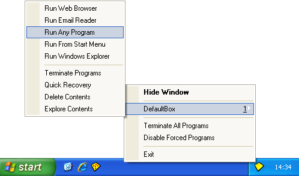
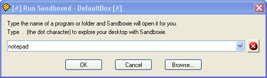
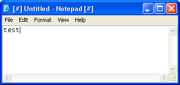
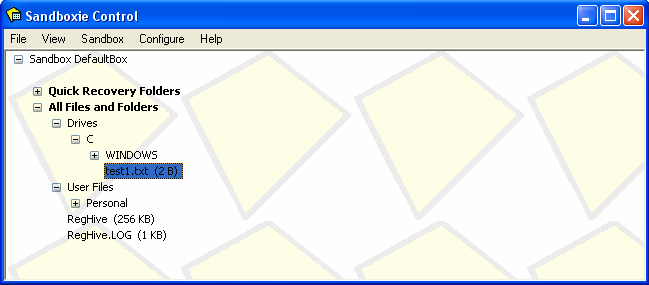

# はじめに 第 3 部

### 第 3 部: サンドボックス

ここまでで、Web ブラウザーが**サンドボックス内で**実行されているはずです。Internet Explorer でもその他のブラウザーでもかまいません。

ブラウザー プログラムはコンピューターに変更を加える可能性があります。これらの変更はすべてサンドボックス内に閉じ込められます。

実際に試してみましょう。次のリンクを右クリックし、ファイルをデスクトップに保存します。Internet Explorer を使用している場合、これは右クリック メニューの _Save Target As_（リンク先を名前を付けて保存）コマンドです。Firefox を使用している場合、これは右クリック メニューの _Save Link As_（リンク先を名前を付けて保存）コマンドです。

[favicon.ico](https://github.com/sandboxie-plus/sandboxie-docs/raw/main/Media/favicon.ico)

既定のおすすめの構成では、Sandboxie はファイルが重要な場所（この場合はデスクトップ）に保存されたことを識別し、そのファイルに対して[即時復元](ImmediateRecovery.md)を提案します。

この演習の目的は、復元しない限りファイルがサンドボックス内に残ることを示すことなので、上のウィンドウの _Close_（閉じる）ボタンをクリックして、ファイルをサンドボックス内に保持するよう Sandboxie に指示します。

保存したファイル _favicon.ico_ は、デスクトップにこのアイコンとして表示されます。

すべてのウィンドウを最小化してデスクトップを確認すると、新しいアイコンは表示され**ない**はずです。これは、ファイルが実際には**サンドボックス内に**保存されており、まだ復元されていないためです。

[Sandboxie Control](SandboxieControl.md) は最初、[プログラム ビュー](ProgramsView.md)で動作し、サンドボックス内で実行されているプログラムを一覧表示しますが、[表示 メニュー](ViewMenu.md)を使用して表示モードを[ファイルとフォルダー ビュー](FilesAndFoldersView.md)に切り替えると、サンドボックスの内容を表示できます。_表示_ メニューの _Files and Folders_ をクリックします。

枝（**_+_** 記号）を展開して、フォルダーに整理されたサンドボックスの内容を表示します。すぐ上の図でわかるように、先ほど保存したファイル _favicon.ico_ は**サンドボックス化された**デスクトップ フォルダーに配置されています。

* * *

同様に、サンドボックス化されたプログラムによって作成されたファイルは、本来配置される**べき**実際のフォルダーに対応するサンドボックス フォルダーに配置されます。

今度はサンドボックス化されたメモ帳で試してみましょう。これを行うには、_Run Any Program_（任意のプログラムを実行）コマンドを使用します。

Sandboxie は _Run..._ ダイアログ ボックスを表示します。**notepad** と入力します。

メモ帳がサンドボックス内で起動するはずです。

新しいメモ帳のドキュメントに数文字入力し、C ドライブのルート フォルダーに _test1.txt_ というファイルとして保存します。次に、C ドライブのルート フォルダーでこのファイルを探します。見つからないはずです。これはファイルがサンドボックス内に保存されたためです。

* * *

まとめ:

*   サンドボックス化されたプログラムによって作成または変更されたファイルは、最初はサンドボックス内に配置されます。

*   サンドボックス内のファイルは、サンドボックス外のプログラムからは見えません。

* * *

チュートリアルは[はじめに 第 4 部](GettingStartedPartFour.md)に続きます。
