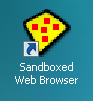
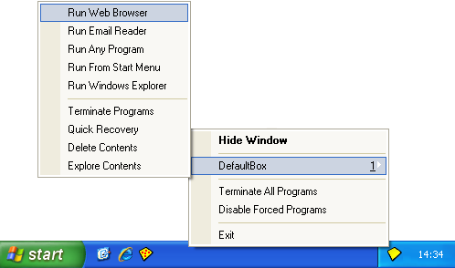
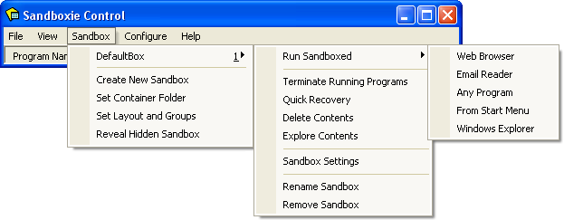
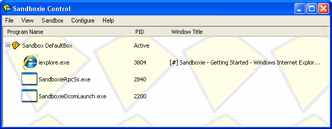

# はじめに 第 2 部

### 第 2 部: Web ブラウザーを実行する

Web ブラウザーを起動するには、Sandboxed Web Browser（サンドボックス化された Web ブラウザー）のデスクトップ ショートカット アイコンを見つけてクリックします。

または、[Sandboxie Control](SandboxieControl.md) のトレイ アイコンを右クリックし、ポップアップする[トレイ アイコン メニュー](TrayIconMenu.md)から _Run Web Browser_（Web ブラウザーを実行）アクションを選択します。

3 つ目の方法は、Sandboxie Control のメイン ウィンドウにある[サンドボックス メニュー](SandboxMenu.md)を使用する方法です。

* * *

Web ブラウザーは**サンドボックス化されて**起動するはずです。プログラムがサンドボックス化されているかどうかは、そのウィンドウのタイトル バーに Sandboxie の **[#]** インジケーターが追加されていることで判断できます。（注: 新しいブラウザーではタイトル バーに # が表示されない場合がありますが、ウィンドウの端にマウスを合わせると黄色に変わります。）

（注: 一部のコンピューター システムでは、_Run Web Browser_ を選択したときに Sandboxie が誤ったプログラムを起動することがあります。その場合は、[よくある質問](FrequentlyAskedQuestions.md#why-does-the-wrong-program-start-when-i-run-my-default-web-browser-sandboxed)を参照して修正してください。）

サンドボックス化されたプログラムは、[Sandboxie Control](SandboxieControl.md) のメイン ウィンドウに表示されるはずです。

このウィンドウには、Sandboxie の監視下で現在**サンドボックス内で**実行されているプログラムのリストが表示されます。最初は 1 つのサンドボックス _DefaultBox_ だけですが、さらにサンドボックスを作成できます。[サンドボックス メニュー](SandboxMenu.md)の[新しいサンドボックスの作成](SandboxMenu.md#create-new-sandbox)コマンドを参照してください。

上の図では、Sandboxie が 3 つのプログラムを実行していることを示しています。最初の _iexplore.exe_ は Internet Explorer を表しており、このチュートリアルでは Internet Explorer が使用中の Web ブラウザーであると想定しています。システムの既定の Web ブラウザーが Firefox または Opera の場合、サンドボックス内で最初に実行されるプログラムとして、それぞれ _firefox.exe_ または _opera.exe_ が表示されます。

このスクリーンショットでは、さらに 2 つのプログラム **SandboxieRpcss.exe** と **SandboxieDcomLaunch.exe** が実行されていることがわかります。これらのサポート プログラムは Sandboxie の一部です。必要な場合は、ユーザーによる明示的な操作なしに自動的に起動されます。[サービス プログラム](ServicePrograms.md)を参照してください。

Sandboxie がサンドボックスのいずれかでプログラムをアクティブに実行しているとき、Sandboxie のトレイ アイコン（画面の隅）には赤い点が表示されます。

* * *

チュートリアルは[はじめに 第 3 部](GettingStartedPartThree.md)に続きます。
