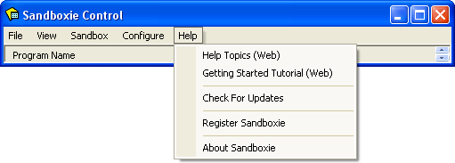
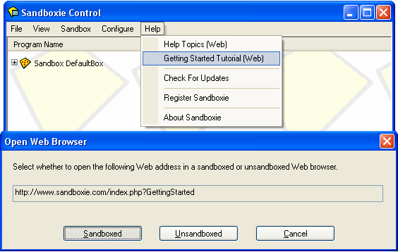
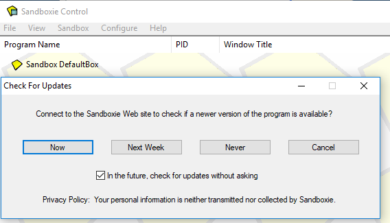
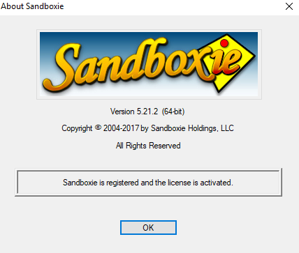

# ヘルプ メニュー

[Sandboxie Control](SandboxieControl.md) > ヘルプ メニュー

* * *

### ヘルプ トピック (Web)

[Sandboxie Control](SandboxieControl.md) > [ヘルプ メニュー](HelpMenu.md) > ヘルプ トピック (Web)

このオンライン ドキュメントの[ヘルプ トピック](HelpTopics.md)ページを Web ブラウザーで開きます。Web ブラウザーを Sandboxie の監視下で実行するかどうか（推奨）を確認するウィンドウが開きます。以下の[はじめにチュートリアル (Web)](HelpMenu.md#getting-started-tutorial-web)を参照してください。

* * *

### はじめにチュートリアル (Web)

[Sandboxie Control](SandboxieControl.md) > [ヘルプ メニュー](HelpMenu.md) > はじめにチュートリアル (Web)

このオンライン ドキュメントの[はじめに](GettingStarted.md)ページを Web ブラウザーで開きます。Web ブラウザーを Sandboxie の監視下で実行するかどうか（推奨）を確認するウィンドウが開きます。

* * *

### 更新の確認

[Sandboxie Control](SandboxieControl.md) > [ヘルプ メニュー](HelpMenu.md) > 更新の確認

このコマンドは、コンピューターにインストールされているバージョンよりも新しい Sandboxie のバージョンが Sandboxie の Web サイトで報告されているかどうかを確認します。

*   すぐに確認を開始するには **Now** ボタンをクリックします。
*   確認を後回しにするには **Next Week** ボタンをクリックします。
*   更新の自動確認を無効にするには **Never** ボタンをクリックします。

* * *

### Sandboxie について

[Sandboxie Control](SandboxieControl.md) > [ヘルプ メニュー](HelpMenu.md) > Sandboxie について

Sandboxie プログラムの製品情報~~および登録情報~~を表示します。

* * *

[Sandboxie Control](SandboxieControl.md#menus)、[ヘルプ トピック](HelpTopics.md)に進みます。
