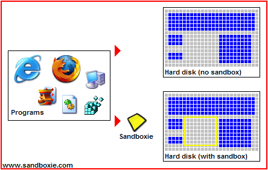
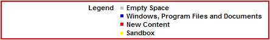

# How it Works

Sandboxie はプログラムを分離された空間で実行し、コンピューター内の他のプログラムやデータに永続的な変更を加えることを防ぎます。

赤い矢印は、実行中のプログラムからコンピューターに流れ込む変更を示しています。_Hard disk (no sandbox)_ とラベル付けされたボックスは、通常どおり実行されているプログラムによる変更を示しています。_Hard disk (with sandbox)_ とラベル付けされたボックスは、Sandboxie の下で実行されているプログラムによる変更を示しています。このアニメーションは、Sandboxie が変更をインターセプトし、黄色い長方形として描かれた **サンドボックス** 内にそれらを分離できることを示しています。また、変更をまとめることで、それらすべてを一度に簡単に削除できることも示しています。

**[今すぐ Sandboxie をダウンロード](https://github.com/sandboxie-plus/Sandboxie/releases)して試してみてください!**
