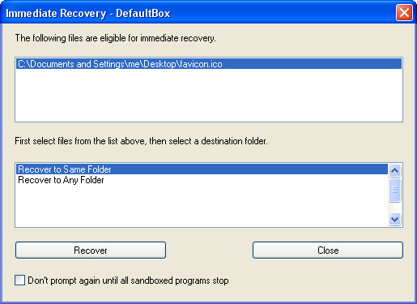

# Immediate Recovery

このページは、Sandboxie Control / Classic のスクリーンショットとワークフローを保持しています。現在の Sandboxie Plus は復元ダイアログまたは通知に SandMan を使用します。[File Recovery Architecture](RecoveryArchitecture.md) を参照してください。

即時復元は、構成された [`RecoverFolder`](RecoverFolder.md) エントリを使用しますが、[Quick Recovery](QuickRecovery.md) と同じスキャンではありません。[`AutoRecover=y`](AutoRecover.md) の場合、SbieDll はサンドボックス化されたプロセス内の対象となるファイル アクティビティを検出し、[`AutoRecoverIgnore`](AutoRecoverIgnore.md) を適用します。クイック復元は、呼び出されたときに別個にファイルをスキャンしてリストします。

クイック復元は、明示的な要求によって、または通常はサンドボックス化されたプログラムの実行が終了した後の Classic の削除ワークフローを通じて呼び出されます。対照的に、即時復元の **検出** はサンドボックス化されたプロセスで実行されます。表示とサンドボックス外への実際の移動は、ホスト側の復元 UI によって処理されます。対象となる空でないファイルは、関連するファイル アクティビティの後に報告され、必ずしも作成された正確な瞬間に報告されるわけではありません。

上記の Classic ワークフローでは、対象となるファイルが _Immediate Recovery_ ウィンドウに表示され、開いている間にさらに候補を収集できます。上部領域には対象となるファイルが表示され、下部領域には宛先フォルダーが一覧表示されます。現在の SandMan は、グローバル通知設定に応じて代わりに通知を表示することがあります。一時的に抑制されたプロンプトは表示されないことがあります。

ファイルを復元するには、上部領域で 1 つ以上のファイルを選択し、下部領域からフォルダーを選択して _Recover_ をクリックします。(上部領域で複数のファイルを選択するには _CTRL_ キーと _SHIFT_ キーを使用します)。

下部領域には、最初は特別な宛先である _Recover to Same Folder_ と _Recover to Any Folder_ のみが表示されます。これらは [Quick Recovery](QuickRecovery.md) で説明されているとおりに機能します。_Recover to Any Folder_ コマンドを使用すると、より多くの宛先が下部領域に記録され、後で使用できるようになります。

*   この機能を無効にするには、_Recover to Any Folder_ コマンドを呼び出したときに表示される _Browse For Folder_ ダイアログ ボックスで _Store selected folders for later use_ チェックボックスをオフにします。

Classic ウィンドウでは、_Don't prompt again until all sandboxed programs stop_ をマークすることで、すべてのサンドボックス化されたアクティビティが停止するまで _Immediate Recovery_ プロンプトを一時的に無効にできます。SandMan には **Global Settings > General Config > Notifications** および **Recovery Options** に独自の表示設定があります。

* * *

[Quick Recovery](QuickRecovery.md)、[Sandboxie Control](SandboxieControl.md)、[Help Topics](HelpTopics.md) に進みます。
