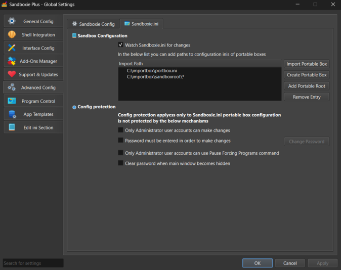

# Import Box

**ImportBox** は [Sandboxie Ini](SandboxieIni.md) のサンドボックス設定です。ユーザーが外部 INI ファイルからサンドボックス構成を読み込めるようにします。

## 構文

```ini
ImportBox=<Path to INI file>
```

* **Path to INI file**: サンドボックス構成設定を含む外部 INI ファイルへの完全なパス。

## 目的

ImportBox は、すべてをメインの Sandboxie.ini ファイルに保存するのではなく、外部 INI ファイルからサンドボックスを読み込むことにより、ポータブルなサンドボックス構成の作成を可能にします。

## 使用例

### 基本的なインポート

外部ファイルからサンドボックス設定をインポートするには:

```ini
[GlobalSettings]
ImportBox=C:\Sandboxes\PortableSandbox.ini
```

### 複数のインポート

必要なだけ多くのサンドボックスをインポートできます:

```ini
[GlobalSettings]
ImportBox=C:\Sandboxes\SecureSandbox.ini
ImportBox=C:\Sandboxes\NoNetworkSandbox.ini
ImportBox=C:\Sandboxes\BrowserSandbox.ini
```

### ポータブル構成の例

任意の場所にポータブル構成ファイルを作成します (例: `C:\Sandboxes\BrowserBox.ini`):

```ini
[BrowserBox]
Enabled=y
```

> **重要:**
> 外部 INI ファイルからサンドボックスをインポートする場合、ファイルには正確に 1 つのセクションが含まれている必要があり、そのセクション名はファイル名 (`.ini` 拡張子を除く) と一致する必要があります。
> 追加のセクションがある場合、またはセクション名がファイル名と一致しない場合、インポートは失敗します。

次にそれを Sandboxie にインポートします:

```ini
[GlobalSettings]
ImportBox=C:\Sandboxes\BrowserBox.ini
```

### サンドボックス ルート ディレクトリ全体のインポート

個々のサンドボックスを手動でインポートする代わりに、ワイルドカードを使用してディレクトリ内のすべてのサンドボックス構成をインポートできます:

```ini
[GlobalSettings]
ImportBox=C:\Sandboxes\*
```

これにより、指定されたディレクトリ内のすべての `.ini` ファイルがインポートされ、そのフォルダー内のサンドボックスが使用可能になります。

## ユーザー インターフェイス

**Sandboxie Plus** では、次の場所で ImportBox 設定を管理できます:

**Global Settings** > **Advanced Config** > **Sandboxie.ini**

このインターフェイスでは、新しいポータブル サンドボックスの作成、既存のサンドボックス ファイルのインポート、またはディレクトリをサンドボックス ルートとして追加してそれらのディレクトリ内のサンドボックスを自動的にインポートできます。


