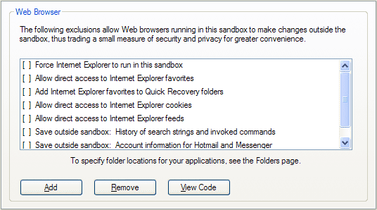
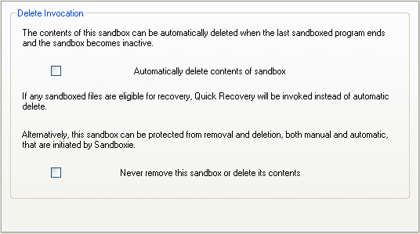
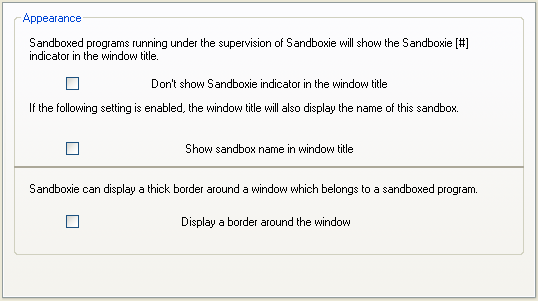

# Internet Explorer Tips

## Internet Explorer 固有のヒント

[Sandboxie Control](SandboxieControl.md) > [Sandbox Settings](SandboxSettings.md) > [Applications > Web Browser > Internet Explorer](ApplicationsSettings.md#web-browser)

* * *

#### Always Run In Sandbox

*   設定: Force Internet Explorer to run in this sandbox

この設定は、Sandboxie の機能やコマンドを通じて直接開始されなかった場合でも、Internet Explorer の任意のインスタンスが起動するときに自動的に監督するよう Sandboxie に指示します。

* * *

#### UAC が有効な場合の Internet Explorer

UAC が有効な Windows Vista/7/8/8.1 では、Internet Explorer は 2 組の構成 (通常の構成と管理者の構成) を維持します。各組には独自の Cookie、ホーム ページ、およびその他の設定が含まれます。通常どおり Internet Explorer を起動すると、通常の構成が得られます。Internet Explorer を右クリックして _Run as administrator_ アクションを選択すると、管理者の構成が得られます。

Sandboxie の下では、Internet Explorer は管理者の構成を選択します。(ただし、Internet Explorer が Sandboxie の下で必ずしも管理者として実行されるわけではありません。) 管理者の構成を微調整するには、サンドボックスの外で Internet Explorer を実行するときに _Run as administrator_ 右クリック アクションを使用します。

* * *

#### Windows XP での Windows Update

Windows Update の Web サイトにアクセスしたい場合は、Internet Explorer をサンドボックスの外で実行する必要があります。Internet Explorer が常に Sandboxie の下で実行するよう強制されている場合 (上記で説明したように)、Windows Update の Web サイトにアクセスする前後に [Disable Forced Programs](FileMenu.md#disable-forced-programs) コマンドを使用して強制サンドボックス化を無効にします。

Windows の自動更新機能は Internet Explorer に依存せず、Internet Explorer に関連する Sandboxie 設定の影響を受けないことに注意してください。同様に、Windows Vista の Windows Updates ウィンドウも Internet Explorer に依存せず、Sandboxie の影響も受けません。

* * *

#### お気に入り {#favorites}

*   設定: Allow direct access to Internet Explorer favorites
*   設定: Add Internet Explorer favorites to Quick Recovery folders

これらの設定は、Sandboxie の下で実行されている Internet Explorer がサンドボックスの外にお気に入りを保存できるようにし、サンドボックスが削除された後でも保持されるようにします。このオプションが設定されていない場合、お気に入りはサンドボックス内にのみ保存され、サンドボックスが削除されると削除されます。

最初の設定 (直接アクセス) は、お気に入りをサンドボックスの外に直接保存します。2 番目の設定 ([Quick Recovery](QuickRecovery.md)) は、最初はお気に入りをサンドボックス内に保持しますが、新しいお気に入りが追加されると、それらを復元する (サンドボックスの外に移動する) ことを提案します。

最初の設定は、お気に入りを自由に追加、編集、削除できるという点でより柔軟です。2 番目の設定はより安全ですが、利便性がある程度犠牲になります。

**結論:** より便利にするには、"Allow direct access to Internet Explorer favorites." 設定を選択します。

* * *

#### Cookie

*   設定: Allow direct access to Internet Explorer cookies

この設定は、Sandboxie の下で実行されている Internet Explorer がサンドボックスの外に Cookie を保存できるようにし、サンドボックスが削除された後でも保持されるようにします。このオプションが設定されていない場合、Cookie はサンドボックス内にのみ保存され、サンドボックスが削除されると削除されます。

この設定の代替アプローチは、通常の Internet Explorer でお気に入りのサイトに一度アクセスし、これらのサイトの Cookie にあなたを記憶させることです。次に Sandboxie の下の Internet Explorer に切り替えると、新しい Cookie はサンドボックスを削除するまでサンドボックス内に保持されます。

**結論:**

*   Cookie を定期的に削除し、Sandboxie を定期的に使い始める予定がある場合は、この設定を選択しないままにしておくことができ、定期的に Cookie を削除し続ける必要はありません。
*   サンドボックス化された Internet Explorer でアクセスする Web サイトにあなたを記憶させたい場合は、この設定を選択します。

* * *

#### フィード

*   設定: Allow direct access to Internet Explorer feeds

この設定は、Sandboxie の下で実行されている Internet Explorer がサンドボックスの外にフィード リンクを保存できるようにし、サンドボックスが削除された後でも保持されるようにします。このオプションが設定されていない場合、フィード リンクはサンドボックス内にのみ保存され、サンドボックスが削除されると削除されます。

Internet Explorer は、Web ブラウザーの外で実行されているコンポーネントからフィードを定期的にチェックします。この設定が有効でない場合、そのコンポーネントはサンドボックス内に作成されたフィードを認識せず (チェックまたは更新もせず)、表示しません。(技術的には、このコンポーネントはスケジュールされたタスクです。このタスクは、Internet Options ダイアログの Feed Settings タブを使用するたびに作成および変更されます。)

**結論:** Internet Explorer のフィードを扱う場合は、この設定を選択することをお勧めします。

* * *

#### Save Outside Sandbox

*   設定: Save outside sandbox: History of search strings and invoked commands.
*   ~~設定: Save outside sandbox: Account information for Hotmail and Messenger.~~ (Sandboxie v0.8.0 / 5.50.0 以降 [OpenCredentials](OpenCredentials.md) に置き換えられました)

最初の設定は、Sandboxie の下で実行されている Internet Explorer が "AutoComplete" 情報を保存できるようにします。これは通常、検索文字列の履歴、または入力ボックスに入力されたコマンドの履歴を保持するために使用されます。

~~2 番目の設定は、Sandboxie の下で実行されている Internet Explorer が "Credentials" 情報を保存できるようにします。これは通常、Hotmail などの Microsoft Web サイトが Windows Live ID を記憶するために使用されます。Windows (Live) Messenger でも使用されます。~~

**結論:** これらの設定は、セキュリティよりもプライバシーに関係します。Web サイトに入力する情報は、(通常のブラウザーと同様に) 永続的に保持することも、サンドボックスを削除するまでのみ保持することもできます。永続的に保持するには、これらの設定を選択します。それ以外の場合は、設定を選択しないままにします。

* * *

## 一般的なヒント

#### Automatic Delete Sandbox

[Sandboxie Control](SandboxieControl.md) > [Sandbox Settings](SandboxSettings.md) > [Delete](DeleteSettings.md) > [Invocation](DeleteSettings.md#invocation)

*   設定: Automatically delete contents of sandbox

この設定は、サンドボックス内のすべてのプログラムが実行を停止するたびにサンドボックスを削除するよう Sandboxie に指示します。

* * *

#### Highlight Windows of Programs Running Under Sandboxie

[Sandboxie Control](SandboxieControl.md) > [Sandbox Settings](SandboxSettings.md) > [Appearance Settings](AppearanceSettings.md)

*   設定: Display a border around the window

この設定は、このサンドボックスで実行されているプログラムに属するウィンドウの周りに色付きの境界線を描画するよう Sandboxie に指示します。既定の色は黄色ですが、サンドボックスごとに異なる色を選択できます。

あるいは、Sandboxie の監督下で実行されているプログラムとそうでないプログラムの区別を曖昧にしたい場合は、"Don't show Sandboxie indicator in the window title." 設定を選択します。
