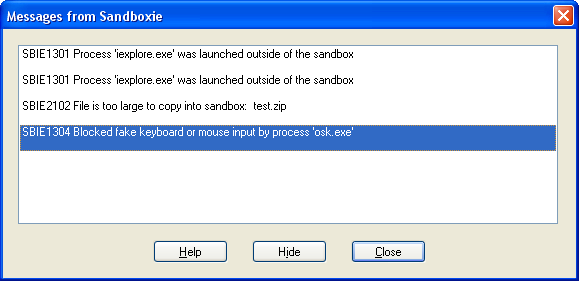

# Messages From Sandboxie

_Messages From Sandboxie_ ウィンドウは、Sandboxie が少なくとも 1 つのエラーまたは情報メッセージをログに記録するたびに自動的に表示されます。(Sandboxie メッセージの詳細については、[SBIE Messages](SBIEMessages.md) を参照してください。)

このウィンドウには、以下の例のように 1 行につき 1 つのメッセージが表示されます。



_Help_ ボタンをクリックすると、Web ブラウザーが開き、強調表示されたメッセージのドキュメント ページに移動します。

_Hide_ ボタンをクリックすると、このメッセージを今後受信したくないことを示します。メッセージに情報の詳細が含まれている場合、_Hide_ ボタンはその特定の詳細と組み合わせた場合にのみメッセージを非表示にします。

たとえば、上に表示されている [SBIE1304](SBIE1304.md) メッセージには _osk.exe_ という詳細があります。この場合、_Hide_ ボタンは _osk.exe_ に対する [SBIE1304](SBIE1304.md) の今後の発生を非表示にします。他のプログラム名に対して [SBIE1304](SBIE1304.md) が発行された場合、それは依然として表示されます。

_Close_ ボタンをクリックすると、ウィンドウが閉じます。

## メッセージをファイルに記録する {#log-messages-to-a-file}
レジストリ内の簡単な構成で _Messages From Sandboxie_ をファイルにログ記録できます:
```cmd
reg.exe add "HKLM\SYSTEM\CurrentControlSet\Services\SbieSvc" /t REG_SZ /v LogFile /d "2;C:\Windows\System32\LogFiles\Sandboxie.log" /f
```
`LogFile` 値は 2 つの情報で構成されます:

- `2` はログ レベルです。正しい値は `2` (クラシック ログ) または `3` (プロセス SID 付きログ) の 2 つだけです
- `C:\Windows\System32\LogFiles\Sandboxie.log` はログの完全なパスです

ログ レベル 2 の出力例:
```
2022-09-02 01:04:18 SBIE1308 Program cannot start due to restrictions - powershell.exe [ChromeBox]
2022-09-02 01:04:18 SBIE1308 Program cannot start due to restrictions - powershell.exe [ChromeBox]
2022-09-02 01:04:18 SBIE1308 Program cannot start due to restrictions - HelpPane.exe [ChromeBox]
```

バージョン 1.3.3 / 5.58.3 以降、ターゲット プロセスによって使用されるアカウントの SID を取得するために、詳細モードでログを渡すことが可能です。

ログ レベル 3 の出力例:
```
2022-09-02 01:04:18 SBIE1308 Program cannot start due to restrictions - powershell.exe [ChromeBox] (DESKTOP-RZ4242\administrator)
2022-09-02 01:04:18 SBIE1308 Program cannot start due to restrictions - powershell.exe [ChromeBox] (DESKTOP-RZ4242\administrator)
2022-09-02 01:04:18 SBIE1308 Program cannot start due to restrictions - HelpPane.exe [ChromeBox] (DESKTOP-RZ4242\administrator)
```

別のレジストリ キーでは、特定のメッセージでログをフィルター処理および分割できます:
```cmd
reg.exe add "HKLM\SYSTEM\CurrentControlSet\Services\SbieSvc" /t REG_SZ /v LogFile /d "2;C:\Windows\System32\LogFiles\Sandboxie.log" /f
reg.exe add "HKLM\SYSTEM\CurrentControlSet\Services\SbieSvc" /t REG_SZ /v MultiLog /d "1308,1307" /f
```
この簡単な構成では:

- フィルターのないすべてのログを `C:\Windows\System32\LogFiles\Sandboxie.log` に入れます
- イベント 1308 および 1307 のみを含む _ボックスごとに 1 つのファイル_ (例: `C:\Windows\System32\LogFiles\Sandboxie_DefaultBox.log`) を作成します
