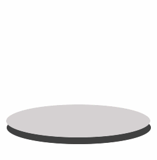

# Paper Analogy

PC を 1 枚の紙だと考えてください。実行するすべてのプログラムが紙に書き込みます。ブラウザーを実行すると、訪問したすべてのサイトについて紙に書き込みます。そして遭遇するマルウェアは通常、それ自体を紙に書き込もうとします。

従来のプライバシーおよびマルウェア対策ソフトウェアは、紙に残したくないと思われる書き込みを探して消去しようとします。ほとんどの場合、それらは正しく処理します。しかしまず、これらのソリューションの製作者は、紙の上で何を探すべきか、またそれを安全に消去し、残された痕跡を除去する方法をソリューションに教えなければなりません。

一方、Sandboxie サンドボックスは、紙の上に置かれた透明なレイヤーのように機能します。プログラムは透明なレイヤーに書き込み、プログラムから見ると本物の紙のように見えます。サンドボックスを削除すると、透明なレイヤーを取り除くようなもので、変更されていない本物の紙が現れます。

(注: グラフィックはバージョン 3.20 より前の [Sandboxie Control](SandboxieControl.md) アプリケーションを描いています。)

紙のメタファーを提供してくれた _esalkin_ に感謝します。グラフィックを提供してくれた _warwagon_ に感謝します。

* * *

同じ概念の別の図については、Sandboxie の[デモンストレーション](https://www.youtube.com/watch?v=9ZF9c03PN8I)も参照してください。
