# Sandboxie-Plus 移行ガイド

このガイドでは、既知のすべての Sandboxie 機能が新しい UI のどこにあるかを示します。

## メイン ウィンドウ

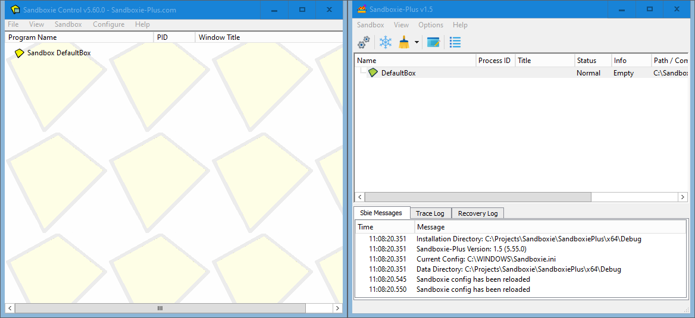

SandMan.exe のメイン ウィンドウの全体的なレイアウトは、「シンプル ビュー」を選択したときの SbieCtrl.exe の古いものとまったく同じです。「詳細ビュー」を選択した場合は、ウィンドウの下部に 3 つの追加タブ（「Sbie Messages」など）があるため、右の図に示される内容に対応します。

## ファイル メニューとサンドボックス メニュー

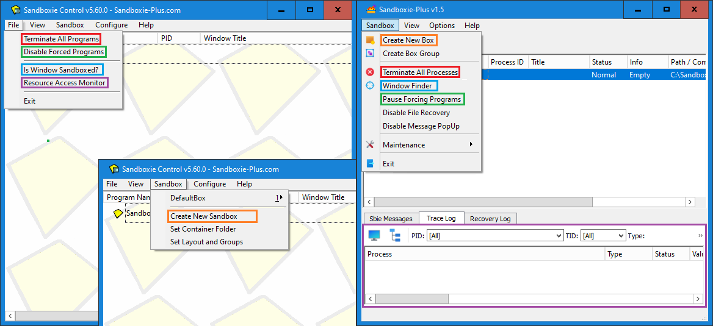

すべての重要なメニュー コマンドは、一部は移動されていますが、同様の場所にあります。

## 新しいボックスの作成ダイアログ

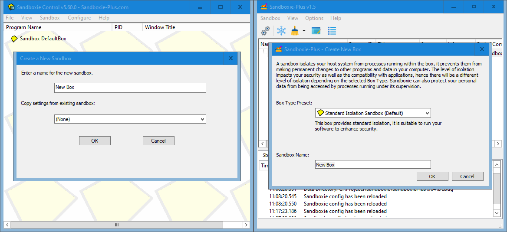

「Create New Box」（新しいボックスの作成）コマンドは、新しいボックスのダイアログを開きます。Classic とは異なり、ここではボックス タイプのプリセットを選択できます。

既存のボックスをコピーする機能は、別の場所にあります。（次の項目を参照してください。）

## サンドボックス構成のコピー

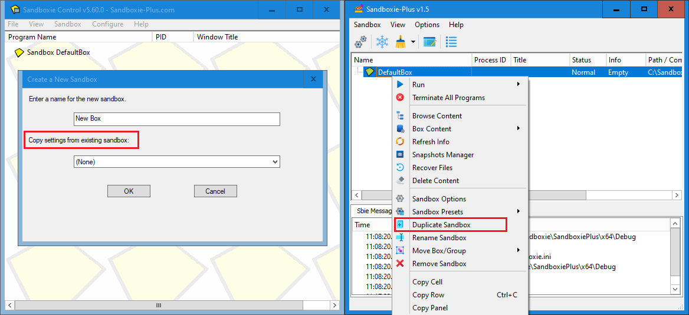

既存のボックス構成をコピーするには、「Duplicate Sandbox」（サンドボックスの複製）メニュー コマンドを使用できます。

## 表示 メニュー

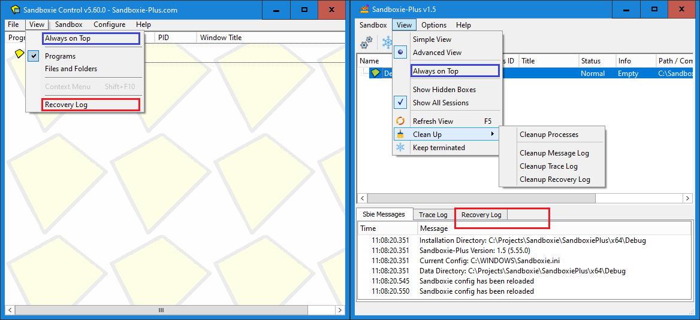

「View」（表示）メニューには、いくつかの追加機能と、簡易表示モードを有効にするオプションがあります。復元ログは独立したウィンドウではなくなり、下部のタブになりました（「詳細ビュー」を選択すると表示されます）。

## 表示 メニュー - ファイルとフォルダー

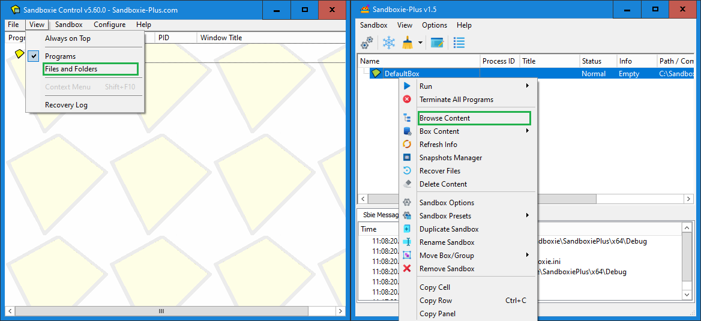

最新の Sandboxie UI では、「Files and Folders」（ファイルとフォルダー）ビューが、ボックスのコンテキスト メニューから開ける独立したウィンドウに置き換えられました。

## ファイルとフォルダー - ビュー / ウィンドウ

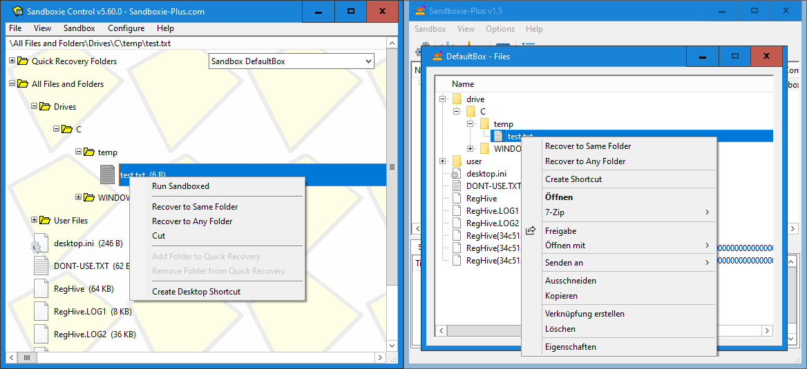

「Files」（ファイル）ウィンドウは古いビューと同じ機能を提供しますが、完全なコンテキスト メニューを提供することで強化されています。

## グローバル設定

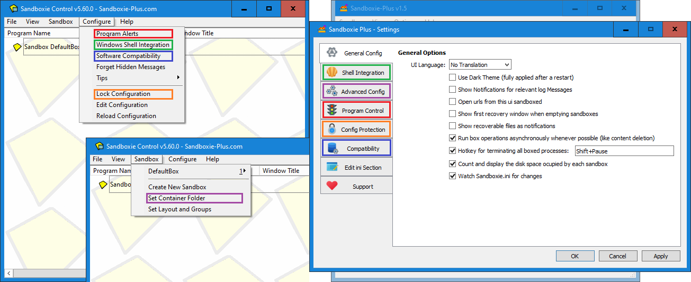

新しい Sandboxie Plus UI にはグローバル設定ウィンドウ（Options --> Global Settings）があり、個々のウィンドウを開く必要がなく、すべてのオプションが垂直タブにまとめられています。

## ファイル システム ルート

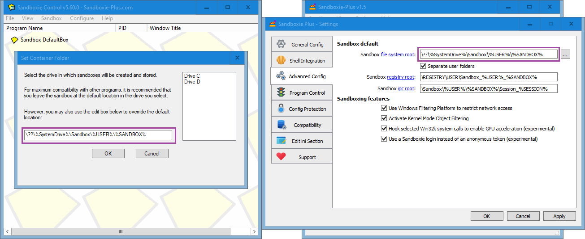

最新の UI では、ファイル システム ルート パスだけでなく、レジストリ ルートと IPC ルートも変更できます。

## プログラム起動の監視

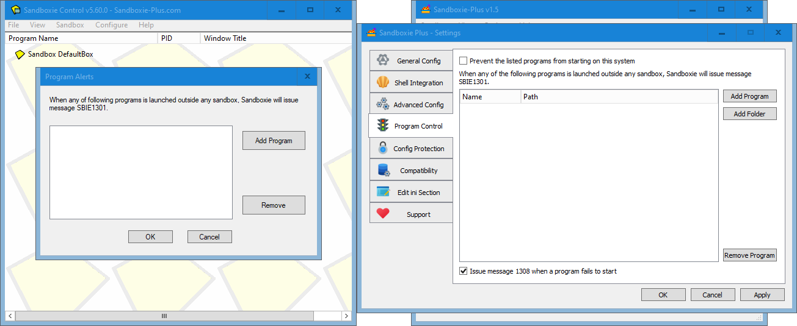

Sandboxie Plus は、非サンドボックス プロセスが起動されたときに警告するだけでなく、それらの起動を完全に防ぐこともできます。

## シェル統合

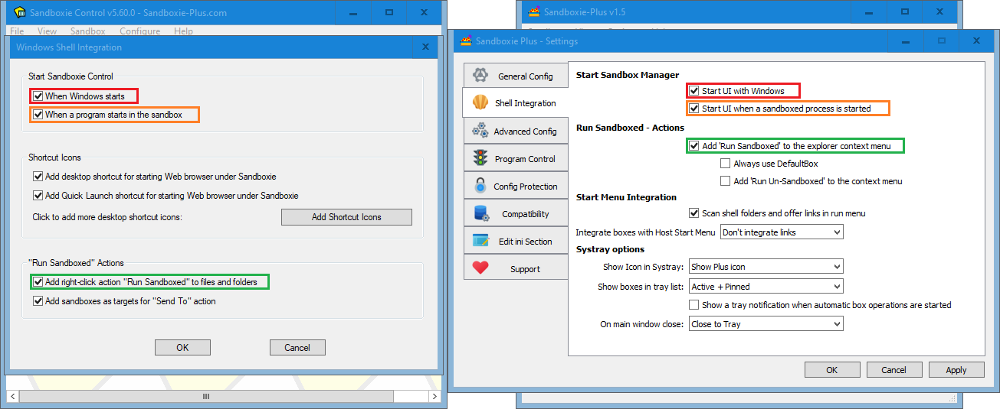

このタブでは、シェル統合を構成できます。ほとんどの機能が利用可能ですが、一部の非推奨機能は削除され、その他のオプションは外に移動されました。

## サンドボックス ショートカットの作成

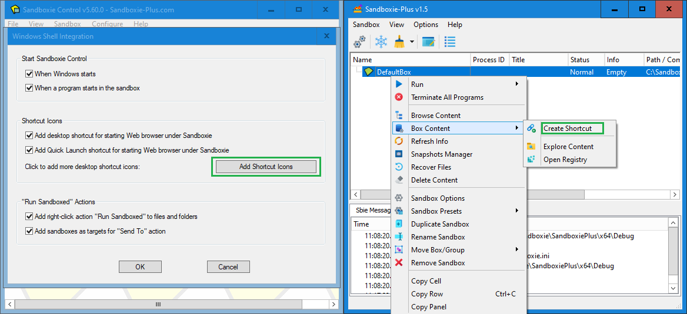

ボックス化されたプログラムへのショートカットを作成するには、ボックスのコンテキスト メニューのオプションを使用するようになり、より迅速にアクセスできます。

## ソフトウェア互換性

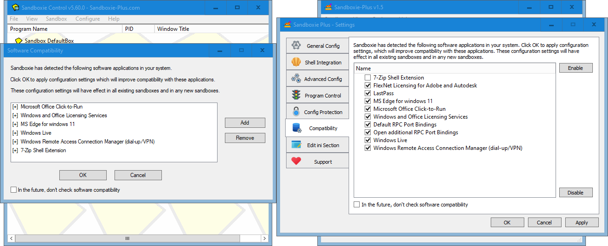

互換性ダイアログも、グローバル設定を含むウィンドウ（「Compatibility」タブ）に統合されました。

## 構成のロック

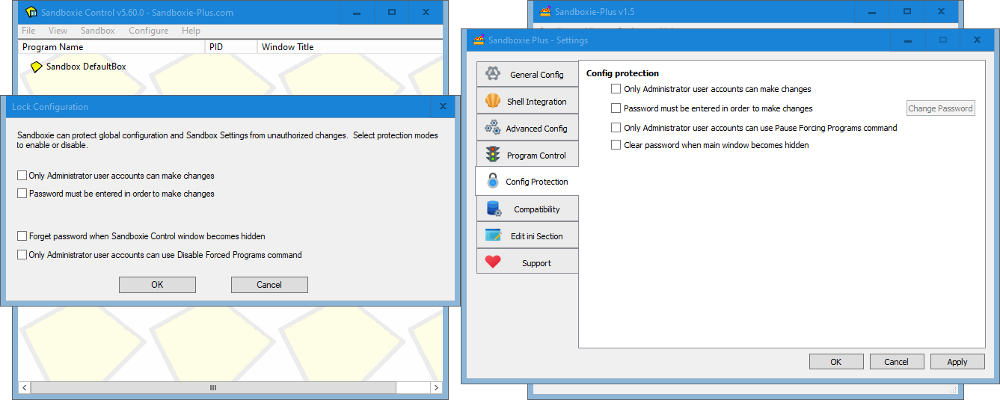

バージョン 1.9.0 / 5.64.0 以降、[構成の保護](ConfigurationProtection.md)オプションは「Advanced Config」タブのサブタブ「Sandboxie.ini Presets」にあります。

## サンドボックス コンテキスト メニュー

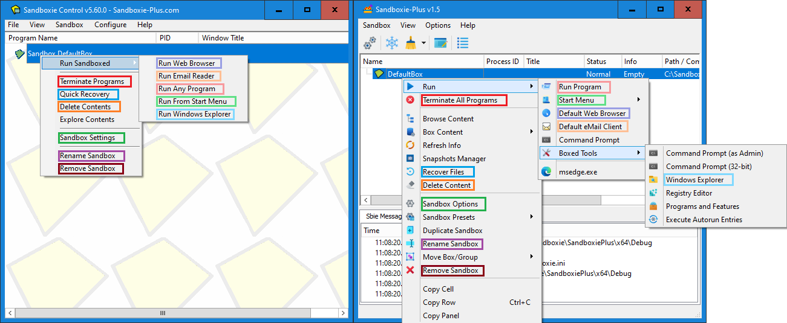

サンドボックス コンテキスト メニューははるかに高度になり、古いメニューのすべてのオプションを含んでいます。サンドボックス名をダブルクリックすると、サンドボックス設定が開きます。

## 内容の探索

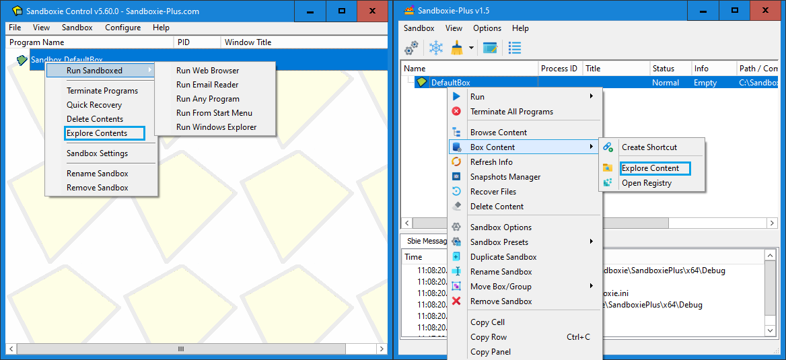

内容を探索できることに加えて、「Box Content」サブメニューでは、サンドボックス化されたレジストリをマウントして参照できます。

## サンドボックス設定

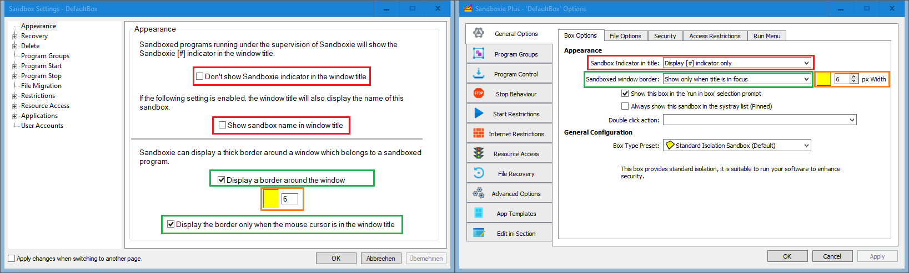

古い Sandbox Settings のすべての機能は、Sandbox Options にあります。いくつかの領域は似ていますが、多くは移動されています。

## クイック復元と即時復元

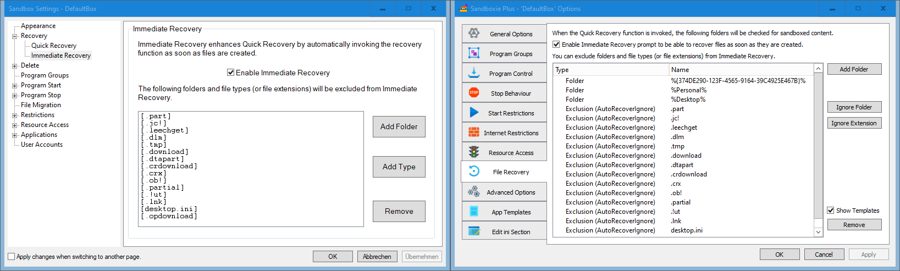

クイック復元と即時復元のオプションは、1 つのタブ（「File Recovery」）に統合されました。

## 削除オプション

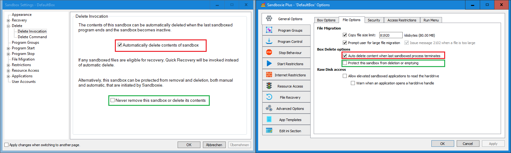

削除オプションは、「General Options」タブのサブタブ「File Options」に移動されました。

## 削除コマンド

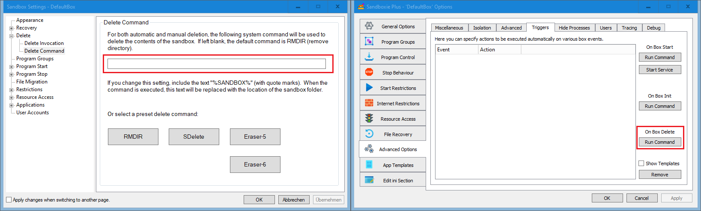

SandMan は、ホスト側の事前クリーンアップ自動化のために **Advanced Options > Triggers** の下で [`OnBoxDelete`](SandManTriggers.md#onboxdelete) を提供します。レガシーな `DeleteCommand` 設定は Sandboxie Control Classic/`Start.exe` に関連付けられたままであり、同じメカニズムではありません。

## プログラム グループ

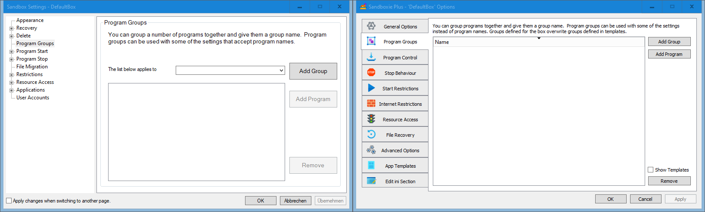

SandMan は階層的なボックス グループをサポートし、メインのサンドボックス ツリーで直接管理します。現在の SandMan はレイアウトを [`BoxGrouping`](BoxGrouping.md) を使用して保存し、Sandboxie Control Classic はレガシーな `BoxDisplayOrder` 形式を使用します。`BoxGrouping` マッピングが利用できない場合、SandMan はフォールバックとしてレガシー階層を使用できますが、2 つの形式は継続的に同期されません。

## 強制プログラムと強制フォルダー

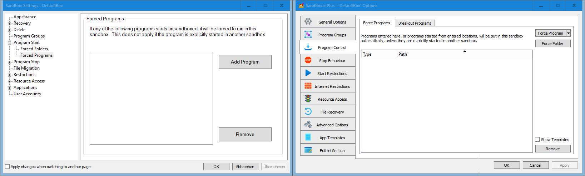

強制プログラムと強制フォルダーも 1 つのタブ（「Program Control」、サブタブ「Force* Programs」）に統合されました。

## 残留プログラムとリーダー プログラム

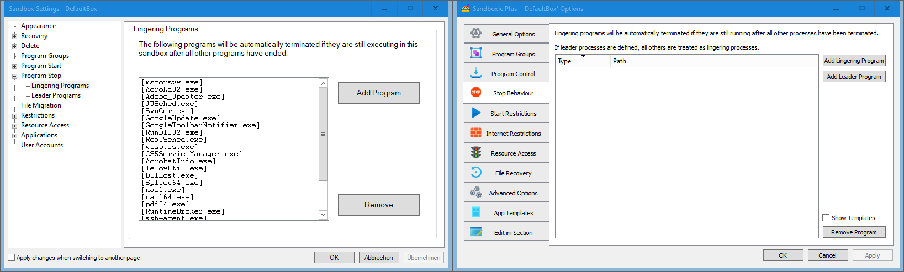

プログラム停止の動作も 1 つのタブに統合されました。

## ファイル移行

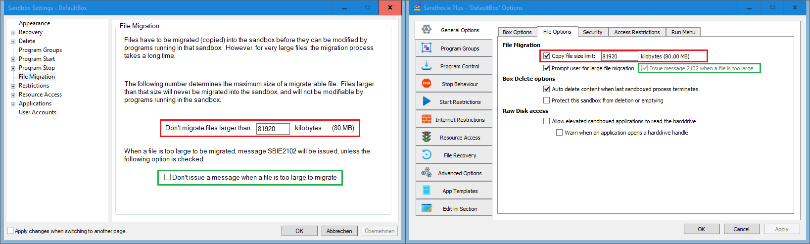

ファイル移行オプションは、「General Options」タブの「File Options」サブタブに統合されました。

## インターネット アクセス

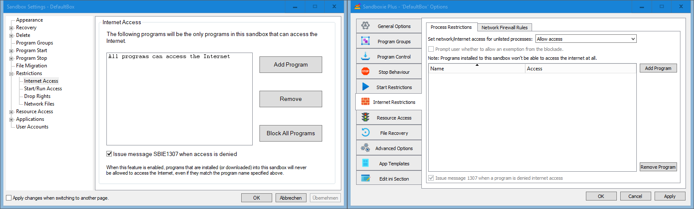

Sandboxie Plus は、インターネット アクセスをブロックする古い方法だけでなく、より優れた互換性を提供する Windows Filtering Platform (WFP) も使用できます。

## ネットワーク アクセス

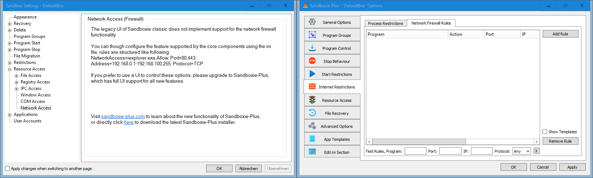

さらに、WFP 機能を使用して、サンドボックスごとのファイアウォールを構成できます（タブ「Internet Restrictions」--> サブタブ「Network Firewall Rules」）。

## 開始/実行アクセス

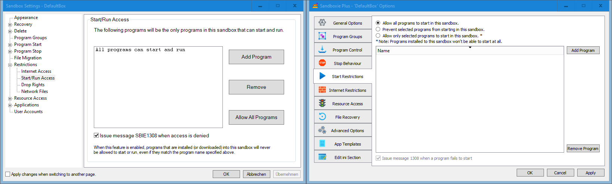

開始制限オプションは最上位のタブに昇格されました。

## 権限の削除

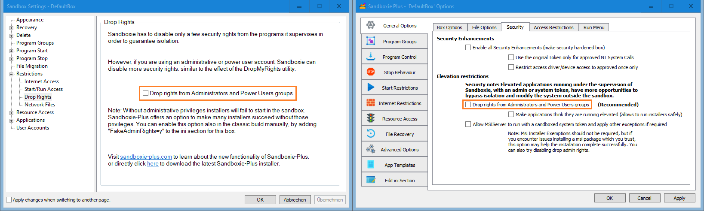

「Drop Admin Rights」（管理者権限の削除）オプションは、新しい UI では「General Options」タブの「Security」サブタブにあり、追加のセキュリティ強化とともに配置されています。

## ネットワーク ファイル

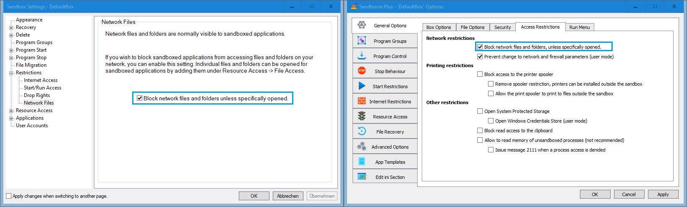

「Block network files and folders access」（ネットワーク ファイルとフォルダーへのアクセスをブロック）は、「General Options」タブの「Access Restrictions」サブタブに移動されました。

## リソース アクセス

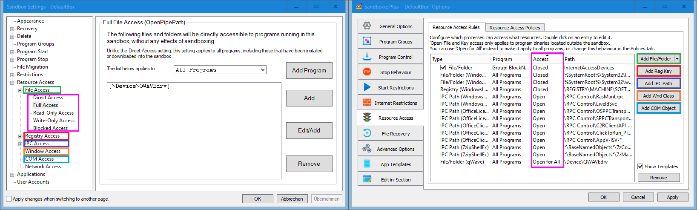

「Resource Access」（リソース アクセス）オプションは、すべてのプリセットを 1 つのリストに表示する統合ビューに統合され、オプションを削除せずに編集および無効化できます。

## アプリケーション互換性テンプレート

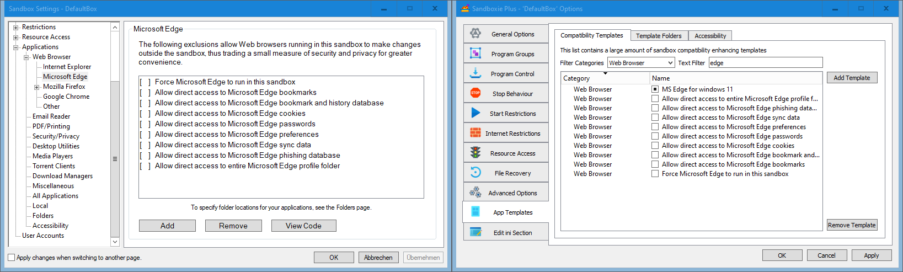

互換性テンプレートも統合ビュー（タブ「App Templates」、サブタブ「Compatibility Templates」）として表示されるようになりました。

## ユーザー アカウント

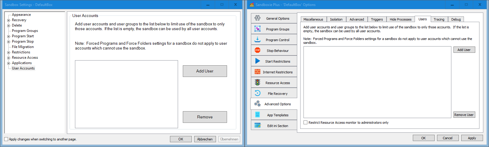

最後に、ボックスを選択したユーザーに制限する機能は、「Advanced Options」タブのサブタブ「Users」に移動されました。

## バージョン情報ダイアログ

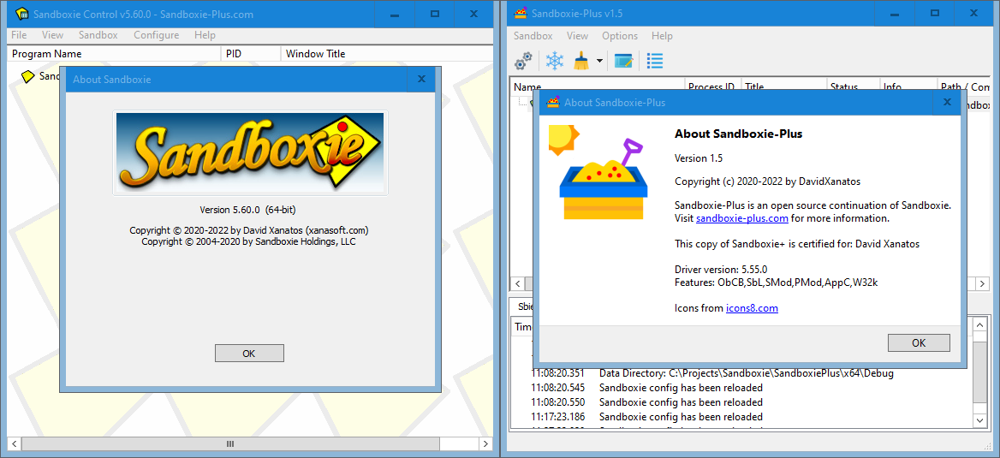

そして最後に、バージョン情報ダイアログがあります。

明らかなように、Sandboxie Plus にはここに示されていないさらに多くの追加オプションがあります。このガイドは、Sandboxie Classic から Sandboxie Plus への移行を容易にするためのものだからです。
