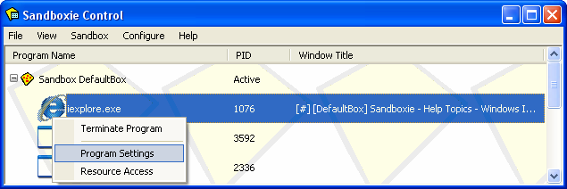
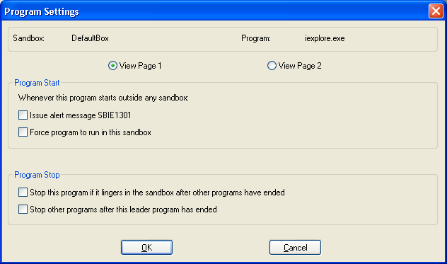
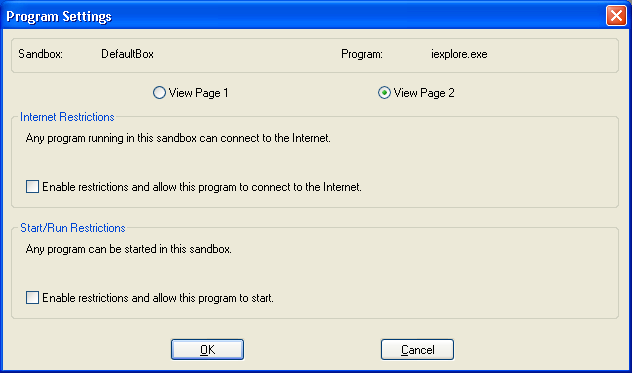

# Program Settings

### 概要

Program Settings ウィンドウは、Sandboxie のいくつかの側面を構成する簡単な方法です。ウィンドウにアクセスするには、実行中のサンドボックス化されたプログラムの名前を右クリックしてコンテキスト メニューを表示し、_Program Settings_ を選択します:

(Shift+F10 または View メニューを使用してコンテキスト メニューを表示することもできます。)

Program Settings ウィンドウには、プログラムが実行されているサンドボックス、プログラムの実行可能ファイルの名前、および簡単な構成設定用のチェックボックスが表示されます。2 つのページで構成されています。_View Page 1_ と _View Page 2_ のラジオ ボタンを使用してページを切り替えます。

* * *

### ページ 1 {#page-1}

**Program Start**

これらの設定は、Sandboxie がサンドボックスの外で開始するプログラムをどのように処理するかを制御します。

*   **Issue alert message SBIE1301**
    *   Sandboxie は、このプログラムがサンドボックスの外で開始されるたびにメッセージ [SBIE1301](SBIE1301.md) を発行します。
    *   [Configure Menu > Program Alerts](ConfigureMenu.md#program-alerts) も参照してください。

*   **Force program to run in this sandbox**
    *   Sandboxie は、このプログラムをこのサンドボックス内で実行するよう自動的に強制します。
    *   [Sandbox Settings > Program Start > Forced Programs](ProgramStartSettings.md#forced-programs) も参照してください。

**Program Stop**

これらの設定は、Sandboxie がこのサンドボックス内でこのプログラムの停止をどのように処理するかを制御します。

*   **Stop this program if it lingers in the sandbox after other programs have ended**
    *   Sandboxie は、他のすべてのプログラムが停止したときにこのプログラムが実行されたままである場合、自動的にこのプログラムを終了します。
    *   [Sandbox Settings > Program Stop > Lingering Programs](ProgramStopSettings.md#lingering-programs) も参照してください。

*   **Stop other programs after this leader program has ended**
    *   Sandboxie は、このプログラムが停止するとサンドボックス内の他のすべてのプログラムを終了します。
    *   [Sandbox Settings > Program Stop > Leader Programs](ProgramStopSettings.md#leader-programs) も参照してください。

* * *

### ページ 2 {#page-2}

これらの設定は、このプログラムに適用される制限を制御します。

**Internet Restrictions**:

*   **Enable restrictions and allow this program to connect to the Internet**
    *   サンドボックスでインターネット制限を有効にします。これは、明示的に許可されない限り、どのプログラムもインターネットに接続できないことを意味します。
    *   さらに、このプログラムがこのサンドボックスからインターネットに接続することを明示的に許可します。
    *   [Sandbox Settings > Restrictions > Internet Access](RestrictionsSettings.md#internet-access) も参照してください。

**Start/Run Restrictions**:

*   **Enable restrictions and allow this program to start**
    *   サンドボックスで Start/Run 制限を有効にします。これは、明示的に許可されない限り、どのプログラムも開始できないことを意味します。
    *   さらに、このプログラムがこのサンドボックス内で開始および実行することを明示的に許可します。
    *   [Sandbox Settings > Restrictions > Start/Run Access](RestrictionsSettings.md#startrun-access) も参照してください。
