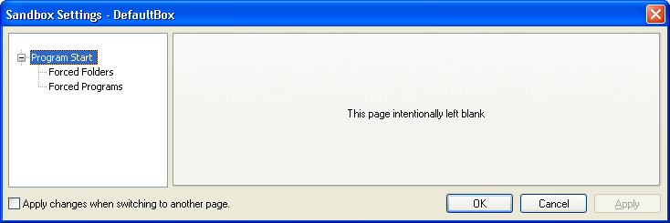
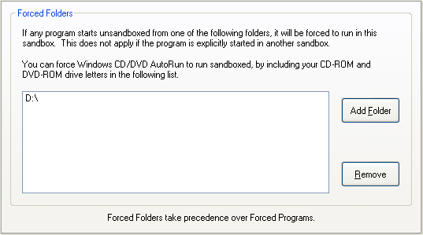
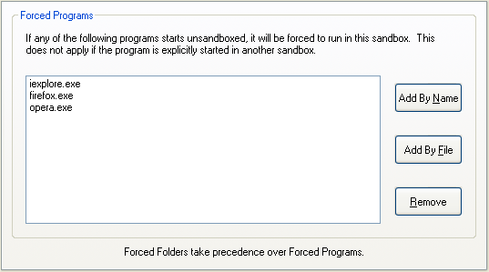

# Program Start Settings

### 「Program Start」設定グループ

[Sandboxie Control](SandboxieControl.md) > [Sandbox Settings](SandboxSettings.md) > Program Start:

このセクションの設定は、サンドボックスの外で開始されたときにどのプログラムが自動的にサンドボックス化されるかを制御します。別の言い方をすれば、ここでは Sandboxie がサンドボックス内で実行するよう「強制」するプログラムを選択します。

* * *

### Forced Folders {#forced-folders}

[Sandboxie Control](SandboxieControl.md) > [Sandbox Settings](SandboxSettings.md) > Program Start > Forced Folders

自動または強制のサンドボックス化のためにいくつかのフォルダーを指定できます。これは、そのフォルダーからのプログラムがサンドボックス化されずに開始された場合、Sandboxie がそのプログラムをサンドボックス内で実行するよう自動的に強制することを意味します。これが役立ついくつかの例:

*   「ダウンロード」フォルダー。通常はインターネットからソフトウェアをダウンロードする場所です。
*   CDROM または DVD ドライブ。CD および DVD の「AutoRun」プログラムがサンドボックス化されて開始されます。
*   同じプログラムの複数のバージョンを別々のフォルダーにインストールし、各バージョンを別々のサンドボックスに分離したい場合。

この設定ページを使用して、Forced Folders を適用するフォルダー (またはドライブ) を選択します。

注:

*   レガシ Classic の [Disable Forced Programs](FileMenu.md#disable-forced-programs) コマンドと現在の SandMan の **Pause Forcing Programs** は、Windows セッションの新しいプロセスの強制を一時的に一時停止します。これは永続的なボックスごとの [Disable Force Rules](DisableForceRules.md) とは異なります。[Program Forcing Controls](ProgramForcingControls.md) を参照してください。

*   実行可能ファイル自体のディレクトリに基づく Forced Folder の一致は、[Forced Programs](ProgramStartSettings.md#forced-programs) の前に評価されます。作業ディレクトリまたはドキュメント引数に基づく追加の Forced Folder チェックは Forced Programs の後に行われるため、Forced Folders が普遍的な優先順位を持つわけではありません。

関連する [Sandboxie Ini](SandboxieIni.md) 設定: [ForceFolder](ForceFolder.md)。

* * *

### Forced Programs {#forced-programs}

[Sandboxie Control](SandboxieControl.md) > [Sandbox Settings](SandboxSettings.md) > Program Start > Forced Programs

自動または強制のサンドボックス化のためにいくつかのプログラム名を指定できます。これは、そのプログラムがサンドボックス化されずに開始された場合、Sandboxie がそのプログラムをサンドボックス内で実行するよう自動的に強制することを意味します。Forced Programs 設定の最も一般的な用途は、Web ブラウザーを自動的にサンドボックス化して実行するように設定することです。

この設定ページを使用して、サンドボックス内で実行するよう強制されるプログラムを選択します。_Add By Name_ ボタンを使用してプログラム名を入力するか、_Add By File_ ボタンを使用してフォルダー ナビゲーションでプログラム ファイルを選択します。

この設定は [Program Settings](ProgramSettings.md) ウィンドウでも構成できます。

*   「ダウンロード」フォルダー。通常はインターネットからソフトウェアをダウンロードする場所です。
*   CDROM または DVD ドライブ。CD または DVD の「AutoRun」プログラムがサンドボックス化されて開始されます。
*   同じプログラムの複数のバージョンを別々のフォルダーにインストールし、各バージョンを別々のサンドボックスに分離したい場合。

注:

*   レガシ Classic の [Disable Forced Programs](FileMenu.md#disable-forced-programs) コマンドと現在の SandMan の **Pause Forcing Programs** は、Windows セッションの新しいプロセスの強制を一時的に一時停止します。ボックスごとの `DisableForceRules=y` を設定するものではありません。[Program Forcing Controls](ProgramForcingControls.md) を参照してください。

*   実行可能ファイル自体のディレクトリに基づく [Forced Folder](ProgramStartSettings.md#forced-folders) の一致は、Forced Programs の前に評価されます。作業ディレクトリまたはドキュメント引数に基づく追加の Forced Folder チェックは Forced Programs の後に行われるため、Forced Folders が普遍的な優先順位を持つわけではありません。

関連する [Sandboxie Ini](SandboxieIni.md) 設定: [ForceProcess](ForceProcess.md)。
