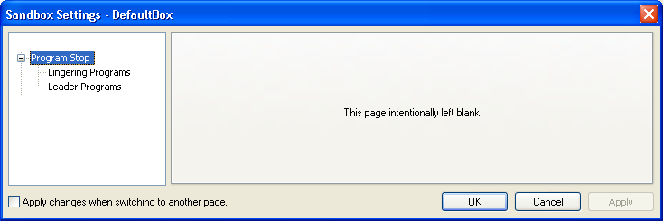
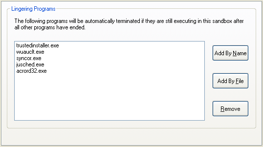
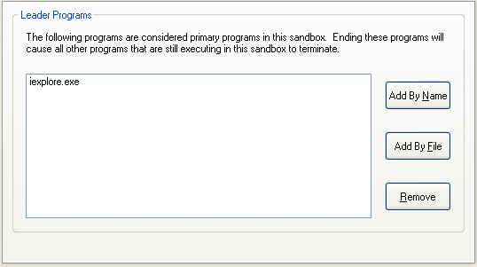

# Program Stop Settings

Sandboxie は、残っているサンドボックス化されたプロセスをいつ停止すべきかの決定、初期化中の互換性のためのプロセスの再起動、および終了要求の処理方法の選択のために、いくつかの独立した設定を提供します。leader と linger の分類は SandboxieRpcSs によってサンドボックス内で評価されます。SandMan と Sandboxie Control は構成インターフェイスを提供しますが、そのランタイム分類自体を実行しません。

## Leader クリーンアップ

[LeaderProcess](LeaderProcess.md) は 1 つ以上のプライマリ実行可能イメージを識別します。構成されたリーダーは、まず実行中であることが観察されている必要があります。その後、構成されたリーダー イメージがいずれも残っていない場合、Sandboxie は残りのプロセスの終了を要求します。

複数のエントリは集合的に動作します。`browser.exe` と `viewer.exe` の両方が構成され観察されている場合、`viewer.exe` がまだ実行されている間は `browser.exe` の終了によってクリーンアップはトリガーされません。リーダーによってトリガーされるクリーンアップは、linger 固有の寛容性、最近のプロセスの猶予、および可視ウィンドウのチェックをバイパスします。

```ini
[DefaultBox]
LeaderProcess=browser.exe
LeaderProcess=viewer.exe
```

名前は正確かつ大文字と小文字を区別せずに照合されます。現在のコンシューマーはワイルドカードを解釈しません。

## Linger クリーンアップ

[LingerProcess](LingerProcess.md) は、通常の非 linger プロセスが残っていない後にクリーンアップ候補になり得るヘルパーまたはバックグラウンドの実行可能ファイルを識別します。一致するプロセスは、開始されたという理由だけで、またはその名前がリストに表示されるという理由だけで終了されるわけではありません。クリーンアップは、残っている関連するすべてのプロセスが lingerer として分類され、該当する例外が妨げない場合にのみ検討されます。Sandboxie はまた、自身の一部のヘルパー プロセスを内部的に lingerer として扱います。

```ini
[DefaultBox]
LingerProcess=helper.exe
LingerProcess=updater.exe
```

名前は正確かつ大文字と小文字を区別せずに照合されます。ワイルドカードは現在のコンシューマーによってサポートされていません。

### LingerLeniency

`LingerLeniency` はボックスごとのブール設定で、既定は `y` です。有効な場合、次の 3 つの互換性動作を提供します:

1. SandboxieRpcSs が初期化されるときに既にアクティブな構成済み lingerer が保持されます。
2. 関連する強制または `Start.exe` パスを通じて明示的に開始された構成済み lingerer が免除されます。
3. 最近開始された残りのプロセスが、自動 linger クリーンアップの前に現在の 5 秒の猶予チェックを受けます。

```ini
[DefaultBox]
LingerLeniency=n
```

`n` に設定すると、これらの寛容性の動作が無効になります。5 秒の間隔はこの設定を通じて構成可能な期間ではありません。`LingerLeniency` は Sandboxie Plus 1.0.7 / Classic 5.55.7 で導入されました。Sandboxie Plus 1.13.4 / Classic 5.68.4 は無効化された動作を拡張し、`n` が 5 秒の猶予チェックも削除するようにしました。

### 可視ウィンドウの例外

[LingerExemptWnds](LingerExemptWnds.md) は既定で `y` です。自動 linger クリーンアップがそれ以外の点で対象となる場合、残っているサンドボックス プロセスが可視のトップレベル ウィンドウを持っていれば、残りのクリーンアップ候補を保持します。`n` に設定すると、その例外が削除されます。プロセスを lingerer として分類したり、それ自体で終了を開始したりするものではありません。

## プロセス初期化の再起動設定

これらの設定は、プロセスの初期化中の互換性の再起動に関するものです。クラッシュ回復サービスではなく、アプリケーションが後に正常に終了した後に再起動するものでもありません。

### ForceRestart

`ForceRestart` は繰り返し可能なボックスごとのリストです。強制されたプロセスが構成されたイメージ名に大文字と小文字を区別せずに正確に一致する場合、Sandboxie は通常の実行が続行される前に、現在の強制プロセス再起動パスを通じてそれをクリーンに再起動します。ワイルドカードは現在のコンシューマーによってサポートされていません。

```ini
[DefaultBox]
ForceRestart=program.exe
```

個々の `ForceRestart` エントリ専用の現在の SandMan リスト エディターはありません。この設定は Sandboxie Plus 0.8.0 / Classic 5.50.0 で導入されました。

### ForceRestartAll

`ForceRestartAll` はボックスごとのブール設定で、既定では無効です。有効な場合、強制プロセス再起動パスは `ForceRestart` でリストされたイメージだけでなく、すべての強制プロセスに適用されます。

```ini
[DefaultBox]
ForceRestartAll=y
```

SandMan は、**Sandbox Options > Various Options > Compatibility** の下で **Restart force process before they begin to execute** としてこれを公開しています。設定メタデータはバージョン 0.8.0 をリストしています。専用の UI オプションは Sandboxie Plus 1.14.5 / Classic 5.69.5 で追加されました。

### NoRestartOnPCA

Windows Program Compatibility Assistant は PCA ジョブ内でプロセスを起動できます。Sandboxie の PCA ジョブ フラグを持つ非 AppContainer プロセスの場合、Sandboxie はまず PCA 再起動パスを処理します。この PCA 分岐は、別個の強制プロセス `ForceRestart` / `ForceRestartAll` 分岐より優先されます。PCA 条件が一致する場合、その初期化のために強制プロセス分岐は評価されません。

```ini
[DefaultBox]
NoRestartOnPCA=y
```

`NoRestartOnPCA=y` は通常の PCA 再起動を抑制します。PCA 条件が既にその分岐を選択しているため、再起動を抑制しても同じプロセス初期化のために `ForceRestart` または `ForceRestartAll` にフォールスルーしません。したがって、この設定は `ForceRestartAll` から独立しており、そのエイリアスまたは下位スイッチではありません。

SandMan は、**Sandbox Options > Various Options > Compatibility** の下で反転された肯定オプション **Restart forced processes that were launched within a PCA (Program Compatibility Assistant) job object** を提示します。`NoRestartOnPCA` が存在しないか `n` の場合、チェックボックスは選択されています。チェックを外すと、否定の `NoRestartOnPCA=y` 設定が保存されます。SandMan は `ForceRestartAll` が選択されている間、このチェックボックスを無効にします。

修正された `NoRestartOnPCA` の綴りは Sandboxie Plus 1.11.4 / Classic 5.66.4 で文書化されました。専用のチェックボックスは Sandboxie Plus 1.16.7 で追加されました。

## Global Terminate All からの除外 {#global-terminate-all-exclusion}

`ExcludeFromTerminateAll` はボックスごとのブール設定で、既定では無効です。SandMan の通常のグローバル **Terminate All Processes** 操作は、次で構成されたボックスをスキップします:

```ini
[DefaultBox]
ExcludeFromTerminateAll=y
```

これは、通常のボックスごとの終了、leader または linger クリーンアップ、または他のすべての終了ルートを妨げません。SandMan は、**Sandbox Options > Various Options > Compatibility** の下で **Exclude this sandbox from being terminated when "Terminate All Processes" is invoked.** としてこの設定を公開しています。設定メタデータはバージョン 1.12.0 をリストしています。

構成されたグローバル終了/パニック ホットキーには、その 1 秒のカウンター ウィンドウ内に別個の繰り返しアクティブ化の上書きがあります。最初のアクティブ化は通常の操作を実行し、2 番目の迅速なアクティブ化は意図的に終了を実行せず、3 番目以降の迅速なアクティブ化は除外をバイパスしてグローバル終了を呼び出します。この動作は特にホットキーに属します。通常のメニュー コマンドを繰り返しクリックすることは同じメカニズムではありません。

## 終了ルート {#termination-route}

`TerminateUsingService` は事実上グローバルのブール設定で、既定は `y` です。有効な場合、Sandboxie はまずサービス支援のプロセス キャンセルを試みます。それが成功しない場合、通常のカーネル スケジュールされた終了パスにフォールバックします。`TerminateUsingService=n` の場合、サービス支援の試行はスキップされます。

```ini
[GlobalSettings]
TerminateUsingService=n
```

これは保証されたグレースフル シャットダウンではありません。通常のプロセスごとの終了ルートを選択し、[Job Objects](JobObjects.md) で説明されている `TerminateJobObject` 動作とは別個です。Leader および linger クリーンアップは最終的に通常の kill-all 動作を要求します。設定メタデータはバージョン 0.8.5 をリストしており、専用の現在の SandMan エディター コントロールは特定されていません。

## クリーンアップによってサンドボックスが空になる場合

Leader または linger クリーンアップは、サンドボックスを空にすることによって間接的に `OnBoxTerminate` イベントにつながることがあります。どちらの設定もトリガーを直接実行しません。SandMan が空のボックスへの通常の遷移を観察すると、文書化されたライフサイクルには、該当する場合、クリーンアップ前の `OnBoxTerminate`、回復または [Auto Delete](AutoDelete.md) 処理、および `OnBoxDelete` が含まれることがあります。詳細な順序については [SandMan Triggers](SandManTriggers.md) を参照してください。

## Sandboxie Plus インターフェイス

**Sandbox Options > Program Control > Stop Behaviour** を開きます。関連するタブは次のとおりです:

* `LingerProcess` エントリ用の **Lingering Programs**。
* `LeaderProcess` エントリ用の **Leader Programs**。
* **Don't stop lingering processes with windows** と **Use Linger Leniency** を含む **Stop Options**。

上記の再起動およびグローバル終了除外コントロールは、**Sandbox Options > Various Options > Compatibility** の下にあります。

## Sandboxie Control Classic

Sandboxie Control は、その歴史的な **Program Stop** ページを保持しています:

[Sandboxie Control](SandboxieControl.md) > [Sandbox Settings](SandboxSettings.md) > Program Stop



### Lingering Programs {#lingering-programs}

[Sandboxie Control](SandboxieControl.md) > [Sandbox Settings](SandboxSettings.md) > Program Stop > Lingering Programs



このページは [LingerProcess](LingerProcess.md) を構成します。[Program Settings](ProgramSettings.md#linger) ウィンドウも歴史的なプログラムごとのショートカットを提供します。

### Leader Programs {#leader-programs}

[Sandboxie Control](SandboxieControl.md) > [Sandbox Settings](SandboxSettings.md) > Program Stop > Leader Programs



このページは [LeaderProcess](LeaderProcess.md) を構成します。[Program Settings](ProgramSettings.md#leader) ウィンドウも歴史的なプログラムごとのショートカットを提供します。

共有ランタイムは互換性のある手動 INI 設定を使用できますが、Sandboxie Control Classic が SandMan によって公開されるすべての新しいライフサイクル オプションの専用コントロールを提供すると想定すべきではありません。

## 変更の適用

`LeaderProcess` および `LingerProcess` リストは、SandboxieRpcSs が初期化されるときに読み込まれます。`LingerLeniency` は初期化時とその後のクリーンアップ チェック中の両方で読み取られ、`LingerExemptWnds` はクリーンアップ評価中に読み取られます。leader、linger、寛容性、または再起動ポリシーを変更した後に予測可能な動作を得るには、影響を受けるサンドボックス プロセス ツリーを再起動または再作成してください。

`ForceRestart`、`ForceRestartAll`、および `NoRestartOnPCA` は、プロセスの初期化中に読み取られます。`ExcludeFromTerminateAll` は SandMan がグローバル終了を実行するときに読み取られ、`TerminateUsingService` は関連する各ドライバー終了要求に対して読み取られます。これらの設定が変更されたという理由だけで、サービスまたはドライバーの再起動は通常必要ありません。
