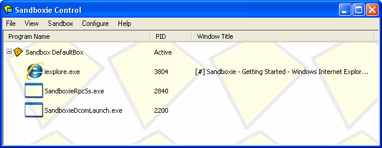

# Programs View

[Sandboxie Control](SandboxieControl.md) > [View Menu](ViewMenu.md) > [Programs](ViewMenu.md#programs)

_Programs View_ は [Sandboxie Control](SandboxieControl.md) の既定の表示モードです。各サンドボックスで実行されているプログラムがここに表示され、サンドボックス名でグループ化されます。リストには 3 つの列が表示されます:

*   _Program Name_ 列には、プログラムの実行可能ファイルの名前が表示されます。たとえば、画像には Internet Explorer の実行可能ファイル名である _iexplore.exe_ が表示されています。
    *   サンドボックスを表す行では、この列にサンドボックスの名前が表示されます。

*   _PID_ 列には、プログラムのプロセス ID が表示されます。これは Windows タスク マネージャーのプロセス タブに表示される同じ番号です。(Windows タスク マネージャーは、キーボード ショートカット Ctrl+Shift+Esc または Windows ログオン画面につながる Ctrl+Alt+Del を押すと表示されます。)

*   _Window Title_ 列には、プログラムのメイン ウィンドウに関連付けられたタイトルが表示されます。

各 _Active_ サンドボックス行の先頭にある小さな _+_ または _-_ アイコンを使用して、サンドボックス内のプログラムの表示を展開または折りたたみます。

**コンテキスト メニュー**

_Programs View_ はサンドボックスとプログラムのコンテキスト メニューを提供します。ある行の項目 (サンドボックスまたはプログラム) のコンテキスト メニューを表示するには、次のいずれかを行います:

*   行の任意の場所でマウスの右ボタンをクリックします。

*   マウスまたはキーボードを使用して行を選択 (ハイライト) し、Shift+F10 を押します。

*   マウスまたはキーボードを使用して行を選択 (ハイライト) し、[View Menu -> Context Menu](ViewMenu.md#context-menu) コマンドを使用します。

サンドボックス行の場合、表示されるコンテキスト メニューは [Sandbox Menu -> Sandbox Sub-Menu](SandboxMenu.md#sandbox-sub-menu) と同じです。完全な説明についてはそちらを参照してください。

プログラム行の場合、コンテキスト メニューは次のコマンドを提供します:

*   _Terminate Program_ コマンドはプログラムを終了します。

*   _Program Settings_ コマンドは、そのプログラムの [Program Settings](ProgramSettings.md) ウィンドウを表示します。

*   _Resource Access_ コマンドは、[Sandbox Settings > Resource Access](ResourceAccessSettings.md) 設定ページのグループを表示し、プログラム名がプログラム名フィルター (_The list above applies to_ フィルター) で事前に選択されます。

* * *

[Sandboxie Control](SandboxieControl.md)、[Files And Folders View](FilesAndFoldersView.md)、[Help Topics](HelpTopics.md) に移動します。
