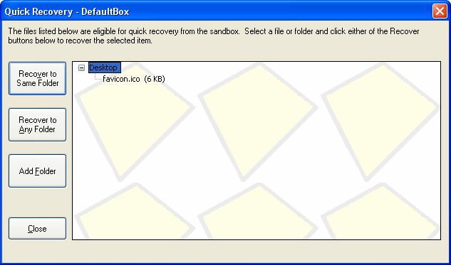

# Quick Recovery

以下のメニュー パスとスクリーンショットは Sandboxie Control / Classic を説明しています。現在の Sandboxie Plus では、SandMan は **Sandbox Options > File Recovery > Quick Recovery** の下で回復場所を構成し、別個の Quick Recovery ウィンドウを開きます。スキャンは [`AutoRecover`](AutoRecover.md) とは独立しています。[File Recovery Architecture](RecoveryArchitecture.md) を参照してください。

[Sandboxie Control](SandboxieControl.md) > [Sandbox Menu](SandboxMenu.md) > Quick Recovery

[Sandboxie Control](SandboxieControl.md) > [Tray Icon Menu](TrayIconMenu.md) > Quick Recovery

サンドボックス化されたプログラムはサンドボックス内にファイルとフォルダーを作成します。これらの作成されたファイルの一部をサンドボックスの外に移動したいことがあります。たとえば、サンドボックス化されたブラウザーによってダウンロードされたドキュメント ファイルはサンドボックスに保存されますが、そのファイルを抽出してサンドボックスの外の _Documents_ フォルダーに配置する必要があります。

基本的なアプローチは、通常のサンドボックス化されていない Windows Explorer を使用して、サンドボックスを構成するフォルダー内を移動することです。[Sandbox Menu > Sandbox > Explore Contents](SandboxMenu.md#sandbox-menu) コマンドを使用すると、サンドボックスへのビューを持つ (サンドボックス化されていない) フォルダー ウィンドウを開くことができます。その後、サンドボックス フォルダーの深部を移動し、サンドボックス化されたファイルを_切り取り_、他の場所に_貼り付け_することができます。

Quick Recovery 機能は、サンドボックス化されたプログラムによって作成および保存されたファイル (およびフォルダー全体) を抽出しやすくします。構成されたリテラル回復フォルダーを再帰的にスキャンし、一致するファイル (およびフォルダー) をリストします。ワイルドカード `RecoverFolder` エントリは、任意のスキャン ルートではなく候補フィルターとして機能します。ウィンドウはすべてのボックス化されたファイルを表示することもできます。選択した項目は、サンドボックスの外の対応する場所、または別の場所に回復できます。

Quick Recovery ウィンドウを呼び出すには、[Sandbox Menu > Sandbox > Quick Recovery](SandboxMenu.md#sandbox-menu) コマンド ([Tray Icon Menu](TrayIconMenu.md) の対応するコマンド) を使用します。Quick Recovery は [Delete Sandbox](DeleteSandbox.md) ウィンドウの一部としても表示されます。

**Quick Recovery ウィンドウ**

ウィンドウの右下隅まで広がる中央領域には、特定のサンドボックス内のクイック回復可能なファイルとフォルダーが表示されます。ファイルまたはフォルダーを選択し、左側の 2 つの _Recover to_ ボタンのいずれかをクリックします:

*   _Recover to Same Folder_ は、ファイル (またはフォルダー) をサンドボックスからサンドボックスの外の対応する場所に移動します。たとえば、上の画像はサンドボックス化された _Desktop_ フォルダー内のファイル _favicon.ico_ を示しています。このコマンドをファイルに対してクリックすると、実際のデスクトップ フォルダーに移動されます。
*   _Recover to Any Folder_ は、まず _Browse For Folder_ ダイアログ ボックスを表示し、次にファイル (またはフォルダー) をダイアログ ボックスで選択されたフォルダーに移動します。

これらのコマンドは、ファイルまたはフォルダーでコンテキスト メニューを呼び出す (通常はその上でマウスの右ボタンをクリックする) 場合にも使用できます。

**Quick Recovery へのフォルダーの追加**

前述のとおり、構成されたリテラル フォルダーが通常の Quick Recovery スキャン ルートを提供します。現在の新しいボックスの既定には _Desktop_ と _Documents_ (_Personal_)、および利用可能な場合は _Downloads_ が含まれます。_Favorites_ は現在の既定ではありません。これらはボックス作成時の設定であり、すべてのボックスに固有のスキャン ルートではありません。有効なテンプレートも有効な `RecoverFolder` エントリを提供できます。

*   _Add Folder_ ボタンを使用してさらにフォルダーを追加できます。
*   [Sandbox Settings > Recovery > Quick Recovery](RecoverySettings.md#quick-recovery) を使用してフォルダーを追加および削除できます。
*   [Sandboxie Control](SandboxieControl.md) が [Files And Folders View](FilesAndFoldersView.md) ビューにある場合、フォルダーを右クリックして _Add Folder to Quick Recovery_ を選択できます。

SandMan では、[`UseAutoRecoverIgnoreForQuick`](UseAutoRecoverIgnoreForQuick.md) が [`AutoRecoverIgnore`](AutoRecoverIgnore.md) に一致するエントリを非表示にできます。**Show All Files** と **Show Ignored** はそれ以外の場合は非表示のエントリを公開できます。このフィルター処理は自動回復が有効であることを必要としません。

現在の SandMan は、選択された回復をホスト側の移動として実行します。既存の宛先を上書きする前に確認を求めることがあり、失敗を報告します。すべての回復が成功することを保証するものではありません。再利用可能な代替宛先はユーザー インターフェイスの設定であり、`RecoverFolder` ボックス ルールではありません。

* * *

[Delete Sandbox](DeleteSandbox.md)、[Immediate Recovery](ImmediateRecovery.md)、[Sandboxie Control](SandboxieControl.md)、[Help Topics](HelpTopics.md) に移動します。
