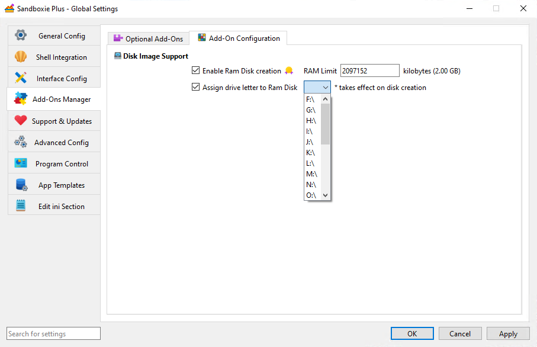

# Ram Disk Letter

_RamDiskLetter_ は [Sandboxie Ini](SandboxieIni.md) のグローバルな作成時設定 (v1.11.1 / 5.66.1 で導入) で、[UseRamDisk](UseRamDisk.md) が有効なサンドボックスによって使用される共有 RAM ディスク バックエンドに、オプションで可視のドライブ文字を割り当てます。ボックスごとの別個のドライブ文字割り当てではありません。

## 使用法

`RamDiskLetter` を設定するには、Sandboxie 構成ファイルの `[GlobalSettings]` セクションに次の行を追加します:

```ini
[GlobalSettings]

# Example for assigning the drive letter R to the RAM disk
RamDiskLetter=R:\
```

## SandMan GUI

RAM ディスク文字の設定は次を通じて選択できます:

1. SandMan インターフェイスで `Global Settings` ウィンドウを開きます。
2. `Add-Ons Manager` > `Add-On Configuration` タブに移動します。
3. `Assign drive letter to Ram Disk` 設定を有効にし、RAM ディスクのドライブ文字を選択します。

    

SandMan は直接のグローバル値を読み書きします。有効な構成には適用可能なテンプレートも含まれることがあります。上に示す正規形式 (`R:\` など) を書き込みます。

## 重要な注意事項

- **共有ドライブ文字**: 構成された文字は個々のサンドボックスではなく、共有 RAM ボリュームを参照します。可視の文字は分離またはアクセス制御の境界を追加しません。

- **オプションのマッピング**: 有効な構成済み文字がない場合、通常の作成パスは依然として作成/フォーマット用の一時的な空き文字を取得し、その後そのマッピングを削除しようとします。サンドボックスは可視のドライブ文字を保持せずにそのルート ジャンクションを使用できます。一時的な空き文字は依然として利用可能でなければなりません。

- **利用可能なドライブ文字**: 正規の `R:\` 形式で未使用の文字を使用します。明示的に構成された文字が作成中に無効または既に使用中の場合、そのパスは自動的に別の文字を選択せず、要求されたマウントを続行できません。

## 変更の適用

共有 RAM バックエンドが新しく作成される前に、目的の文字を構成します。この設定を変更またはクリアしても、構成を再読み込みしても、既存のバックエンドの文字は変わりません。新しい値は、後の取得が新しいバックエンドを作成するときにのみ使用され、単にボックスが再度開かれたという理由では使用されません。共有バックエンドを破棄する前に、必要な揮発性コンテンツを保存してください。

## アクセスの容易さ

特定のドライブ文字を割り当てると、RAM ボリュームをファイル パスで参照および閲覧しやすくなります。通常のサンドボックス操作には依然としてオプションです。

## 関連設定

- [RamDiskSizeKb](RamDiskSizeKb.md) - 共有 RAM ディスクの要求容量を指定します。
- [UseRamDisk](UseRamDisk.md) - 個々のサンドボックスで RAM ディスクの使用を有効にします。
