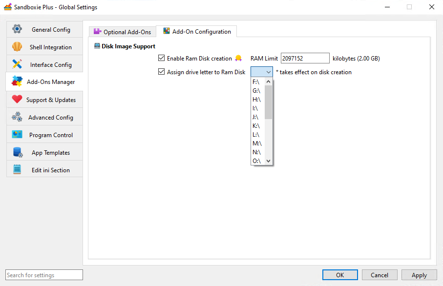

# Ram Disk Size Kb

_RamDiskSizeKb_ は [Sandboxie Ini](SandboxieIni.md) のグローバル設定 (v1.11.0 / 5.66.0 で導入) で、[UseRamDisk](UseRamDisk.md) が有効なサンドボックスによって使用される共有 RAM ディスク バッキングの要求容量を KiB 単位で指定します。ボックスごとのクォータでも、その量の物理 RAM の即時割り当てでもありません。

## 使用法

`RamDiskSizeKb` を設定するには、Sandboxie 構成ファイルの `[GlobalSettings]` セクションに次の行を追加します:

```ini
[GlobalSettings]

# Example for a 2 GiB RAM disk
RamDiskSizeKb=2097152
```

## SandMan GUI

RAM ディスク サイズの設定は次を通じて設定できます:

1. SandMan インターフェイスで `Global Settings` ウィンドウを開きます。
2. `Add-Ons Manager` > `Add-On Configuration` タブに移動します。
3. `Enable Ram Disk creation` を有効にし、`RAM Limit` フィールドに容量を入力します。

    

サイズ フィールドが空の状態で有効にすると、SandMan は `2097152` KiB (2 GiB) を提案します。これは UI が提案する値であり、サービスのフォールバックや即時のメモリ予約ではありません。コントロールは直接のグローバル値を読み書きします。有効な構成には適用可能なテンプレートも含まれることがあります。

## 重要な注意事項

- **共有容量**: RAM バックエンドのボックスは 1 つの共有バックエンドを使用します。1 つのボックスが消費した領域は、他のボックスのための利用可能なファイルシステム領域を減らします。この設定はボックスごとに独立した容量を構成しません。

- **作成の最小値**: 新しいバックエンドの作成には少なくとも `102400` KiB (100 MiB) が必要です。サービスの値欠落時のフォールバックは `0` です。有効値の欠落またはゼロ、およびしきい値未満の値では、通常の新規作成に進みません。ちょうど `102400` はこの最小チェックを通過しますが、作成の成功を保証するものではありません。

- **容量とメモリ**: 構成されたバッキング容量、現在のコミット済みメモリ、物理常駐、および使用可能な NTFS 空き領域は異なる量です。データ メモリは Windows のコミット可用性に従って段階的にコミットされます。ファイルシステムとバッキングのオーバーヘッドも使用可能な領域を減らします。構成された値は、その量の空きファイル領域の約束ではありません。

- **揮発性ストレージ**: 共有バックエンドにのみ保存されたコンテンツは、そのバックエンドが実際に破棄されると失われます。必要なデータは事前に永続ストレージに保存してください。同じ RAM ボリューム上のスナップショットは永続的な独立バックアップではありません。

- **ドライブ文字の割り当て**: [RamDiskLetter](RamDiskLetter.md) は、バックエンドが作成されるときにオプションで可視のドライブ文字を割り当てます。

## 変更の適用

サービスは、新しい共有バックエンドを作成する必要があるときに、有効なグローバル サイズを参照します。この設定の変更または構成の再読み込みは、既存の RAM ディスクのサイズを変更しません。現在のサイズ設定が欠落またはゼロであっても、既存のバックエンドは再利用できます。

変更されたサイズは、以前の共有 RAM バックエンドが実際に削除され、後の取得が新しいものを作成するときにのみ使用されます。アプリケーションや SandMan を閉じること、または単にサービスを再起動することは、その再作成を保証しません。バックエンドの破棄前に必要な揮発性コンテンツを保存してください。

## パフォーマンスの考慮事項

- システム メモリ リソースと共有ファイルシステムの空き領域を監視します。段階的な割り当てはメモリ逼迫による失敗を排除しません。
- 一時ファイル ストレージ、開発ワークロード、およびテストが可能な用途です。パフォーマンスは、永続ストレージに対する普遍的な速度優位ではなく、ワークロードとメモリ逼迫に依存します。

## 関連設定

- [UseRamDisk](UseRamDisk.md) - 個々のサンドボックスで RAM ディスクの使用を有効にします。
- [RamDiskLetter](RamDiskLetter.md) - 新しく作成された RAM ディスクのドライブ文字をオプションで指定します。
