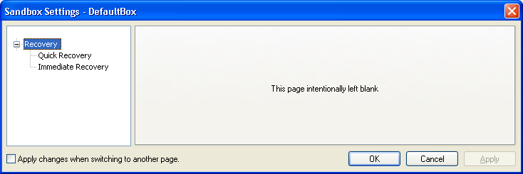
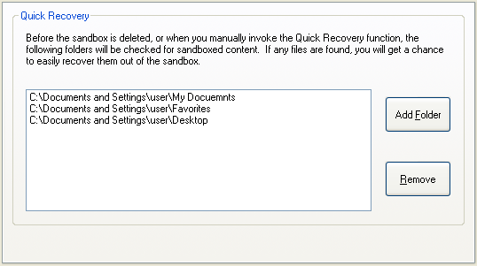
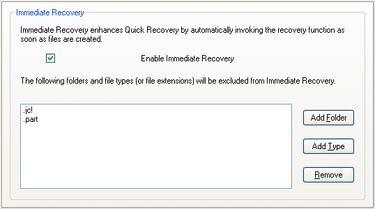

# Recovery Settings

このページは Sandboxie Control / Classic の回復設定を示します。現在の SandMan ワークフローと、自動検出、Quick Recovery スキャン、およびホスト側のファイル移動の違いについては、[File Recovery Architecture](RecoveryArchitecture.md) を参照してください。

### 「Recovery」設定グループ

[Sandboxie Control](SandboxieControl.md) > [Sandbox Settings](SandboxSettings.md) > Recovery:

サンドボックスの内容を手動で探索して必要なファイルを抽出することもできますが、Sandboxie には特定のフォルダーをスキャンし、サンドボックスの外への回復に利用可能なファイルがあれば通知する [Quick Recovery](QuickRecovery.md) ツールがあります。Classic の Recovery グループは Quick Recovery の場所と Immediate Recovery 検出を構成します。

* * *

### Quick Recovery {#quick-recovery}

[Sandboxie Control](SandboxieControl.md) > [Sandbox Settings](SandboxSettings.md) > Recovery > Quick Recovery:

この設定ページを使用して、Sandboxie によってスキャンされるべきフォルダーを追加および削除します。

この設定に間接的に影響を与えることもできます:

*   [Files And Folders View](FilesAndFoldersView.md) で、_フォルダー_項目を右クリックし、_Add Folder to Quick Recovery_ または _Remove Folder from Quick Recovery_ アクションを呼び出します。

*   [Delete Sandbox](DeleteSandbox.md) または [Quick Recovery](QuickRecovery.md) ウィンドウで、_Add Folder_ ボタンをクリックします。

関連する [Sandboxie Ini](SandboxieIni.md) 設定: [RecoverFolder](RecoverFolder.md)。

* * *

### Immediate Recovery

[Sandboxie Control](SandboxieControl.md) > [Sandbox Settings](SandboxSettings.md) > Recovery > Immediate Recovery:

Quick Recovery は、Classic の削除ワークフローを含め、呼び出されたときにフォルダーをスキャンします。[Immediate Recovery](ImmediateRecovery.md) は、サンドボックス化されたファイル アクティビティ中に対象となるファイルを別途検出し、それらについて通知できます。

Classic の新しいボックスの既定ではこの動作が有効ですが、無効にできます。`AutoRecover` が存在しない場合のランタイム フォールバックは無効です。現在の SandMan の新規ボックス ウィザードも明示的に有効にできます。

Immediate Recovery を有効のままにしつつ、一部のファイル タイプを Immediate Recovery から除外したいこともあります。たとえば: (サンドボックス化された) デスクトップに保存されたドキュメント ファイルについては Immediate Recovery 通知を受け取りたいが、サンドボックス化されたプログラムのインストール中にデスクトップに作成される可能性のあるショートカット (_.LNK_) ファイルについては受け取りたくない場合があります。

この設定ページを使用して、Immediate Recovery 拡張を有効または無効にし、Immediate Recovery への除外を構成します。

関連する [Sandboxie Ini](SandboxieIni.md) 設定: [AutoRecover](AutoRecover.md)、[AutoRecoverIgnore](AutoRecoverIgnore.md)。
