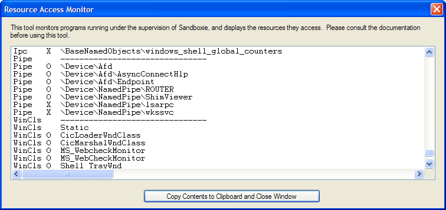

# リソース アクセス モニター (Sandboxie Classic 用)

リソース アクセス モニターは、サンドボックス化されたプログラムによってアクセスされたシステム リソースを表示します。これは、[Sandboxie Trace](SandboxieTrace.md) オプションで使用される共有モニターの Sandboxie Control Classic ビューアーであり、互換性の問題に関与するリソースを特定するのに役立ちます。

**重要:** 新しい問題を報告する前に、リソース アクセス モニターの使用を検討してください。

## モニターの使用

1\. モニターをアクティブにするには、[Sandboxie Control](SandboxieControl.md) ウィンドウを展開または開き、**File > Resource Access Monitor** を選択します。

2\. 通常、いずれかのサンドボックスでプログラムが実行される前にモニターをアクティブにする必要があります。リソース アクセス モニター ウィンドウは、そのメニューを含む [Sandboxie Control](SandboxieControl.md) メイン ウィンドウへのアクセスをブロックするため、[トレイ アイコン メニュー](TrayIconMenu.md)を通じてサンドボックス化されたプログラムを開始する必要があることに注意してください。

3\. モニターがアクティブになり、そのウィンドウが画面に表示されると、実行中のすべてのサンドボックス化されたプログラムからリソース アクセス情報を即座に収集して表示し始めます。

4\. この時点で、Sandboxie の監督下で実行すると失敗する特定のタスクを実行します。

5\. 最後に、**Copy Contents to Clipboard and Close Window** をクリックします。これにより、収集されたデータがクリップボードにコピーされ、モニター サブスクリプションが閉じられます。

6\. これで、収集されたデータをどこかに貼り付け (Ctrl+V)、分析に利用できるようにすることができます。

## パフォーマンスへの影響

共有モニター バッファーと Classic ビューアーは、リソース アクセス モニターが閉じられている間は非アクティブです。明示的に有効にされたトレース設定は、このビューアーが閉じられていても、独立して診断作業を追加する場合があります。監視がアクティブな間、オーバーヘッドはイベント量と有効なトレース オプションに依存します。

ネットワーク管理者は [MonitorAdminOnly](MonitorAdminOnly.md) を使用して、共有モニターのアクティブ化を Administrators グループのメンバーに制限できます。
