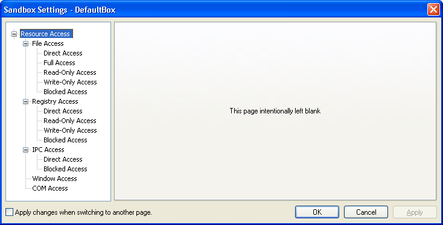
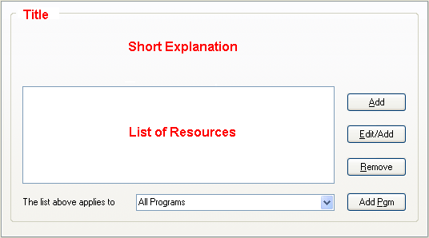

# Resource Access Settings

### 「Resource Access」設定グループ

[Sandboxie Control](SandboxieControl.md) > [Sandbox Settings](SandboxSettings.md) > Resource Access

サンドボックス内で実行されるプログラムは、一般にシステム リソースに直接アクセスすることを許可されません。場合によっては、このルールに例外を設けることが望ましいことがあります。ここの設定はその例外のセットを表示および変更します。

複数のルールが同じリソースに一致する場合、結果は [Rule Specificity](../PlusContent/RuleSpecificity.md) がアクティブかどうか、どのプロセス セレクターが適用されるか、リソース パターンがどのように一致するか、およびルールが表すアクセス モードによって異なります。

例外が便利または必要な例:

*   特定のフォルダーへの直接アクセスを許可します。たとえば、Web ブラウザーがダウンロードを _Downloads_ フォルダーに直接配置できるようにします。 
    下の [File Access](ResourceAccessSettings.md#file-access) カテゴリを参照してください。
*   プログラムが正しく動作するために一部のリソースへのアクセスを必要とすることがあります。プログラムが既知で信頼できる場合、そのような例外を設けることは妥当です。いくつかの例については [Known Conflicts](KnownConflicts.md) を参照してください。

構成の変更は、構成が変更された時点で既にサンドボックス化されて実行されているプログラムには適用されません。単純にするため、サンドボックス内でプログラムが実行されていないときに構成を変更することをお勧めします。

* * *

### 一般情報 {#general-information}

Resource Access グループ内の各設定ページは、一般に次の特徴を持ちます:

*   ページの_タイトル_があります。たとえば、_Direct File Acccess_ や _Read-Only Registry Access_ です。
*   設定が何をするかを説明する_短い説明_があります。

*   特別な扱いを受けるリソースを示す_リソースのリスト_があります。
    *   特定の設定に応じて、それらのリソースがサンドボックス化されたプログラムから完全にアクセス可能になることを意味することがあります。
    *   または、それらのリソースがまったくアクセスできなくなることを意味することがあります。
    *   _短い説明_は、それらのリソースとそれらにアクセスするプログラムとの関係を簡単に説明します。
    *   これが何を意味するかを完全に理解するには、特定の設定に関する以下のドキュメントも参照してください。
    *   リスト内のリソースは特定のプログラムにのみ適用されることがあります。ただし、一般には_All Programs_に適用されます。

*   リストに新しいリソース エントリを追加する_Add_ ボタンがあります。
*   リスト内のリソース エントリを編集するか、リストに新しいリソース エントリを追加する_Edit/Add_ (_Edit_ のみの場合もあります) があります。
*   リストからリソース エントリを削除する _Remove_ ボタンがあります。

*   _The list above applies to._ というラベルのリスト ボックスがあります。このリスト ボックスはリソースを特定のプログラムに関連付けます。
    *   既定では、上の例に示すように、リソースは _All Programs_ に適用されます。
    *   リスト ボックスからそのプログラムを選択して、リソースを特定のプログラムに適用するよう選択できます。
    *   特定のプログラムの名前をリスト ボックスに直接入力することもできます。
    *   _Add Pgm_ ボタンを使用して、フォルダーに移動して特定のプログラムを選択することもできます。

* * *

### File Access {#file-access}

[Sandboxie Control](SandboxieControl.md) > [Sandbox Settings](SandboxSettings.md) > Resource Access > File Access

このカテゴリは次の種類のリソースを管理します: ファイル、フォルダー、ドライブ、およびその他のデバイス。

リソースの編集と特定のプログラムへのリソースの関連付けの詳細については、上の[一般情報](ResourceAccessSettings.md#general-information)を参照してください。

#### File Access > Direct Access {#file-access-direct-access}

Sandboxie の監督をバイパスして、一部のファイルまたはフォルダーへの直接アクセスを許可します。たとえば、フォルダー **C:\Downloads** を追加すると、Sandboxie の下で実行されているプログラムはそのフォルダー内のファイルを作成または更新できるようになります。

_直接アクセス_の除外は、プログラム自体がサンドボックス内にある場合は適用されないことに注意してください。たとえば、**C:\Downloads** フォルダーへの直接アクセスを許可し、その後新しい Web ブラウザーをサンドボックスにインストールするとします。この新しいサンドボックス化されたブラウザーは **C:\Downloads** フォルダーへの直接アクセスを_持ちません_。

関連する [Sandboxie Ini](SandboxieIni.md) 設定: [OpenFilePath](OpenFilePath.md)

#### File Access > Full Access {#file-access-full-access}

_直接アクセス_に似ていますが、サンドボックス化されたプログラム自体がサンドボックス内にある場合でも常に適用されます。より良い保護のため、可能な場合は常に _Full Access_ ではなく _Direct Access_ を使用することをお勧めします。

関連する [Sandboxie Ini](SandboxieIni.md) 設定: [OpenPipePath](OpenPipePath.md)

#### File Access > Read-Only Access {#file-access-read-only-access}

このアクセス モードは、ファイル (またはフォルダー) リソースに対するサンドボックス化の効果を除外し、プログラムが実際のリソースを変更せずに読み取ることを許可します。

関連する [Sandboxie Ini](SandboxieIni.md) 設定: [ReadFilePath](ReadFilePath.md)

#### File Access > Write-Only Access {#file-access-write-only-access}

このアクセス モードは通常、選択されたパスでの通常のファイル オープンに対してホスト側の内容を非表示にしつつ、作成およびアクセス チェックの対象として、対応するサンドボックスの場所にファイルとフォルダーを作成できるようにします。

Write-Only Access はフォルダーだけでなくファイルにも適用されます。ホストとサンドボックス コピーの両方のアクセスを閉じる _Blocked Access_ とは異なり、選択された _Write-Only Access_ ルールは通常、サンドボックス コピー側を許可しつつホスト側を閉じます。操作と付与されたハンドル権限が許せば、既存のサンドボックス コピーは読み取り可能なままにできます。

これは操作が成功することを保証するものではありません。結果は、有効なルール、既存のサンドボックス コピーの状態、要求された操作とアクセス権、作成条件、Windows のアクセス許可、および適用可能な仮想化と強制のパスによって異なります。

関連する [Sandboxie Ini](SandboxieIni.md) 設定: [WriteFilePath](WriteFilePath.md)

#### File Access > Blocked Access {#file-access-blocked-access}

リソースへのすべてのアクセスを拒否します。たとえば、機密データを含むフォルダーに対して。[Rule Specificity](../PlusContent/RuleSpecificity.md) が無効な場合、一致する _Blocked Access_ ルールは他の File Access モードに対して古典的な優先順位を持ちます。Rule Specificity が有効な場合、競合は specificity とプロセス一致のルールを使用して解決されるため、より具体的な適用可能ルールが優先されることがあります。

関連する [Sandboxie Ini](SandboxieIni.md) 設定: [ClosedFilePath](ClosedFilePath.md)

* * *

### Registry Access {#registry-access}

[Sandboxie Control](SandboxieControl.md) > [Sandbox Settings](SandboxSettings.md) > Resource Access > Registry Access

このカテゴリはレジストリ キー リソースを管理します。レジストリは、プログラムが構成と設定を保存するために Windows が提供するメカニズムです。

リソースの編集と特定のプログラムへのリソースの関連付けの詳細については、上の[一般情報](ResourceAccessSettings.md#general-information)を参照してください。

#### Registry Access > Direct Access {#registry-access-direct-access}

レジストリ キー リソースへの直接アクセスを許可します。_直接アクセス_の除外は、プログラム自体がサンドボックス内にある場合は適用されないことに注意してください。これは上の File Access カテゴリでより詳細に説明されています。File Access カテゴリとは異なり、レジストリ キーには _Full Access_ アクセス モードがないことに注意してください。

関連する [Sandboxie Ini](SandboxieIni.md) 設定: [OpenKeyPath](OpenKeyPath.md)

#### Registry Access > Read-Only Access {#registry-access-read-only-access}

このアクセス モードは、レジストリ キー リソースに対するサンドボックス化の効果を除外し、プログラムが実際のリソースを変更せずに読み取ることを許可します。

関連する [Sandboxie Ini](SandboxieIni.md) 設定: [ReadKeyPath](ReadKeyPath.md)

#### Registry Access > Write-Only Access {#registry-access-write-only-access}

このアクセス モードは、サンドボックスの外にある選択されたレジストリ キー内に位置するすべてのレジストリ データを非表示にします。ただし、サンドボックス内のプログラムは、サンドボックス内の対応するフォルダー内に新しいレジストリ データを作成できます。

関連する [Sandboxie Ini](SandboxieIni.md) 設定: [WriteKeyPath](WriteKeyPath.md)

#### Registry Access > Blocked Access {#registry-access-blocked-access}

レジストリ キー リソースへのすべてのアクセスを拒否します。たとえば、Windows ポリシー設定を含むキーに対して。[Rule Specificity](../PlusContent/RuleSpecificity.md) が無効な場合、一致する _Blocked Access_ ルールは他の Registry Access モードに対して古典的な優先順位を持ちます。Rule Specificity が有効な場合、より具体的な適用可能ルールが優先されることがあります。

関連する [Sandboxie Ini](SandboxieIni.md) 設定: [ClosedKeyPath](ClosedKeyPath.md)

* * *

### IPC Access {#ipc-access}

[Sandboxie Control](SandboxieControl.md) > [Sandbox Settings](SandboxSettings.md) > Resource Access > IPC Access

このカテゴリは NT IPC オブジェクトの除外を管理します。これらのリソースは、操作を調整したり、その他の方法で通信したりする方法として、システムを実行しているプログラムによって作成されます。

リソースの編集と特定のプログラムへのリソースの関連付けの詳細については、上の[一般情報](ResourceAccessSettings.md#general-information)を参照してください。

#### IPC Access > Direct Access {#ipc-access-direct-access}

IPC オブジェクト リソースへの直接アクセスを許可します。File Access および Registry Access カテゴリとは異なり、IPC オブジェクトの_直接アクセス_除外は常にすべてのサンドボックス化されたプログラムに適用されることに注意してください。

関連する [Sandboxie Ini](SandboxieIni.md) 設定: [OpenIpcPath](OpenIpcPath.md)

#### IPC Access > Blocked Access {#ipc-access-blocked-access}

IPC オブジェクト リソースへのすべてのアクセスを拒否します。一般的な IPC オブジェクト一致は Closed、Normal、および Open ルールを比較します。[Rule Specificity](../PlusContent/RuleSpecificity.md) が無効な場合、一致する _Blocked Access_ ルールは古典的な優先順位を持ちます。Rule Specificity が有効な場合、より具体的な適用可能な Normal または Open IPC ルールが優先されることがあります。別個の `ReadIpcPath=$:...` ターゲット プロセス ポリシーはこの一般的な IPC 比較に参加しません。

この設定は、Sandboxie の既定の _IPC Access > Direct Access_ 設定を上書きしてアクセスをブロックするために使用できます。たとえば、既定では Sandboxie はサンドボックス化されたプログラムがオーディオ デバイスにアクセスすることを許可します。これを上書きしてサンドボックス化されたプログラムによるオーディオ出力を遮断するには、**\RPC Control\AudioSrv** の除外を追加します。

関連する [Sandboxie Ini](SandboxieIni.md) 設定: [ClosedIpcPath](ClosedIpcPath.md)

* * *

### Window Access {#window-access}

[Sandboxie Control](SandboxieControl.md) > [Sandbox Settings](SandboxSettings.md) > Resource Access > Window Access

このカテゴリはウィンドウ クラスの除外を管理します。これらのリソースは主に画面に表示されるウィンドウに関連しますが、操作を調整したり、その他の方法で通信したりする方法としてプログラムで使用することもできます。サンドボックスの外で作成されたどのウィンドウ クラスがサンドボックス化されたプログラムで使用可能になるかを指定できます。

リソースの編集と特定のプログラムへのリソースの関連付けの詳細については、上の[一般情報](ResourceAccessSettings.md#general-information)を参照してください。

関連する [Sandboxie Ini](SandboxieIni.md) 設定: [OpenWinClass](OpenWinClass.md)

* * *

### COM Access {#com-access}

[Sandboxie Control](SandboxieControl.md) > [Sandbox Settings](SandboxSettings.md) > Resource Access > COM Access

このカテゴリは COM クラスの除外を管理します。これらのリソースは、操作を調整したり、その他の方法で通信したりする方法として使用されるオブジェクトを表します。サンドボックスの外に存在し、サンドボックス化されたプログラムからアクセス可能であるべき COM オブジェクトの COM クラス識別子を指定できます。

リソースの編集と特定のプログラムへのリソースの関連付けの詳細については、上の[一般情報](ResourceAccessSettings.md#general-information)を参照してください。

関連する [Sandboxie Ini](SandboxieIni.md) 設定: [OpenClsid](OpenClsid.md)
