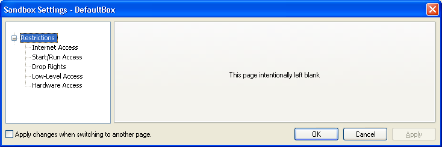
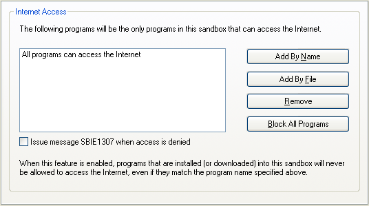
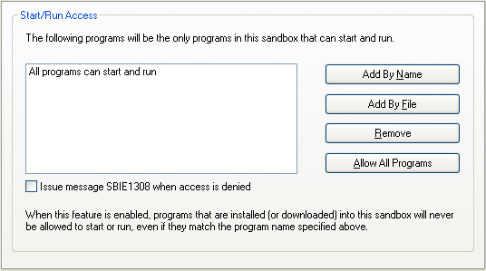
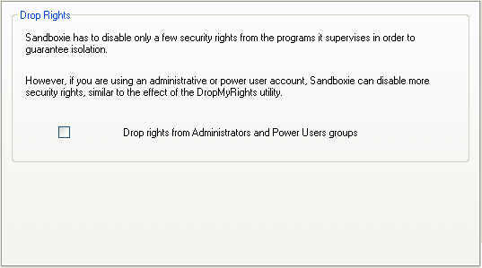
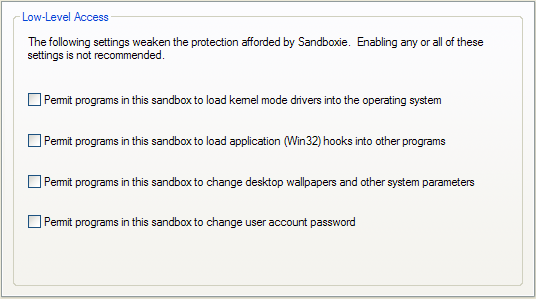
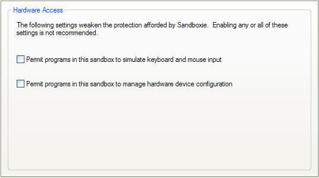

# Restrictions Settings

### 「Restrictions」設定グループ

[Sandboxie Control](SandboxieControl.md) > [Sandbox Settings](SandboxSettings.md) > Restrictions

このセクションの設定は、Sandboxie がサンドボックス内で実行されるプログラムに課す既定の制限のセットを変更することを目的としています。

*   サンドボックスのセキュリティを強化するために、プログラムに追加の制限を課すことができます。
*   一部の既定の制限を緩和できます。これは通常は推奨されませんが、一部の特殊なプログラムが動作するようになることがあります。

* * *

### Internet Access {#internet-access}

[Sandboxie Control](SandboxieControl.md) > [Sandbox Settings](SandboxSettings.md) > Restrictions > Internet Access

これらの設定を使用して、サンドボックス内でインターネットにアクセスすることを許可するプログラムを選択します。最初は、サンドボックス内のすべてのプログラムがインターネットにアクセスできます。

_Add by Name_ ボタンを使用して、明示的な実行可能ファイル名を入力してプログラムを追加します。または、_Add by File_ ボタンを使用してプログラム フォルダーに移動し、そのプログラム実行可能ファイルを選択します。~~SMB/CIFS のブロック。[BlockPort](BlockPort.md) にアクセスしてブロックすることもできます。~~

_あらゆる_制限が有効な場合、サンドボックスにインストール (またはダウンロード) されたプログラムは、インターネットにアクセスすることを決して許可されません。

_Remove_ ボタンを使用して、以前にリストに追加されたプログラムを削除します。

_Block All Programs_ ボタンは、サンドボックス内のすべてのプログラムがインターネットにアクセスすることを防ぎます。このモードが有効な場合、ボタンは _Allow All Programs_ に変わり、クリックするとすべてのプログラムのブロックの効果が取り消されます。

_Issue message [SBIE1307](SBIE1307.md) when access is denied_: この設定によりプログラムが制限されると、Sandboxie は通知メッセージを発行できます。このチェックボックス設定を使用して、これらの通知を受け取りたいかどうかを示します。メッセージ [SBIE1307](SBIE1307.md) も参照してください。

この設定は [Program Settings](ProgramSettings.md) ウィンドウでも構成できます。

関連する [Sandboxie Ini](SandboxieIni.md) 設定: [ClosedFilePath](ClosedFilePath.md)、[Notify Internet Access Denied](NotifyInternetAccessDenied.md)。

* * *

### Start/Run Access {#startrun-access}

[Sandboxie Control](SandboxieControl.md) > [Sandbox Settings](SandboxSettings.md) > Restrictions > Start/Run Access

これらの設定を使用して、サンドボックス内で開始および実行することを許可するプログラムを選択します。最初は、サンドボックス内のすべてのプログラムがサンドボックス内で開始および実行できます。

_Add by Name_ ボタンを使用して、明示的な実行可能ファイル名を入力してプログラムを追加します。または、_Add by File_ ボタンを使用してプログラム フォルダーに移動し、そのプログラム実行可能ファイルを選択します。

_あらゆる_ Start/Run 制限が有効な場合、サンドボックスにインストール (またはダウンロード) されたプログラムは、開始または実行することを決して許可されません。

_Remove_ ボタンを使用して、以前にリストに追加されたプログラムを削除します。_Allow All Programs_ は、リストに表示されるすべてのエントリで _Remove_ をクリックするのと同じ効果があります。

_Issue message [SBIE1308](SBIE1308.md) when access is denied_: この設定によりプログラムが制限されると、Sandboxie は通知メッセージを発行できます。このチェックボックス設定を使用して、これらの通知を受け取りたいかどうかを示します。メッセージ [SBIE1308](SBIE1308.md) も参照してください。

この設定は [Program Settings](ProgramSettings.md) ウィンドウでも構成できます。

関連する [Sandboxie Ini](SandboxieIni.md) 設定: [ClosedIpcPath](ClosedIpcPath.md)、[Notify Start Run Access Denied](NotifyStartRunAccessDenied.md)。

* * *

### Drop Rights

[Sandboxie Control](SandboxieControl.md) > [Sandbox Settings](SandboxSettings.md) > Restrictions > Drop Rights

このページの設定は、Sandboxie がこのサンドボックス内で実行されるプログラムから管理者権限を剥奪するようにします。

具体的には、サンドボックス化されたプログラムを開始するために使用されるセキュリティ資格情報に、Administrators および Power Users グループのメンバーシップが含まれなくなります。

既に非管理者ユーザー アカウントで実行している場合、これの効果はほとんどないことに注意してください。

関連する [Sandboxie Ini](SandboxieIni.md) 設定: [DropAdminRights](DropAdminRights.md)。

* * *

### Low-Level Access -削除済み {#low-level-access-removed}

## Hardware Access は Sandboxie v4 以降で削除されました。

### 以前のバージョンの Sandboxie は使用すべきではなく、機能しない可能性があります。

[Sandboxie Control](SandboxieControl.md) > [Sandbox Settings](SandboxSettings.md) > Restrictions > Low-Level Access

このカテゴリは、サンドボックス内で何らかの方法で制限されるいくつかの種類のグローバル操作の制限を管理します。詳細については、関連する [Sandboxie Ini](SandboxieIni.md) 設定を参照してください。

*   _Permit programs in this sandbox to load kernel mode drivers into the operating system_
    *   関連する [Sandboxie Ini](SandboxieIni.md) 設定: [BlockDrivers](BlockDrivers.md)

*   _Permit programs in this sandbox to load application (Win32) hooks into other programs_
    *   関連する [Sandboxie Ini](SandboxieIni.md) 設定: [BlockWinHooks](BlockWinHooks.md)

*   _Permit programs in this sandbox to change desktop wallpaper and other system parameters_
    *   関連する [Sandboxie Ini](SandboxieIni.md) 設定: [BlockSysParam](BlockSysParam.md)

*   _Permit programs in this sandbox to change user account password_
    *   関連する [Sandboxie Ini](SandboxieIni.md) 設定: [BlockPassword](BlockPassword.md)
    *   メッセージ [SBIE1309](SBIE1309.md) も参照してください。

* * *

### Hardware Access -削除済み {#hardware-access-removed}

## Hardware Access は Sandboxie v4 以降で削除されました。

### 以前のバージョンの Sandboxie は使用すべきではなく、機能しない可能性があります。

[Sandboxie Control](SandboxieControl.md) > [Sandbox Settings](SandboxSettings.md) > Restrictions > Hardware Access

このカテゴリは、サンドボックス内で何らかの方法で制限される 3 種類のグローバル操作の制限を管理します。詳細については、関連する [Sandboxie Ini](SandboxieIni.md) 設定を参照してください。

*   _Permit programs in this sandbox to simulate keyboard and mouse input_
    *   関連する [Sandboxie Ini](SandboxieIni.md) 設定: [BlockFakeInput](BlockFakeInput.md)
    *   メッセージ [SBIE1304](SBIE1304.md) も参照してください。

*   _Permit programs in this sandbox to manage hardware device configuration_
    *   関連する [Sandboxie Ini](SandboxieIni.md) 設定: _Template=PlugPlay_
    *   この設定により、プログラムはハードウェア デバイスの構成とドライバーを更新できます。

ハードウェア アクセス設定は既定の無効の状態に保つことをお勧めします。

ただし、サンドボックス内でゲームやその他の全画面アプリケーションを実行する場合、キーボードとマウス入力のシミュレーションを許可すると役立つことがあります。
