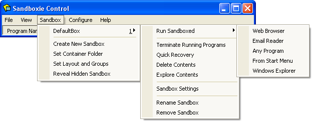

# サンドボックス メニュー

[Sandboxie Control](SandboxieControl.md) > サンドボックス メニュー

* * *

### サンドボックス サブメニュー

定義されているサンドボックスごとに 1 つ以上のサブメニューが表示されます。既定の構成には _DefaultBox_ という名前のサンドボックスが 1 つだけ含まれていますが、[新しいサンドボックスの作成](SandboxMenu.md#create-new-sandbox)コマンドを使用して追加できます。各サブメニューには次のコマンドが含まれます。

*   _Run Sandboxed_（サンドボックス内で実行）サブサブメニューは、Sandboxie の監視下でプログラムを起動するために使用します。
*   _Web Browser_ コマンドは、システム（既定）の Web ブラウザーを起動します。 
    （注: 誤ったプログラムが起動する場合は、[よくある質問](FrequentlyAskedQuestions.md#why-does-the-wrong-program-start-when-i-run-my-default-web-browser-sandboxed)を参照して修正してください。）
*   _Email Reader_ コマンドは、システム（既定）の電子メール リーダーを起動します。
*   _Any Program_ コマンドは、標準の Windows の _Run..._ ダイアログ ボックスに似た Run Any Program ダイアログ ボックスを表示します。Sandboxie の監視下で、プログラムの起動、ドキュメントを開く、フォルダーの参照に使用できます。
*   _From Start Menu_ コマンドは、標準の Windows スタート メニューに似た Sandboxie スタート メニューを表示します。スタート メニューやデスクトップに表示されるプログラムやその他のショートカットを起動するために使用できます。サンドボックスにプログラムがインストールされている場合、Sandboxie スタート メニューにはインストール中に作成されたショートカットが含まれることに注意してください。
*   _Windows Explorer_ コマンドは、サンドボックス化された Windows エクスプローラーのインスタンスを起動します。Sandboxie の監視下で、フォルダーの参照やプログラムの起動に使用できます。
*   _Terminate Running Programs_ コマンドは、サンドボックスで実行されているすべてのプログラムを停止します。
*   _Quick Recovery_ コマンドは、[クイック復元](QuickRecovery.md)ウィンドウを表示します。
*   _Delete Contents_ コマンドは、[サンドボックスの削除](DeleteSandbox.md)ウィンドウを表示します。
*   _Explore Contents_ コマンドは、サンドボックスの内容を**Sandboxie の監視外で**（_サンドボックス化されていない_フォルダー ビューで）開きます。可能であれば、[ファイルとフォルダー ビュー](FilesAndFoldersView.md)を使用してサンドボックスの内容を参照してください。
*   _Sandbox Settings_ コマンドは、[サンドボックス設定](SandboxSettings.md)ウィンドウを開きます。
*   _Rename Sandbox_ コマンドは、サンドボックスの名前を変更します。
*   _Remove Sandbox_ コマンドは、[新しいサンドボックスの作成](SandboxMenu.md#create-new-sandbox)コマンドを使用して作成したサンドボックスを削除します。

これらのコマンドは、Rename Sandbox と Remove Sandbox を除き、[トレイ アイコン メニュー](TrayIconMenu.md)でも使用できます。

* * *

### 新しいサンドボックスの作成

_Create New Sandbox_（新しいサンドボックスの作成）コマンドは、Sandboxie に新しいサンドボックスを定義します。新しいサンドボックスの名前を尋ねるダイアログ ボックス ウィンドウが表示されます。名前は数字と文字の任意の組み合わせで、最大長は 32 文字です。コンボ ボックス ボタンで既存のサンドボックスを指定すると、その設定が新しいサンドボックスにコピーされます。そのような既存のサンドボックスが選択されていない場合、新しいサンドボックスには最初に既定の設定セットが適用されます。サンドボックスが作成されたら、[サンドボックス設定](SandboxSettings.md)ウィンドウを使用してサンドボックス設定を変更できます。

* * *

### コンテナ フォルダーの設定

_Set Container Folder_（コンテナ フォルダーの設定）コマンドは、他のすべてのサンドボックスを含むコンテナ（またはマスター、親）フォルダーを選択します。既定の場所は **X:\\Sandbox\\%USER%\\%SANDBOX%** です。ここで **X:** は Windows がインストールされているドライブ（通常は **C:**）を表します。

特殊変数 **%SANDBOX%** はサンドボックスの名前に置き換えられます。

特殊変数 **%USER%** は、そのサンドボックスを使用しているユーザー アカウント（またはログオン）の名前に置き換えられます。1 つのユーザー アカウントで作成されたサンドボックスは、システム内の他のアカウントから見えて使用できることに注意してください。ただし、コンテナ フォルダーに **%USER%** 特殊変数が含まれている場合、ユーザー アカウントは実際には同じサンドボックスを共有しません。各アカウントがサンドボックスの別々のインスタンスを持ちます。

関連する [Sandboxie Ini](SandboxieIni.md) 設定: [FileRootPath](FileRootPath.md)。

* * *

### レイアウトとグループの設定

Sandboxie Control Classic では、_Set Layout and Groups_（レイアウトとグループの設定）コマンドを使用して、メニューやリストに表示されるときにサンドボックスをグループの階層内で並べ替えることができます。Classic はこのレイアウトをレガシーな `BoxDisplayOrder` 設定を使用して保存します。この整理は、サンドボックス内でのプログラムの動作には影響しません。

現在の SandMan は、メインのサンドボックス ツリーでグループを直接管理し、ユーザーごとの階層を [`BoxGrouping`](BoxGrouping.md) を使用して保存します。各サンドボックスは独立して構成されたままであり、グループ化は設定の継承や追加の分離を提供しません。

グループが定義されると、[Sandboxie Control](SandboxieControl.md) のメインの[プログラム ビュー](ProgramsView.md)にコンボ ボックス ボタンが含まれ、表示されるサンドボックスのリストを制限するために使用できます。

関連する [Sandboxie Ini](SandboxieIni.md) 設定: Sandboxie Control Classic 用のレガシーな `BoxDisplayOrder` と、現在の SandMan 用の [`BoxGrouping`](BoxGrouping.md)。

* * *

### 非表示のサンドボックスを表示

_Reveal Hidden Sandbox_（非表示のサンドボックスを表示）コマンドは、現在のユーザー アカウントから見えない、または使用できないサンドボックスがある場合にのみメニューに表示されます。サンドボックスは、[サンドボックス設定](SandboxSettings.md)ウィンドウの[ユーザー アカウント設定](UserAccountsSettings.md)設定ページを使用して、特定のユーザー アカウントに制限できます。_Reveal Hidden Sandbox_ コマンドは、現在のユーザー アカウントで使用できなくなったサンドボックスの表示を復元できます。

* * *

[Sandboxie Control](SandboxieControl.md#menus)、[ヘルプ トピック](HelpTopics.md)に進みます。
