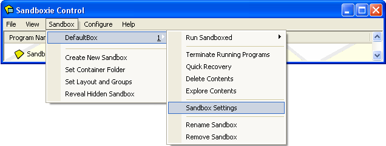
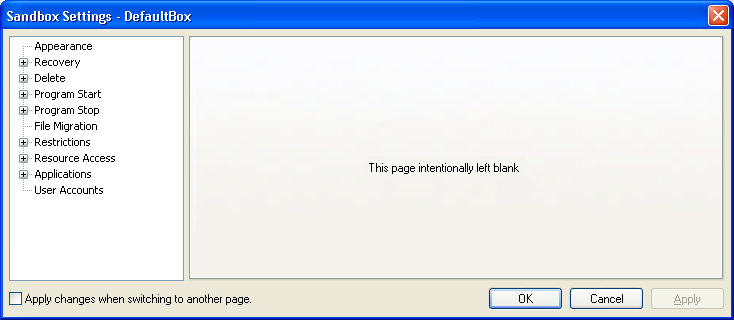

# Sandbox Settings

[Sandboxie Control](SandboxieControl.md) の Sandbox Settings ウィンドウは、単一のサンドボックスに関連付けられた構成とオプションを表示および変更します。Sandbox Settings ウィンドウには 2 つの方法でアクセスできます:

*   メニュー バーから: [Sandbox Menu](SandboxMenu.md) にアクセスし、リストされたサンドボックスの 1 つを選択して、_Sandbox Settings_ コマンドを選択します:

*   コンテキスト メニューから: メイン ウィンドウ領域で、サンドボックスの名前を右クリック (または Shift+F10 を押) し、_Sandbox Settings_ コマンドを選択します。(詳細については、[Programs View](ProgramsView.md) または [Files And Folders View](FilesAndFoldersView.md) のコンテキスト メニューに関する説明を参照してください。)

新しいサンドボックスが追加されない限り、Sandboxie は 1 つのサンドボックス DefaultBox のみをリストすることに注意してください。

* * *

Sandbox Settings ウィンドウでは、個々の設定は設定ページに編成され、一部のページは以下に示すようにグループに編成されます。

ウィンドウの左部分にはページとグループが含まれています。左部分で設定ページが選択 (クリック) されると、ウィンドウの右部分に関連する設定が表示されます。

特定のページで変更が行われた場合、他の設定ページに移動する前に変更を Sandboxie に適用する必要があります。これは、Apply ボタンを使用して手動で、またはウィンドウの下部にあるチェックボックス (「Apply changes when switching to another page」) をマークすることによって自動的に行うことができます。

以下のセクションでは、各設定ページを説明します。

構成の変更は、構成が変更された時点で既にサンドボックス化されて実行されているプログラムには適用されません。単純にするため、サンドボックス内でプログラムが実行されていないときに構成を変更することをお勧めします。

* * *

設定の詳細については、次のページを参照してください:

*   [Appearance Settings](AppearanceSettings.md)

*   [Recovery Settings](RecoverySettings.md)

*   [Delete Settings](DeleteSettings.md)

*   [Program Start Settings](ProgramStartSettings.md)

*   [Program Stop Settings](ProgramStopSettings.md)

*   [File Migration Settings](FileMigrationSettings.md)

*   [Restrictions Settings](RestrictionsSettings.md)

*   [Resource Access Settings](ResourceAccessSettings.md)

*   [Applications Settings](ApplicationsSettings.md)

*   [User Accounts Settings](UserAccountsSettings.md)
