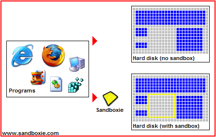
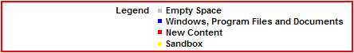

# Sandboxie

迷惑なソフトウェア、スパイウェア、マルウェアへの対処にうんざりしていませんか? 望まないソフトウェアの削除に何時間も費やしていませんか? 見慣れない Web リンクをクリックすることに不安を感じていませんか?

## Sandboxie の紹介

Sandboxie は、プログラムを分離された空間で実行し、コンピューター上の他のプログラムやデータに永続的な変更を加えられないようにします。

 

赤い矢印は、実行中のプログラムからコンピューターに流れ込む変更を示しています。_Hard disk (no sandbox)_ と書かれたボックスは、通常どおり実行されているプログラムによる変更を示しています。_Hard disk (with sandbox)_ と書かれたボックスは、Sandboxie の下で実行されているプログラムによる変更を示しています。このアニメーションは、Sandboxie が変更を傍受し、黄色い四角形で描かれた**サンドボックス**内にそれらを分離できることを示しています。また、変更をまとめることで、それらをすべて一度に簡単に削除できることも示しています。

## 分離されたサンドボックスの利点

*   安全な Web ブラウジング: Web ブラウザーを Sandboxie の保護下で実行するということは、ブラウザーによってダウンロードされたすべての悪意のあるソフトウェアがサンドボックス内に閉じ込められ、簡単に破棄できることを意味します。
*   プライバシーの強化: Web ブラウジング中に収集された閲覧履歴、Cookie、キャッシュされた一時ファイルはサンドボックス内に留まり、Windows に漏れ出しません。
*   安全な電子メール: メールに潜んでいる可能性のあるウイルスやその他の悪意のあるソフトウェアは、サンドボックスから抜け出すことができず、実際のシステムに感染させることもできません。
*   Windows を軽量に保つ: ソフトウェアを分離されたサンドボックスにインストールすることで、Windows の消耗を防ぎます。

**[今すぐ Sandboxie をダウンロード](https://github.com/sandboxie-plus/Sandboxie/releases/latest)して試してみましょう!**

* * *

**Sandboxie の[ヘルプ トピック](../Content/HelpTopics.md)を確認するか、[サポート ページ索引](../Content/AllPages.md)にアクセスしてください。**
