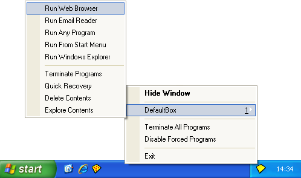

# トレイ アイコン メニュー

トレイ アイコン メニューからコマンドを呼び出すには、システム通知領域（通常は画面の右下隅）に表示される Sandboxie のトレイ アイコンを右クリックします。

* * *

### ウィンドウを隠す / ウィンドウを表示

最初のコマンドは、[Sandboxie Control](SandboxieControl.md) のメイン ウィンドウが表示されているときは _Hide Window_（ウィンドウを隠す）です。メイン ウィンドウが非表示のときは _Show Window_（ウィンドウを表示）に変わります。このコマンドは Sandboxie Control のメイン ウィンドウを表示または非表示にします。

* * *

### サンドボックス サブメニュー

定義されているサンドボックスごとに 1 つ以上のサブメニューが表示されます。既定の構成には _DefaultBox_ という名前のサンドボックスが 1 つだけ含まれていますが、[サンドボックス メニュー](SandboxMenu.md)を使用して追加できます。各サブメニューには次のコマンドが含まれます。

*   _Run Web Browser_ コマンドは、システム（既定）の Web ブラウザーを起動します。 
    [サンドボックス メニュー](SandboxMenu.md) -> _(サンドボックス)_ -> Run Sandboxed -> Web Browser と同じです。 
    （注: 誤ったプログラムが起動する場合は、[よくある質問](FrequentlyAskedQuestions.md#why-does-the-wrong-program-start-when-i-run-my-default-web-browser-sandboxed)を参照して修正してください。）
*   _Run Email Reader_ コマンドは、システム（既定）の電子メール リーダーを起動します。 
    [サンドボックス メニュー](SandboxMenu.md) -> _(サンドボックス)_ -> Run Sandboxed -> Email Reader と同じです。
*   _Run Any Program_ コマンドは、標準の Windows の _Run..._ ダイアログ ボックスに似た Run Any Program ダイアログ ボックスを表示します。Sandboxie の監視下で、プログラムの起動、ドキュメントを開く、フォルダーの参照に使用できます。 
    [サンドボックス メニュー](SandboxMenu.md) -> _(サンドボックス)_ -> Run Sandboxed -> Any Program と同じです。
*   _Run From Start Menu_ コマンドは、標準の Windows スタート メニューに似た Sandboxie スタート メニューを表示します。スタート メニューやデスクトップに表示されるプログラムやその他のショートカットを起動するために使用できます。サンドボックスにプログラムがインストールされている場合、Sandboxie スタート メニューにはインストール中に作成されたショートカットが含まれることに注意してください。 
    [サンドボックス メニュー](SandboxMenu.md) -> _(サンドボックス)_ -> Run Sandboxed -> From Start Menu と同じです。
*   _Run Windows Explorer_ コマンドは、サンドボックス化された Windows エクスプローラーのインスタンスを起動します。Sandboxie の監視下で、フォルダーの参照やプログラムの起動に使用できます。 
    [サンドボックス メニュー](SandboxMenu.md) -> _(サンドボックス)_ -> Run Sandboxed -> Windows Explorer と同じです。
*   _Terminate Programs_ コマンドは、サンドボックスで実行されているすべてのプログラムを停止します。 
    [サンドボックス メニュー](SandboxMenu.md) -> _(サンドボックス)_ -> Terminate Running Programs と同じです。
*   _Quick Recovery_ コマンドは、[クイック復元](QuickRecovery.md)ウィンドウを表示します。 
    [サンドボックス メニュー](SandboxMenu.md) -> _(サンドボックス)_ -> Quick Recovery と同じです。
*   _Delete Contents_ コマンドは、[サンドボックスの削除](DeleteSandbox.md)ウィンドウを表示します。 
    [サンドボックス メニュー](SandboxMenu.md) -> _(サンドボックス)_ -> Delete Contents と同じです。
*   _Explore Contents_ コマンドは、サンドボックスの内容を**Sandboxie の監視外で**（_サンドボックス化されていない_フォルダー ビューで）開きます。可能であれば、[ファイルとフォルダー ビュー](FilesAndFoldersView.md)を使用してサンドボックスの内容を参照してください。 
    [サンドボックス メニュー](SandboxMenu.md) -> _(サンドボックス)_ -> Explore Contents と同じです。

* * *

### すべてのプログラムを終了

_Terminate All Programs_（すべてのプログラムを終了）コマンドは、すべてのサンドボックスで実行されているすべてのプログラムを停止します。 
[ファイル メニュー](FileMenu.md) -> Terminate All Programs と同じです。

関連項目: [ファイル メニュー](FileMenu.md)の[すべてのプログラムを終了](FileMenu.md#terminate-all-programs)。

* * *

### 強制プログラムを無効化

_Disable Forced Programs_（強制プログラムを無効化）トグル コマンドは、強制サンドボックス化を一時的に無効化および再有効化します。[ファイル メニュー](FileMenu.md)の関連コマンドを参照してください。ファイル メニューのコマンドとは異なり、トレイ アイコンのコマンドはコマンドの期間を変更するダイアログ ボックスを表示しないことに注意してください。代わりに、強制サンドボックス化は最後に指定された期間、または既定の 10 秒間中断されます。 
[ファイル メニュー](FileMenu.md) -> Disable Forced Programs と同じです。

関連項目: [ファイル メニュー](FileMenu.md)の[強制プログラムを無効化](FileMenu.md#disable-forced-programs)。

* * *

### UAC 管理者として実行

_Run As UAC Administrator_（UAC 管理者として実行）（図には表示されていません。[ファイル メニュー](FileMenu.md)を参照）トグル コマンドは、プログラムを起動する前に管理者特権への昇格を要求するよう Sandboxie に指示します。このコマンドは、Windows でユーザー アカウント制御 (UAC) が有効であり、ユーザー アカウントがまだ昇格されていない場合にのみ使用できます。このコマンドがメニューで使用できる場合、通常はプログラムをサンドボックスにインストールする前に有効にする必要があり、インストールが完了したら無効にすることをお勧めします。 
[ファイル メニュー](FileMenu.md) -> Run As UAC Administrator と同じです。

関連項目: [ファイル メニュー](FileMenu.md)の [UAC 管理者として実行](FileMenu.md#run-as-uac-administrator)。

* * *

### 終了

_Exit_（終了）コマンドは [Sandboxie Control](SandboxieControl.md) を終了します。ウィンドウを閉じるだけ（または _Hide Window_ コマンドを選択するだけ）では Sandboxie Control は終了**しない**ことに注意してください。 
[ファイル メニュー](FileMenu.md) -> Exit と同じです。

* * *

[Sandboxie Control](SandboxieControl.md#menus)、[ヘルプ トピック](HelpTopics.md)に進みます。
