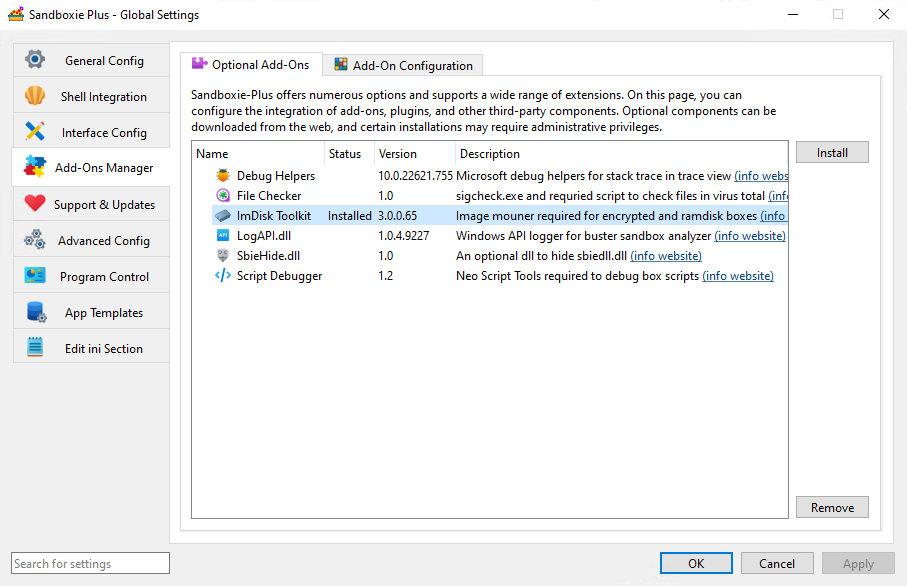
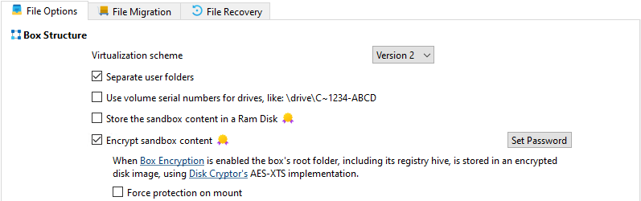
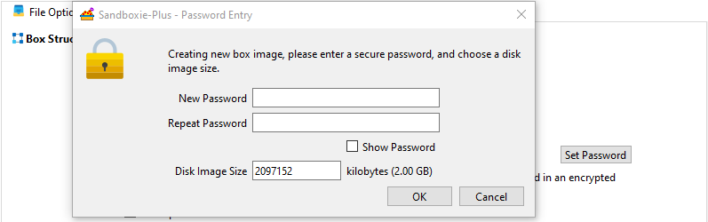
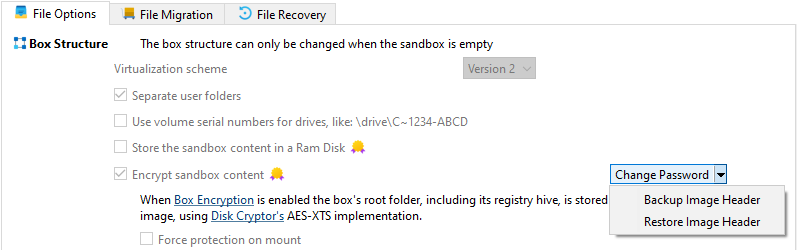
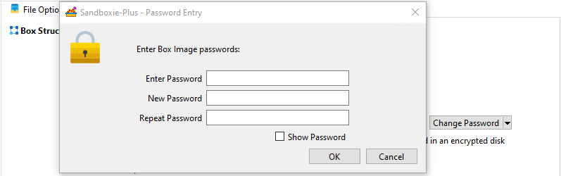
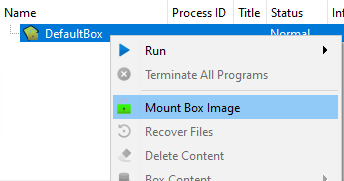
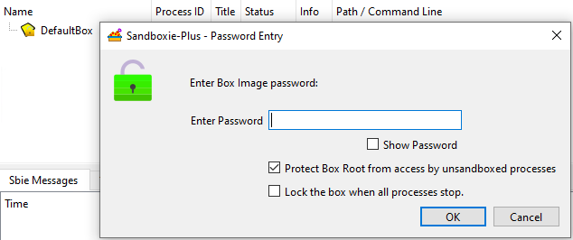
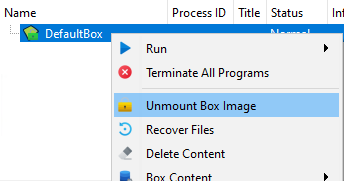

# Use File Image

_UseFileImage_ は [Sandboxie Ini](SandboxieIni.md) のサンドボックス設定で、Sandboxie Plus 1.11.0 / Classic 5.66.0 で導入されました。サンドボックスの通常のファイル ルートの下にある物理的なバッキングを変更します。Sandboxie の論理ファイル仮想化はそのストレージの上にそのまま残ります。

通常のサービス ワークフローは、ImBox および ImDisk を通じてマウントされた永続的な暗号化 `.box` イメージを使用します。ImBox がイメージ/暗号化バッキングを提供し、ImDisk が仮想ディスクを提供し、Sandboxie のサービスとドライバーが統合とマウントされたルートの保護を提供します。

> [!NOTE]
> この機能には、暗号化機能を備えた現在有効な [Support Certificate](https://sandboxie-plus.com/supporter-certificate/) が必要です。

## 前提条件

**Global Settings > Add-Ons Manager > Optional Add-Ons** を通じて **ImDisk Toolkit** をインストールします。



ImDisk デバイス/ドライバーが利用可能で、期待される機能/バージョンで応答する必要があります。SandMan は、インストーラー レコードが存在するかどうかだけでなく、デバイスの準備状態をチェックします。

## 構成

意図したサンドボックスで設定を直接構成します:

```ini
[DefaultBox]

UseFileImage=y
```

サービスは、適用可能なテンプレートおよびグローバル フォールバックを含む有効な構成を、コンシューマー フォールバック `n` で読み取ります。SandMan の通常のチェックボックスは代わりに直接のボックス値を読み取ります。直接のボックスごとの構成がサポートされ、最も明確なワークフローです。継承/グローバル値は、チェックボックスがその有効な状態を表していなくてもサービスに到達することがあります。個々のボックスを構成する代わりに、グローバルにイメージ バッキングを構成しないでください。

`UseFileImage` と [UseRamDisk](UseRamDisk.md) の両方を構成しないでください。SandMan はそれらを代替のストレージ選択として扱います。それでも両方が有効になり、新しいバッキング選択が必要な場合、現在のサービス パスは構成の競合を報告するのではなく RAM ディスク バッキングを選択します。そのエンタイトルメント チェックは依然としてイメージ フラグを監視します。

> [!WARNING]
> 通常の Options ワークフローは空のボックスを対象としています。`UseFileImage` を有効にしても、既存のディレクトリ バッキングのファイル、`RegHive`、またはスナップショット メタデータがイメージにコピーされたり、古いルートがその場で変換されたりすることはありません。無効にしても、イメージの内容がディレクトリ ストレージに抽出されることはありません。既存のデータは別途処理してください。転送/インポート/エクスポートは別のワークフローです。

## イメージ パスと内容

サービスは解決された [FileRootPath](FileRootPath.md) に `.box` を追加します:

```text
Resolved FileRootPath: C:\Sandbox\alice\ExampleBox
Backing image:         C:\Sandbox\alice\ExampleBox.box
Mounted sandbox root:  C:\Sandbox\alice\ExampleBox
```

`.box` ファイルは兄弟バッキング ファイルであり、マウントされたサンドボックス ディレクトリ内のファイルではありません。通常のルート パスは、マウントされた仮想ディスク内の `\Sandbox` へのジャンクションになります。

```text
Sandboxie logical file virtualization
        |
        v
resolved sandbox FileRootPath
        |
        v
junction to mounted virtual disk \Sandbox
        |
        v
ImDisk proxy device
        |
        v
ImBox encrypted backing
        |
        v
persistent .box file
```

そのルートの下に保存された内容は、通常のサンドボックス ファイル、`RegHive`、`RegPaths.dat`、`FilePaths.dat`、`Snapshots.ini`、およびスナップショット ディレクトリを含め、イメージ内に存在します。これはすべてのファイル操作をイメージにリダイレクトするわけではありません。許可されたホスト パスへのアクセスを含む通常のリソース アクセス ルールは引き続き関係します。

`Sandboxie.ini`、外部ヘッダー バックアップ、復元/エクスポートされたファイル、および無関係なサービスの状態は、イメージ内に自動的に保存されません。ルート パスを変更しても既存のイメージは移動しません。ルート構成については [Sandbox Roots and Volume Layout](SandboxRootsVolumeLayout.md) を参照してください。

## SandMan GUI

### パスワードの設定

ImDisk が準備完了の空のボックスの場合:

1. SandMan でサンドボックスを**右クリック**し、**Sandbox Options** を開きます。
2. **General Options > File Options** に移動します。
3. **Encrypt sandbox content** を有効にします。
4. オプションで [**Force protection on mount**](ForceProtectionOnMount.md) を有効にします。
5. **Set Password** をクリックします。

    

6. パスワードを入力して確認し、イメージ容量を選択します。

    

7. Sandbox Options の変更を適用して作成を要求します。

標準の Sandbox Options 作成パスは、最終作成前にパスワードを期待します。ただし、低レベルのサービスは空のパスワード入力でも暗号化イメージ実装を選択します。暗号化だけでは、意味のあるパスワードが選択されたことを確立しません。

SandMan はパスワード/容量をサービスに提供し、サービスは ImBox/ImDisk を使用して NTFS 仮想ディスクを作成し、その後アンマウントを試みます。作成自体はすべてのサンドボックス内容を初期化せず、ロールバックが保証されたトランザクション操作でもありません。依存する前にエラーと結果のイメージを確認してください。

イメージ容量は作成時に選択されます。ここで確立された普遍的にサポートされる最大値はなく、別の作成サイズを指定しても既存の空でないイメージのサイズは変更されません。作成操作を上書きまたはサイズ変更の手順として扱わないでください。

### パスワードの変更

パスワードを変更する前にイメージをアンマウントします。

1. サンドボックスを**右クリック**し、**Sandbox Options > General Options > File Options** を開きます。
2. **Change Password** をクリックします。

    

3. 現在のパスワードを入力します。

    

4. 新しいパスワードを入力して確認します。

パスワードを変更すると、すべてのペイロード ブロックを再暗号化するのではなく、イメージ ヘッダーの暗号化/キー保護メタデータが更新されます。パスワード/ヘッダー操作はトランザクションとして文書化されていません。完全なバックアップを保持し、変更に依存する前に新しいパスワードでイメージのロックが解除されることを確認してください。

マウント パスワードは操作のために提供されます。通常のワークフローは再利用可能なパスワード ボールトを提供したり、`Sandboxie.ini` に保存したりしません。既にマウントされたイメージは、提供されたパスワードを再検証せずに再利用できます。

### ヘッダー バックアップ

イメージをアンマウントした状態で:

1. **Sandbox Options > General Options > File Options** を開きます。
2. **Change Password** の横の下矢印をクリックします。
3. **Backup Image Header** を選択します。

    

4. `.hdr` ファイルの場所を選択します。SandMan は ImBox ユーティリティを呼び出してヘッダーをコピーします。

ヘッダーのコピーにはイメージ パスワードの提供は必要ありません。ヘッダー バックアップは完全な内容のバックアップではありません。イメージを解釈するために必要な機密の暗号化/ヘッダー マテリアルを含みます。それに応じて保護し、内容が重要である場合は完全なバックアップを維持してください。

### ヘッダーの復元

イメージをアンマウントした状態で:

1. **Sandbox Options > General Options > File Options** を開きます。
2. **Change Password** の横の下矢印をクリックします。
3. **Restore Image Header** を選択します。

    

4. 一致するイメージの既知の正常な `.hdr` ファイルを選択します。SandMan は ImBox を呼び出してそれを復元します。

> [!WARNING]
> 復元すると現在のイメージ ヘッダーが上書きされます。同じイメージの有効な古いヘッダーは、古いパスワード/キー メタデータを復元することがあります。パスワードを変更しても、以前の一致するすべてのヘッダー バックアップが自動的に無効になるわけではありません。ユーティリティの完了は完全な回復可能性を保証しません。イメージ/ヘッダーの破損はアクセスを妨げる可能性があるため、完全なバックアップも保持してください。

### ボックス イメージのマウント

1. SandMan でサンドボックスを**右クリック**します。
2. **Mount Box Image** を選択します。

    

3. パスワードを入力し、マウント オプションを確認します。

    

    - **Protect Box Root from access by unsandboxed processes** は、暗号化ではなく、別個のマウントされたルート アクセス制限を要求します。
    - **Lock the box when all processes stop.** は、このマウントの自動クリーンアップ/アンマウントを要求します。

これらはマウント インスタンスのオプションです。ルート保護は、所有するサンドボックス、SbieSvc、`csrss.exe`、および許可されたセッション リーダーの例外を除き、関連する新規ファイルシステム オープンを無関係なホスト プロセスからマウントされたディスク ルートに制限します。[ProtectAdminOnly](ProtectAdminOnly.md) は、そのセッション リーダー例外にも管理者アクセスが必要かどうかを制御します。

以前に取得したハンドルは普遍的に取り消されません。このチェックによってスキップされるカーネル モードおよびその他のパスはその対象範囲外です。Windows のファイルシステム アクセス許可は別個のままです。すべての管理者もすべての SYSTEM プロセスも包括的な例外を受け取るわけではありません。

> [!WARNING]
> ルート保護の登録が失敗しても、マウント要求は成功することがあります。ルート保護はマウント成功のためのフェイルクローズ条件ではなく、通常のマウント クエリは保護がアクティブであることを確実に確立しません。

セキュリティ境界については [Encrypted Sandboxes](../PlusContent/BoxEncryption.md) を参照してください。

### 自動マウントとロック {#automatic-mounting-and-locking}

SandMan がプログラムを開始するとき、起動前にイメージを事前マウントし、そのパスワードを要求することができます。その事前マウントをキャンセルまたは失敗させると、その起動パスが続行できなくなります。

別途、サービスはサンドボックス プロセスの初期化中にボックス ルートを取得します。マウントされたイメージを再利用するか、普遍的な対話型パスワード プロンプトなしでマウントを試みることができます。したがって、イメージにパスワードが必要な場合、他の起動パスはプロンプトを表示する代わりに失敗することがあります。通常のサービス取得は存在しないイメージを作成しません。

ボックスを表示してもマウントされず、サービスは起動時に構成されたすべてのイメージを積極的にマウントしません。

現在のマウントで **Lock the box when all processes stop.** が有効な場合、サンドボックス レジストリ/ルート ライフサイクルが解放された後にクリーンアップ/アンマウントが要求されます。これは最後のプロセスの終了に続くことがありますが、ハイブのアンロードとデバイス クリーンアップの成功が依然として必要です。即時のプロセス数保証ではありません。[ForceProtectionOnMount](ForceProtectionOnMount.md) を、すべてのマウントに対して自動アンマウントを有効にするために依存してはなりません。

### ボックス イメージのアンマウント {#unmounting-box-image}

まずプログラムを閉じ、作業を保存してください。

1. SandMan でサンドボックスを**右クリック**します。

    

2. **Unmount Box Image** を選択します。

> [!WARNING]
> SandMan の手動アンマウント アクションは、アンマウントを要求する前にサンドボックス化されたプロセスを終了しようとします。基になるアンマウント API はプロセスを終了せず、依然として使用中とマークされたルートを拒否することがあります。終了もアンマウントも成功は保証されません。

マウント状態は SandMan ウィンドウだけでなく、サービス/デバイスのライフサイクルに属します。SandMan を閉じても、イメージがアンマウントされたことを証明するものではありません。サービスのシャットダウンはクリーンアップを試みますが、クラッシュ/電源断はクリーン アンマウントの保証ではありません。`.box` ファイルは再起動後も存続しますが、ロック解除されたマウントと再利用可能なパスワードは自動的に永続化されません。

## スナップショット、復元、およびクリーンアップ

[Snapshots](../PlusContent/BoxSnapshots.md) および [recovery](RecoveryArchitecture.md) はマウントされたサンドボックス ルート パスを使用します。アンマウントされたイメージの内容は、それらの通常のパスを通じて利用できません。復元は自動ロック解除ワークフローではありません。

サンドボックス内容の削除と `.box` バッキング イメージの削除は別の操作です。マウントされた内容のクリーンアップは、単にバッキング イメージを再フォーマットまたは削除するのではなく、サンドボックス ファイルシステムの内容に作用します。

## コマンド ライン操作

高度なヘッダー ユーティリティ。アンマウントされたイメージで使用します:

```cmd
rem Backup header
ImBox.exe type=image image="C:\Sandbox\DefaultBox.box" backup="C:\Sandbox\backup.hdr"

rem Restore header; this overwrites the current header
ImBox.exe type=image image="C:\Sandbox\DefaultBox.box" restore="C:\Sandbox\backup.hdr"
```

同じバックアップ/復元の注意がこれらのコマンドにも適用されます。

[Start.exe](StartCommandLine.md) は [mount](StartCommandLine.md#mount-box-images) および [unmount](StartCommandLine.md#unmount-box-images) 操作を提供します:

```cmd
Start.exe /box:BoxName /key:"Password" /mount
Start.exe /box:BoxName /key:"Password" /mount_protected
Start.exe /box:BoxName /unmount
Start.exe /unmount_all
```

`/box` および `/key` はマウント操作の前に置く必要があります。コマンド ライン パスワードは、コマンド履歴やプロセス検査を通じて露出する可能性があります。適切な場合は SandMan の対話型ワークフローを使用してください。

`/mount_protected` はルート保護を明示的に要求します。`/mount` は `ForceProtectionOnMount` を消費せず、Start.exe は同等の対話型パスワード ダイアログを提供しません。そのアンマウント コマンドは終了を試みますが、クリーンアップの成功を保証しません。

共有の SbieDll/SbieSvc/Start.exe パスは SandMan とは独立して存在します。これは Sandboxie Control Classic における同等の暗号化イメージ構成ダイアログを意味するものではありません。

## 失敗に関する考慮事項

イメージの作成/マウントは、前提条件、資格情報、イメージ/ヘッダー、またはルートの準備が利用できないか無効であるために失敗することがあります。必要なルート取得が失敗した場合、サンドボックスの起動は完了できません。ルートが使用中のままアンマウントが失敗することがあります。作成/ヘッダー操作からのロールバックまたは保証された回復を仮定しないでください。

## 関連ページ

- [Sandboxie Ini](SandboxieIni.md)
- [Encrypted Sandboxes](../PlusContent/BoxEncryption.md)
- [Force Protection On Mount](ForceProtectionOnMount.md)
- [Protect Admin Only](ProtectAdminOnly.md)
- [Use RAM Disk](UseRamDisk.md)
- [File Root Path](FileRootPath.md)
- [Sandbox Roots and Volume Layout](SandboxRootsVolumeLayout.md)
- [Start Command Line](StartCommandLine.md)
