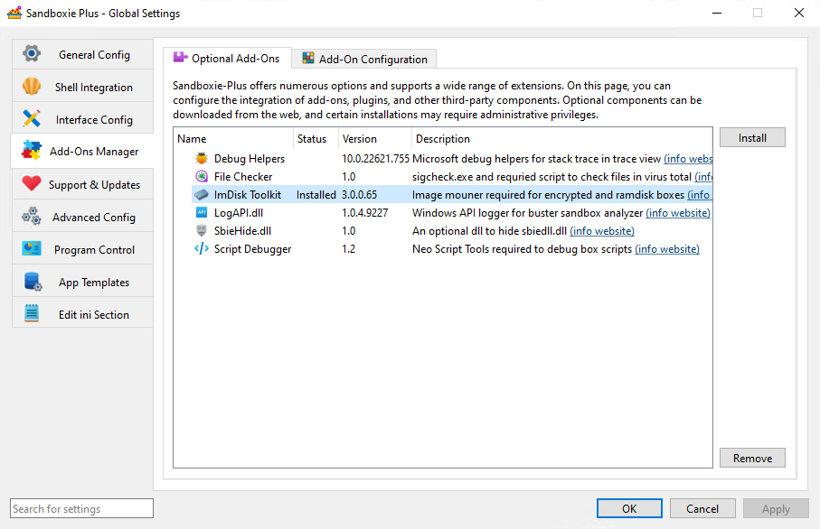
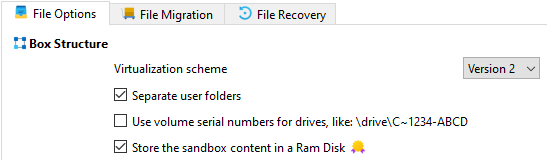

# Use Ram Disk

_UseRamDisk_ は、サンドボックスの通常のファイル ルートの下にある物理的なバッキングを RAM バッキングの仮想ディスクに変更する [Sandboxie Ini](SandboxieIni.md) のサンドボックス設定です (v1.11.0 / 5.66.0 で導入)。Sandboxie の論理ファイルおよびレジストリ仮想化レイヤーはそのストレージの上にそのまま残ります。

> [!WARNING]
> この設定は意図したサンドボックスに対して構成してください。適用可能なテンプレートおよび `[GlobalSettings]` フォールバックもそれを有効にでき、直接の上書きがないボックスに影響を与えます。個々のボックスのバッキングを選択する代わりにグローバル値を使用しないでください。

> [!NOTE]
> 適用可能な有効な [Support Certificate](https://sandboxie-plus.com/supporter-certificate/) が必要です。

## 前提条件

- **Global Settings** の **Add-Ons Manager > Optional Add-Ons** タブから **ImDisk Toolkit** をインストールします。

    

- ImDisk/ImBox ランタイム コンポーネントが動作している必要があります。インストール レコードだけではバッキングを取得できることは保証されません。

- 要求された共有バッキング容量を KiB で定義するために [RamDiskSizeKb](RamDiskSizeKb.md) を構成します。意図したワークロードに必要なファイルシステム領域とシステム メモリ リソースの両方を考慮してください。

- (オプション) [RamDiskLetter](RamDiskLetter.md) 設定を使用して、RAM ディスクへのアクセスを容易にするために特定のドライブ文字を割り当てます。

## 使用方法

```ini
[DefaultBox]

UseRamDisk=y
```

サービスは有効なボックス ブール値をコンシューマー フォールバック `n` で読み取ります。有効な値は、ボックス、適用可能な有効なテンプレート、または `[GlobalSettings]` フォールバックから得られます。SandMan のチェックボックスは、すべての可能な継承された有効値ではなく、直接のボックス値を読み書きします。

> [!WARNING]
> 通常の SandMan ストレージ選択は空のボックスを対象としています。RAM バッキングを有効にしても既存のディレクトリ バッキングの内容は移行されず、無効にしても RAM バッキングの内容がディレクトリ ストレージに自動的にエクスポートされることはありません。バッキングを変更する前に必要なデータを別途保存してください。

`UseRamDisk` と [UseFileImage](UseFileImage.md) の両方を構成しないでください。SandMan はそれらを代替のストレージ選択として提示します。それでも両方が有効になり、新しいバッキング選択が必要な場合、サービスは RAM バッキングを選択します。その証明書チェックは依然としてイメージ フラグを監視します。既存の使用可能なマウントは、単にフラグを変更するだけで普遍的に置き換えられるものではありません。

## ストレージと共有容量

サービスは ImBox および ImDisk を通じて 1 つの共有 RAM ディスク バックエンドを作成または再利用します。RAM バッキングのボックスの場合、サービスはその共有ボリューム上のボックス名ディレクトリを使用し、そのようなすべてのボックスがそのファイルシステム容量を共有します。1 つのボックスが消費した領域は、そこにある他のボックスが利用できる領域を減らします。この共有バッキングは、追加の分離またはアクセス制御境界ではありません。

通常の [FileRootPath](FileRootPath.md) は RAM ディスク上のボックス ディレクトリへのジャンクションになります。通常のサンドボックス ファイル、サンドボックス レジストリ ハイブ、およびそのルートの下に保存されたスナップショット状態を含む、ルートに含まれる状態がこのバッキングを使用します。通常のリソース アクセス ルールは、許可されたホスト パスに操作を送ることができます。`Sandboxie.ini`、ルート外の復元/エクスポートされたファイル、およびその他のホスト側の影響は、自動的に RAM バッキングされるわけではありません。ルートの内容とレイアウトについては [Sandbox Roots and Volume Layout](SandboxRootsVolumeLayout.md) を参照してください。

## 揮発性とデータの保存

共有バックエンドにのみ保存された内容は揮発性です。永続的な RAM イメージによってバッキングされず、そのバックエンドが実際に破棄されると失われます。RAM のみの内容が通常の再起動を乗り越えることに依存しないでください。必要なデータは事前に永続ストレージに復元またはエクスポートして保存してください。同じ RAM ボリューム上のスナップショットは、耐久性のある独立したバックアップではありません。

通常のプロセスの終了、1 つのボックスの閉鎖、ボックス ルートの解放、構成の再読み込み、または SandMan の終了は、それ自体で共有バックエンドが破棄されたことを確立しません。サービスのシャットダウンはクリーンアップを試みますが、サービスの再起動は破棄または再作成の成功を保証するものではありません。

## SandMan GUI

RAM ディスク設定は次の方法で有効にできます:

1. サンドボックスを右クリック > `Sandbox Options`。
2. `General Options > File Options` に移動します。
3. `Store the sandbox content in a Ram Disk` 設定を有効にします。

    

コントロールは通常、ImDisk が準備完了の空のボックスで有効になります。サービスのランタイム チェックは、チェックボックスの可用性および証明書の装飾とは別個のままです。

## メモリと失敗に関する考慮事項

RAM ディスク容量は仮想バッキング容量です。データ用のメモリは、構成された容量全体を永続的に常駐する物理 RAM として割り当てるのではなく、バッキングが埋められるにつれて段階的にコミットされます。Windows はこのコミット済み仮想メモリを管理します。ページング、ページ ファイルの使用、またはホスト ストレージ I/O が除外されると仮定しないでください。

サンドボックスの初期化中に必要な RAM バッキングを取得できない場合、エラーがログに記録され、その起動パスは完了できません。通常のディレクトリ ルートにフォールバックしません。後の割り当てまたはリソースの失敗は異なります。クリーンなトランザクション ロールバックや予測可能なアプリケーション可視エラーに依存しないでください。共有ボリュームの空き領域と同様に、システム メモリ リソースを監視してください。

RAM バッキングは、[UseFileImage](UseFileImage.md) によって提供される永続的な暗号化 `.box` / ユーザー パスワード ワークフローではありません。その揮発性は、オペレーティング システムのアーティファクトのフォレンジック消去または保護を保証するものではありません。

## パフォーマンスに関する考慮事項

- 永続性が不要な場合、一時ファイル ワークロードとテストが可能な用途です。
- パフォーマンスはワークロードとメモリ負荷に依存します。RAM バッキングは、より高速な動作や SSD の摩耗の低減を保証するものではありません。
- 構成された容量は即時の物理メモリ予約ではありません。サンドボックス化されたアプリケーションとホスト アプリケーションのために十分なシステム リソースを残してください。

関連する [Sandboxie Ini](SandboxieIni.md)、[RamDiskSizeKb](RamDiskSizeKb.md)、[RamDiskLetter](RamDiskLetter.md)、[UseFileImage](UseFileImage.md)、[FileRootPath](FileRootPath.md)
