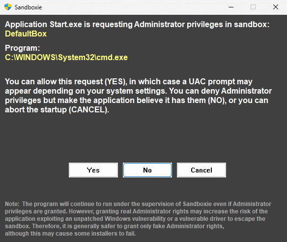

# Use Sandboxie UAC

## 概要

**UseSandboxieUAC** は、Sandboxie UAC プロキシ パス内の Sandboxie の拡張プロンプトを制御する [Sandboxie Ini](SandboxieIni.md) のグローバル設定です。既定で有効です。

```ini
[GlobalSettings]
UseSandboxieUAC=y
```

Sandboxie は、Windows Application Information (AppInfo) サービスへのサポートされている非同期昇格要求を認識し、それを自身の UAC プロキシを通じてルーティングできます。この設定は、要求がそのプロキシ パスに入った後に参照されます:

* `UseSandboxieUAC=y` は Sandboxie の拡張プロンプトを表示します。
* `UseSandboxieUAC=n` は拡張プロンプトをスキップしますが、基になる Sandboxie UAC プロキシ処理は続行されます。

したがって、この設定を無効にしても UAC プロキシは無効になりません。サポートされている UAC RPC 要求の Sandboxie による傍受を無効にする別個の設定については [No UAC Proxy](NoUACProxy.md) を参照してください。

## プロンプトの選択肢



拡張プロンプトはサンドボックスと要求元プログラムを識別し、次の選択肢を提供します:

| 選択肢 | 結果 |
| --- | --- |
| **Yes** | 実際の昇格を要求します。Sandboxie は該当するクイック パスで利用可能な管理者またはリンクされた管理者トークンを使用することがあります。それ以外の場合は通常の Windows `runas` 昇格フローを続行します。 |
| **No** | この昇格操作に偽の管理者権限を使用します。アプリケーションは選択された管理者チェックが成功したと認識することがありますが、真正に昇格された管理者トークンを受け取りません。 |
| **Cancel** | 傍受された昇格要求をキャンセルとして完了します。要求された昇格起動は承認されません。 |

偽の管理者の選択肢は [Fake Admin Rights](FakeAdminRights.md) に関連しますが、`FakeAdminRights=y` をグローバルまたはサンドボックス内のすべてのプロセスに対して有効にするものではありません。

## セキュア デスクトップ

[Prompt On Secure Desktop](PromptOnSecureDesktop.md) 設定は、Sandboxie の拡張プロンプトがセキュア デスクトップを使用することを許可されるかどうかを制御します。プロンプトは、その設定が有効で、かつホスト Windows の UAC ポリシーもセキュア デスクトップ プロンプトを使用する場合にのみそこに配置されます。

Sandboxie Plus インストール ディレクトリに `SbieWallpaper.png` を配置することで、Sandboxie のプロンプトが使用するセキュア デスクトップの背景をカスタマイズできます。

## 他の昇格設定との関係

3 つの昇格関連設定は異なる段階で作用します:

* [Apply ElevateCreateProcess Fix](ApplyElevateCreateProcessFix.md) は、昇格が必要なために元の呼び出しが失敗した後、Windows `runas` を通じて `CreateProcess` の起動を再試行できます。
* [No UAC Proxy](NoUACProxy.md) は、Sandboxie がサポートされている AppInfo/UAC 非同期 RPC 要求を傍受し、プロキシを通じてルーティングするかどうかを制御します。
* **UseSandboxieUAC** は、既にアクティブなプロキシが Sandboxie の拡張予備プロンプトを表示するかどうかを制御します。

特に、`UseSandboxieUAC=n` は `NoUACProxy=y` と同等ではありません。

## SandMan 構成

Sandboxie Plus で **Options > Global Settings > Advanced Config > Sandboxie Config** を開き、次を使用します:

> Use Sandboxie's own enhanced UAC prompt (recommended)

チェックボックスは既定で選択されています。現在のインターフェイスはこのオプションを推奨として説明しています。古い実験的なラベルは現在のものではありません。

## 変更の適用

サービスは、該当する各昇格要求を処理するときにこのグローバル設定を読み取ります。構成の変更が保存および再読み込みされた後、以降の要求は新しい値を使用します。サンドボックス化されたプロセス、SbieSvc、またはドライバーを再起動することは通常必要ありません。既に進行中の要求は遡って変更されません。

## バージョン履歴

`UseSandboxieUAC` および Sandboxie の拡張プロンプトは Sandboxie Plus 1.16.0 / Classic 5.71.0 で導入されました。

## 関連ページ

* [Apply ElevateCreateProcess Fix](ApplyElevateCreateProcessFix.md)
* [Fake Admin Rights](FakeAdminRights.md)
* [No UAC Proxy](NoUACProxy.md)
* [Prompt On Secure Desktop](PromptOnSecureDesktop.md)
* [Sandboxie Ini](SandboxieIni.md)
