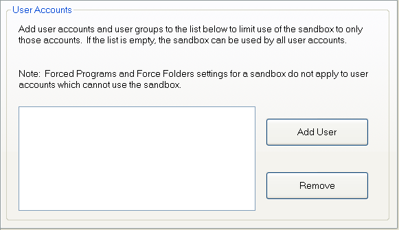

# User Accounts Settings

[Sandboxie Control](SandboxieControl.md) > [Sandbox Settings](SandboxSettings.md) > User Accounts:

この設定ページは、このサンドボックスの使用を特定のユーザー アカウントに制限できます。_Add User_ ボタンは標準の Windows ユーザー アカウント選択ダイアログ ボックスを開き、特定のユーザー アカウントを見つけて選択するために使用できます。ユーザー アカウント グループも指定できます。

特定のユーザーに制限されたサンドボックスは、他のすべてのユーザー アカウントに対して非表示と見なされます。それらの他のユーザー アカウントは [Sandboxie Control](SandboxieControl.md) にサンドボックスがリストされるのを見ることができず、[Forced Programs](ProgramStartSettings.md#forced-programs) および [Forced Folders](ProgramStartSettings.md#forced-folders) 設定はそれらのユーザー アカウントに適用されません。

いずれかのサンドボックスが非表示になっているユーザー アカウントでは、[Sandboxie Control](SandboxieControl.md) の [Sandbox Menu](SandboxMenu.md) に [Reveal Hidden Sandbox](SandboxMenu.md#reveal-hidden-sandbox) コマンドが表示されます。

関連する [Sandboxie Ini](SandboxieIni.md) 設定: [Enabled](Enabled.md)
