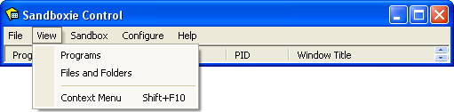

# 表示 メニュー

## プログラム

_プログラム_ コマンドは[プログラム ビュー](ProgramsView.md)を選択し、各サンドボックスで実行されているプログラムを表示します。これは既定のビューです。

## ファイルとフォルダー

_ファイルとフォルダー_ は[ファイルとフォルダー ビュー](FilesAndFoldersView.md)を選択し、各サンドボックス内のファイルとフォルダーを表示します。

## コンテキスト メニュー

_コンテキスト メニュー_ コマンドは、強調表示（選択）されている項目に関連付けられたコンテキスト メニューを表示します。コンテキスト メニューは、項目を右クリックしても表示できます。項目とは、サンドボックス、プログラム、ファイル、またはフォルダーです。すべての項目がすべてのビューに表示されるわけではありません。
