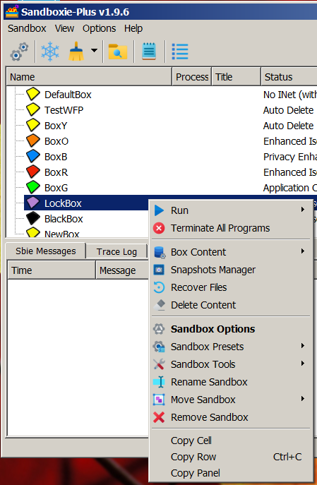
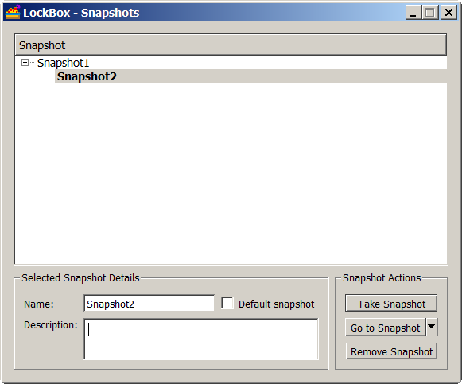
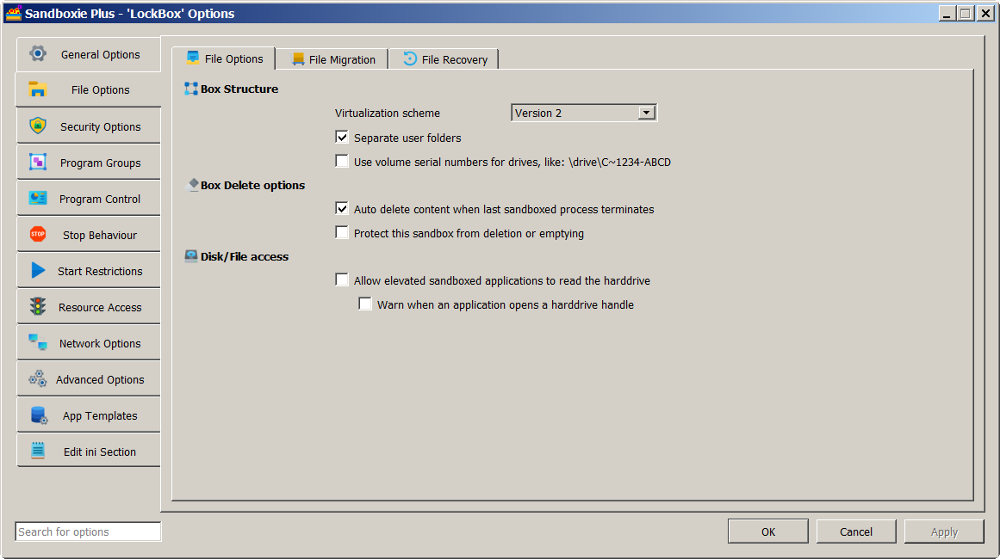

# ボックス スナップショット

スナップショット管理は、Sandboxie Plus の SandMan を通じて利用できます。サンドボックス メニューから **Snapshots Manager** を開いて、サンドボックスの保存されたチェックポイントを作成および管理します。詳細メニュー レイアウトでは、コマンドは **Sandbox Tools > Snapshots Manager** にあります。



ファイルシステム スナップショット データは増分で保存されますが、各スナップショットには完全な保存済みレジストリ状態が含まれます。スナップショットが作成または選択されると、新しい可変の変更はアクティブなスナップショットの上にあるライブ サンドボックス状態で続行されます。

## スナップショット モデル

Sandboxie は、保存されたスナップショットと現在の可変状態を区別します。

- **アクティブ スナップショット**は、ライブ サンドボックス状態の基になる保存されたスナップショットです。
- **ライブ状態**には、アクティブ スナップショットが作成または選択された後に行われた可変の変更が含まれます。それ自体は保存されたスナップショットではありません。
- **既定のスナップショット**は、別途選択されたクリーンアップ対象です。アクティブ スナップショットとは独立しており、通常のサンドボックス実行を制御しません。
- **空のボックス状態**では、アクティブな保存済みスナップショットがありません。アクティブ状態が空であっても、保存されたスナップショットが依然として存在する場合があります。

ファイルシステム ビューは、アクティブ スナップショット、その親スナップショット、および現在のライブ変更から形成されます。

## スナップショットの取得

スナップショットの取得、切り替え、および削除には、ボックス内のすべてのサンドボックス化されたプロセスを停止する必要があります。**Take Snapshot** には、サンドボックスに初期化された空でない内容が含まれていることも必要です。

スナップショットが作成されると:

1. 現在のライブ状態が新しいスナップショットとして保存されます。
2. 以前のアクティブ スナップショットが新しいスナップショットの親になります。
3. 新しいスナップショットがアクティブ スナップショットになります。
4. 既定のスナップショットは変更されません。
5. 新しいライブ可変レイヤーが新しくアクティブなスナップショットの上で続行されます。

したがって、新しく作成されたスナップショットがアクティブになります。既定のスナップショットは別途選択されます。



[自動削除](../Content/AutoDelete.md)は技術的にスナップショットの作成を妨げません。ただし、サンドボックスを準備または更新している間は無効にすると便利な場合があります。そうしないと、最後のサンドボックス化されたプロセスが終了したときに自動クリーンアップがライブ変更を破棄する可能性があるためです。これはワークフローのアドバイスであり、**Take Snapshot** の要件ではありません。

## アクティブ スナップショットと既定のスナップショット

アクティブと既定の選択は異なる場合があります。たとえば、スナップショット B がアクティブである一方、スナップショット A が既定のクリーンアップ対象のままであることがあります。アクティブ状態が空である一方 A が既定のままである場合や、B がアクティブである一方で既定が選択されていない場合もあります。保存されたスナップショットが利用可能なままであっても、両方の選択が空であることがあります。

アクティブ スナップショットは、現在のライブ変更の基になる保存済みスナップショット チェーンを制御します。既定のスナップショットは、既定の対象を要求するクリーンアップ動作によってのみ使用されます。

Snapshot Manager で保存済みスナップショットを選択し、**Default snapshot** チェックボックスを使用して既定を設定または解除します。スナップショットの作成はこの選択を変更しません。

## スナップショットの切り替え

**Go to Snapshot** を使用して、保存済みスナップショットをアクティブにします。サンドボックス化されたプロセスが実行されていてはなりません。SandMan は続行する前に現在の状態が削除されることを警告します。

スナップショットの切り替え:

- 保存されていないライブ変更を破棄します。
- 選択したスナップショットの保存済みレジストリ状態を復元します。
- 選択したスナップショットをアクティブにします。
- 離れる保存済みスナップショットと選択した対象スナップショットの両方を保持します。
- 既定のスナップショット選択を変更しません。

スナップショットの切り替えは、保存されていないライブ状態を破棄します。離れる保存済みスナップショットは削除しません。

## 空のボックスへの復帰

**Revert to empty box** アクションは、保存済みスナップショットを保持したままライブ状態をクリアします。操作後、保存済みスナップショットはアクティブではありません。保存済みスナップショットは後で再度選択できます。

この空のボックス状態は、保存済みスナップショットを持たない空のサンドボックスとは異なります。また、キャプチャするために初期化された内容を必要とする **Take Snapshot** の制限とも異なります。

## スナップショット階層

スナップショットは親/子ツリーを形成し、分岐する場合があります。例:

```text
Snapshot A
├── Snapshot B
└── Snapshot C
```

これは、A がアクティブで、B が作成され、ユーザーが A に戻り、次に C が作成されたときに発生します。B と C はどちらも A を親として持ちます。

実行時には、アクティブ スナップショットからその祖先までのチェーンのみが現在のファイルシステム ビューに寄与します。したがって、スナップショット履歴は必ずしも線形ではありません。

## スナップショットの削除

スナップショットの削除は、選択したスナップショットの階層内の位置によって異なります。

- アクティブでないリーフ スナップショットは直接削除できます。
- 子が 1 つあるスナップショットは、その子が使用可能なままになるように子にマージされる場合があります。
- 複数の子ブランチで共有されるスナップショットは、単純に削除できません。
- アクティブ スナップショットの削除は、サポートされている階層の場合にのみ可能です。保存されたデータは現在のライブ状態にマージされる場合があります。

削除は、内部ディレクトリを単に削除するのではなく、スナップショット データをマージする場合があります。SandMan は確認を求め、すべてのサンドボックス化されたプロセスを停止する必要があります。

スナップショットが既定としてマークされている場合、必要に応じて削除する前に、目的の既定を別途選択または解除してください。別のスナップショットが自動的に既定になるとは仮定しないでください。

## 自動および手動のクリーンアップ

### AutoDelete

自動削除が有効な場合、現在の SandMan バージョンは、サンドボックスをアクティブ スナップショット状態または選択した既定のスナップショットのいずれかに戻すように構成できます。選択は **Sandbox Options > File Options > Box Delete options** にあります。



アクティブな対象は、保存済みスナップショットがアクティブでない場合、空のボックス状態を表すことができます。AutoDelete を有効にしても、既定のスナップショットが自動的に選択または変更されることはありません。

### 内容の削除

保存済みスナップショットが存在する場合、手動の内容削除はそれらを保持または削除できます。スナップショットが保持される場合、クリーンアップは既定のスナップショットに戻ります。既定が選択されていない場合、空のボックス状態に戻ります。

削除ダイアログは **Also delete all Snapshots** も提供できます。そのオプションを選択すると、完全なクリーンアップの一部として保存済みスナップショット ストレージを削除できます。一般的な内容削除ワークフローについては、[サンドボックスの削除](../Content/DeleteSandbox.md)を参照してください。

### ファイルの復元

[クイック復元](../Content/QuickRecovery.md)と[自動復元](../Content/AutoRecover.md)は個々のファイルを復元します。スナップショットの切り替えは、代わりにサンドボックスの状態を変更します。スナップショットの切り替えと削除は独自の確認を使用し、クイック復元を呼び出しません。

## Snapshot Manager

Snapshot Manager は次の関連するコントロールを提供します。

- **Take Snapshot**
- **Refresh View**
- **Go to Snapshot**
- **Revert to empty box**
- **Remove Snapshot**
- 編集可能な **Name** および **Description** フィールド
- **Default snapshot** チェックボックス
- **Snapshot** および **Creation Time** 列

Name と Description は編集可能なメタデータです。別個の **Rename Snapshot** アクションはありません。表示名を変更しても、内部スナップショット ストレージ ディレクトリの名前は変更されません。アクティブ スナップショットはスナップショット ツリーで強調表示され、選択した既定がそのようにマークされます。

## ストレージ モデルと制限

スナップショット メタデータは、サンドボックス ストレージ ルートの下の **Snapshots.ini** に保存されます。アクティブおよび既定の選択、親関係、表示名、説明、および作成タイムスタンプを記録します。

保存されたファイルシステム レイヤーは、`snapshot-<ID>` などの内部ディレクトリを使用します。これらの名前は実装の詳細であり、手動で名前変更しないでください。Snapshot Manager では、内部ストレージ ディレクトリの名前を変更せずに、スナップショットの表示名を変更できます。

ファイルシステム スナップショット ストレージは増分です。スナップショットの作成は、完全なサンドボックス ツリーを複製するのではなく、現在のファイルシステム レイヤーを保存し、アクティブ スナップショット チェーンと現在のライブ状態がファイルの解決に使用されます。スナップショット メカニズムは、ハードリンク、ジャンクション、またはシンボリック リンクのコレクションとして理解すべきではありません。

各スナップショットには完全な保存済みレジストリ状態が含まれます。スナップショットが切り替えられると、選択したアクティブ スナップショットのレジストリ状態がライブ サンドボックスに復元されます。アクティブ スナップショットは古いブランチである場合があり、必ずしも最も最近作成されたスナップショットではありません。

スナップショットの耐久性は、基になるサンドボックス ストレージが利用可能なままであることに依存します。プロセスがまだ実行中の場合、スナップショットが存在しなくなった場合、データをコピーまたは復元できない場合、共有親を安全に削除できない場合、またはサンドボックス ストレージを変更できない場合、スナップショット操作は失敗する可能性があります。スナップショット操作がストレージ障害後のトランザクション ロールバックを提供すると仮定しないでください。

## Sandboxie Plus と Classic

スナップショット管理は、Sandboxie Plus の SandMan を通じて利用できます。低レベルのスナップショット対応ファイルシステム サポートは内部的に共有されていますが、Sandboxie Control Classic は Snapshot Manager インターフェイスを提供しません。[機能比較](../Content/FeatureComparison.md)を参照してください。

## 関連ページ

- [自動削除](../Content/AutoDelete.md)
- [サンドボックスの削除](../Content/DeleteSandbox.md)
- [クイック復元](../Content/QuickRecovery.md)
- [自動復元](../Content/AutoRecover.md)
- [機能比較](../Content/FeatureComparison.md)
