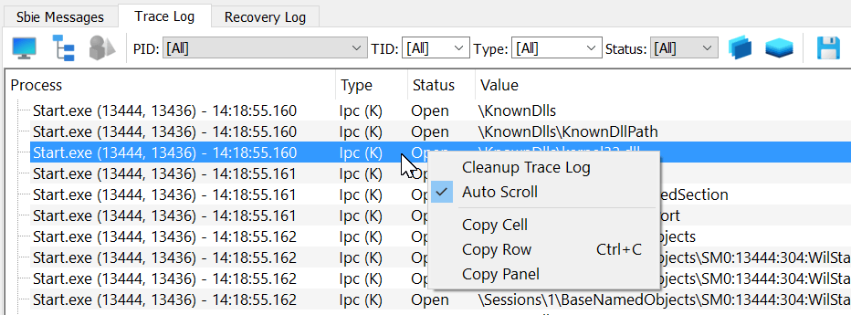

# トレース ログ (Sandboxie Plus 用)

トレース ログは、サンドボックス化されたプログラムからのリソース アクセスおよびその他の診断レコードを表示します。これは、[Sandboxie トレース](../Content/SandboxieTrace.md)オプションで使用される共有モニターの Sandboxie Plus ビューアーです。

**重要:** 新しい問題を報告する前に、トレース ログの使用を検討してください。



## トレース ログの使用

1\. **View > Trace Logging** を通じて **Trace Log** タブを有効にします。

2\. Trace Log タブがアクティブになると、実行中のすべてのサンドボックス化されたプログラムからリソース アクセス情報の収集と表示をすぐに開始します。

3\. この時点で、Sandboxie Plus の監督下で実行すると失敗する特定のタスクを実行します。

4\. 収集されたレコードを検査またはフィルターします。右クリックして **Copy Panel** を選択してデータをコピーするか、保存アクションを使用してログ ファイルを書き込みます。

5\. これで、収集されたデータをどこかに貼り付け (Ctrl+V)、分析に利用できるようにすることができます。

6\. 必要に応じて Ctrl+F を使用して特定のエントリを検索します。

トレース ログを開くと、モニターと表示パイプラインがアクティブになります。`ApiTrace`、`FileTrace`、`HookTrace`、`DebugTrace`、または `ErrorTrace` など、すべての詳細設定が自動的に有効になるわけではありません。これらのオプションは、**Sandbox Options > Advanced Options > Tracing** または [Sandboxie Ini](../Content/SandboxieIni.md) で別途構成します。

## スタック トレースとプロセス情報

**Show Stack Trace** は `MonitorStackTrace` を制御します。トレース ログを開くだけではスタック キャプチャは有効になりません。スタック情報は、新しく作成されたモニター バッファに対してオプションがアクティブになった後にのみ、モニター エントリと共に収集されます。SandMan はその後、シンボルを非同期で解決します。

**Show Stack Trace** を変更した後は、トレース ログを停止して再度開始し、確実に有効化または無効化してください。スタック キャプチャとシンボル解決は診断コストを追加し、シンボルのダウンロードはネットワーク アクセスを伴う場合があります。

統合トレース ログがアクティブな間、SandMan は一時的に **Keep terminated** を有効にし、トレースが停止するとユーザーの保存された設定を復元します。プロセス情報を保持することは、SandMan がプロセスの名前付けとシンボル処理を行うのに役立ちます。基になるスタック キャプチャを有効にするものではありません。

## バッファ サイズ

`TraceBufferPages` は、より大きな共有モニター バッファを要求できます。例:

```ini
[GlobalSettings]
TraceBufferPages=2560
```

この例は、文書化されたバイトまたは MiB 変換を表すものではありません。変更した後は、トレース ログを停止して再起動してください。現在の動作とオーバーフローの考慮事項については、[Sandboxie トレース](../Content/SandboxieTrace.md#monitor-buffer-size)を参照してください。

## パフォーマンスへの影響

トレース ログが無効な場合、SandMan はアクティブなモニター バッファを保持しません。別途有効にされたトレース設定は、ビューアーが閉じられている間でも、サンドボックス化されたプロセス内にフックをインストールしたり作業を追加したりする場合があります。アクティブなトレース中は、オーバーヘッドは選択された診断とイベント量に依存します。

## バージョン履歴

> **Sandboxie Plus v0.7.0** は、`TraceBufferPages` でモニター バッファを調整する機能を追加しました。
>
> **Sandboxie Plus v0.8.0** は、`DisableResourceMonitor=y` で選択したサンドボックスのリソース アクセス モニターを無効にする機能を追加しました。
>
> **Sandboxie Plus v0.9.8b** は、トレース ログ出力を新しい .log ファイルに保存する機能（フロッピー ディスク アイコン経由）を追加しました。
>
> **Sandboxie Plus v0.9.8d** は、複数のアクセス タイプを一度に選択する機能を追加しました。
>
> **Sandboxie Plus v1.0.16** は、リソース アクセス トレースにモニター モードを追加しました。
>
> **Sandboxie Plus v1.9.6** は、モニター レコードのオプトイン スタック情報を追加しました。SandMan はまた、統合トレース ログがアクティブな間、一時的に **Keep terminated** を有効にして、名前付けとシンボル処理に使用されるプロセス情報を保持します。
>
> **Sandboxie Plus v1.10.1** は、自動スクロール機能を追加しました（モニター モードでは既定で有効）。
