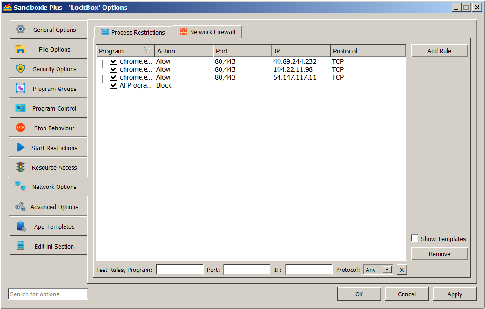

# WFP (Windows Filtering Platform) サポート

Sandboxie は、ドライバー内の Windows Filtering Platform (WFP) コールアウトを通じてネットワーク ポリシーを強制できます。WFP なしでは、その SbieDll ユーザー モード Winsock フックが、サポートされているパスに同じ[ネットワーク アクセス ルール](../Content/NetworkAccess.md)を適用できます。WFP は、ユーザー モード フックを迂回するコードに対するより強力な強制境界を提供しますが、他の Sandboxie および Windows のネットワーク制御は別個のままです。

## WFP の有効化 {#enabling-wfp}

[Sandboxie.ini](../Content/SandboxieIni.md) でグローバル WFP コンポーネントを有効にします。

```ini
[GlobalSettings]
NetworkEnableWFP=y
```

既定は `n` です。Sandboxie の WFP コールアウトは、ボックスごとではなくグローバルに登録されます。ドライバーはトラフィックを追跡されたサンドボックス化されたプロセスにマップし、該当する場合は適切なサンドボックス ポリシーを適用します。

現在のビルドは構成再構成中に WFP コンポーネントをロードまたはアンロードできるため、`NetworkEnableWFP` を切り替えるためだけに Windows の再起動やドライバーの再読み込みは必要ありません。このグローバル モードを変更した後は、影響を受けるサンドボックス化されたプロセスを再起動して、それらの SbieDll ネットワーク パスが WFP またはユーザー モード フィルタリングのいずれかに対して一貫して初期化されるようにしてください。すでに実行中のプロセスが強制パスを完全に自動的に切り替えると仮定しないでください。

## WFP 強制パス

Sandboxie は、WFP の `ALE_AUTH_CONNECT` および `ALE_AUTH_RECV_ACCEPT` 認可レイヤーに IPv4 および IPv6 コールアウトを登録します。追跡されたサンドボックス化されたプロセスについて、これは送信接続ポリシー パスと受信 receive/accept ポリシー パスを提供します。以下で説明するユーザー モード フィルターは主に送信ルール パスであり、同じ受信カバレッジを持つと扱うべきではありません。

WFP プロセス状態には、包括的なインターネット ブロック、別個のループバック ブロック、およびプロセスの `NetworkAccess` ルールが含まれます。共有ルール パーサーは `Any`、`TCP`、`UDP`、および `ICMP` を認識し、WFP はトラフィック プロトコルをそのコンパレーターに渡します。実際のカバレッジは依然として Windows フィルタリング レイヤーとトラフィック タイプに依存します。これはすべての raw または ICMP/ICMPv6 パスの保証ではありません。`Protocol=ICMPv6` は定義されたルール キーワードではありません。

## NetworkAccess ルール

`NetworkAccess` は、WFP とサポートされているユーザー モード パスで使用される共有エンジンに、プログラム、アドレス、ポート、プロトコル、および Allow/Block ルールを提供します。一致するルールがないルール セットはトラフィックを許可します。このルール エンジンを使用して既定で拒否するには、広い適用可能な Block ルールを追加し、次に適切なより狭い Allow ルールを追加します。

[ネットワーク アクセス](../Content/NetworkAccess.md)ページはその構文と正確な比較順序を文書化しています。`Block` はすべての `Allow` を普遍的に上書きするわけではなく、プロセスとエンドポイントの特異性が最初に比較されます。テンプレート提供の例:

```ini
NetworkAccess=*,Block;Port=137,138,139,445
```

これは `BlockPorts` テンプレートによって提供される `NetworkAccess` ルールであり、削除されたレガシー `BlockPort=` 設定ではありません。

## AllowNetworkAccess

`AllowNetworkAccess` は、別個のイメージ認識ブール アクセス ゲートです。

```ini
AllowNetworkAccess=y
AllowNetworkAccess=n
AllowNetworkAccess=program.exe,y
AllowNetworkAccess=program.exe,n
```

グローバルに提供し、該当する場合は上書きすることもできます。

```ini
[GlobalSettings]
AllowNetworkAccess=n
```

WFP 下では、実効的な `AllowNetworkAccess` 値が `n` の追跡されたプロセスは、実行時インターネット アクセス免除がない場合、包括的な BlockInternet 状態になります。その包括的状態は、通常の `NetworkAccess` ルール リストを評価する代わりに適用されます。したがって、`AllowNetworkAccess=n` は `NetworkAccess=*,Block` と同等ではなく、`NetworkAccess=program.exe,Allow` ルールが必ずしもそれを解除するわけではありません。適用可能な `AllowNetworkAccess=...,y` の選択または実行時免除が、包括的ゲートを回避するための関連する方法です。

SandMan は、そのインターネット アクセスの選択に対してプロセス グループ構成を生成する場合があります。[インターネット アクセスのプロンプト](../Content/PromptForInternetAccess.md)で説明されている対話型の決定は、プロセス インスタンスの実行時例外を付与できます。その承認は永続的な `NetworkAccess` ルールではありません。

## ユーザー モード フィルタリング

WFP がフィルタリングを処理していない場合、SbieDll は同じ `NetworkAccess` ルールを読み込み、傍受された Winsock 操作（重要な送信 TCP 接続および UDP 送信パスを含む）を通じてそれらを適用します。このユーザー モード メカニズムは、そのフックを回避または削除するコードによって迂回される可能性があります。すべてのネットワーキング API、raw パケット パス、または ICMP 操作のカバレッジを約束するものではありません。

## WFP とネットワーク デバイスのブロック

SandMan のインターネット アクセスの選択は、WFP が利用可能な場合、**Allow access**、**Block using Windows Filtering Platform**、および **Block by denying access to Network devices** を提供できます。デバイスのブロックはリソース/デバイス アクセス制限を使用します。これは WFP コールアウトおよび `NetworkAccess` ルール選択とは別個であり、WFP を有効にしてもそれらの他の制限が削除されることはありません。

WFP は [BlockLocalLoop](../Content/BlockLocalLoop.md) も独立して追跡します。通常の `NetworkAccess` Allow ルールが一致する場合でも、ループバック ブロックがループバック トラフィックを拒否できます。

## SandMan

ルール エディターは **Sandbox Options > Network Options > Network Firewall** にあります。Program、Action、Protocol、IP/Address、および Port のフィールドを提供します。そのプロトコル テスト セレクターには `Any`、`TCP`、`UDP`、および `ICMP` が含まれます。テスト コントロールは、候補プログラムとエンドポイントに対してどの構成済みルールが優先されるかを評価します。ネットワーク I/O は実行しません。



## 変更の適用と失敗

`NetworkEnableWFP` は Sandboxie Plus 0.9.0a で導入されました。`AllowNetworkAccess` も 0.9.0a で導入されました。`NetworkAccess` と WFP ルール状態は、Sandboxie の構成更新パスを通じて既存の追跡された WFP プロセスのために再構築できるため、すべてのルール編集がプロセスの再起動を必要とするわけではありません。`NetworkEnableWFP` 自体を変更すると強制アーキテクチャが切り替わるため、影響を受けるサンドボックス化されたアプリケーションを再起動して、SbieDll 側のモードを一貫して再構築してください。通常、再起動は必要ありません。

プロセスのルール セットを再構築中に WFP ルールの読み込みが失敗した場合、Sandboxie は既定でトラフィックを許可するのではなく、そのプロセスに対してより制限的な包括的インターネット ブロックを設定できます。必要な WFP 初期化の失敗は、通常のプロセス セットアップまたはフィルタリングを妨げることもあります。これは、考えられるすべての WFP 失敗に対するフェイルクローズ保証を確立するものではありません。

## その他のファイアウォール

Sandboxie の WFP コールアウトは、Windows ファイアウォールおよび他の WFP コンシューマーと共存できます。最終的な有効な動作は、他のインストールされたフィルター、そのレイヤーと重み、および Windows Filtering Platform の調停にも依存します。すべてのサードパーティ製ファイアウォールとの互換性を保証することはできません。

## 関連ページ

- [ネットワーク アクセス](../Content/NetworkAccess.md)
- [ローカル ループのブロック](../Content/BlockLocalLoop.md)
- [インターネット アクセスのプロンプト](../Content/PromptForInternetAccess.md)
- [プロキシ サポート](ProxySupport.md)
