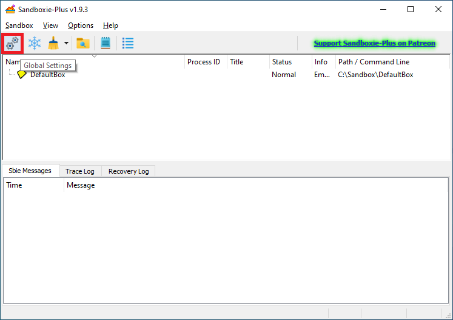
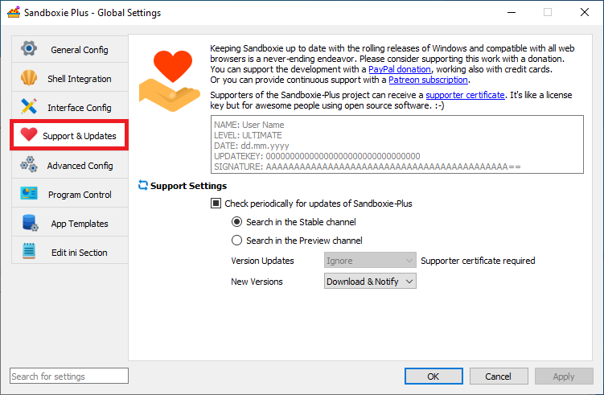
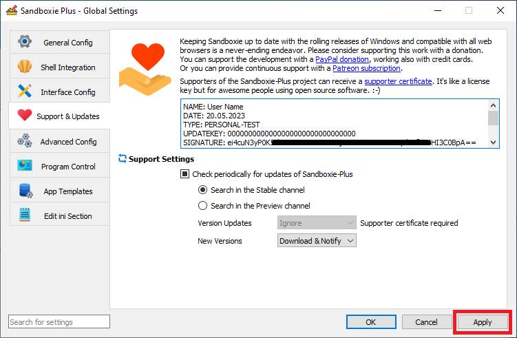
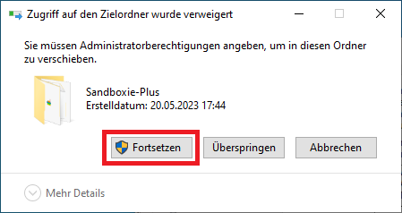
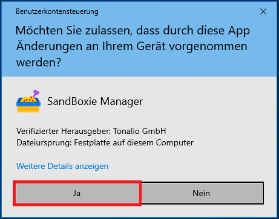
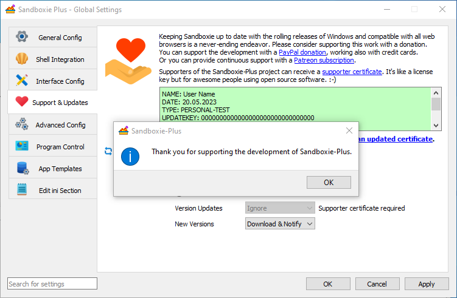

# 最新の SandMan UI を使用したサポーター証明書の適用

サポーター証明書を適用するには、Sandboxie Plus を起動し、グローバル設定を開きます。

グローバル オプションで、「Support & Updates」ページに移動します。

`NAME:` で始まり、最後の 2 つの等号 `==` を含む証明書全体を入力し、Apply（または OK）を押します。

次に、管理者権限を付与するよう求められます。証明書をインストールするにはそれらを許可する必要があります。

OS のプリセットによっては、UAC プロンプトも確認する必要がある場合があります。

証明書が受け入れられると、入力フィールドが緑色になります。

そして、通知ポップアップ ウィンドウが表示されます。
